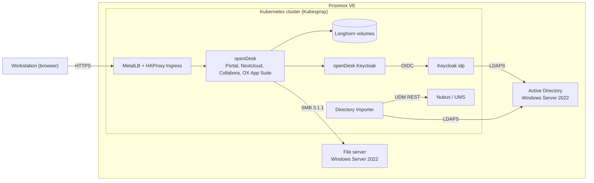

# Kubernetes Homelab: openDesk on Proxmox with Kubespray

A self-built Kubernetes homelab on Proxmox VE running [openDesk](https://gitlab.opencode.de/bmi/opendesk/deployment/opendesk), the open-source workplace suite for the German public sector – integrated with Active Directory, single sign-on via Keycloak and a Windows file server.

Every build step is documented with the exact commands, the expected results and the errors that actually occurred, including root cause and fix. On top of that, the repository contains troubleshooting runbooks for common Kubernetes incidents, each reproduced in the lab and solved step by step.

## Highlights

- **Cluster:** 1 control plane + 6 workers, built with Kubespray on VMs cloned from a Proxmox cloud-init template
- **Networking:** Calico on a VXLAN SDN (MTU 1450), kube-proxy in IPVS mode, MetalLB (L2) and HAProxy Ingress
- **DNS:** split DNS – only the cluster and AD zones are forwarded to the domain controller (CoreDNS and NodeLocal DNSCache)
- **Storage:** Longhorn (iSCSI) for persistent volumes, SMB CSI driver for the Windows file server shares
- **Applications:** openDesk v1.17.2 deployed with helmfile – Nubus portal, Nextcloud, Collabora Online, OX App Suite (mail, calendar, contacts)
- **Identity:** 500 users and 22 groups imported from Active Directory; "Login with AD account" via a dedicated Keycloak (LDAPS federation, OIDC)
- **Operations:** etcd snapshots before every change, adding and replacing worker nodes, failure drills

## Architecture

## Tech stack

| Layer | Components |
|---|---|
| Virtualization | Proxmox VE, cloud-init template (Ubuntu 24.04 LTS) |
| Kubernetes | Kubespray v2.32.0, Kubernetes v1.36.4, containerd 2.3.5, Calico |
| Networking | MetalLB 0.16.1 (L2), HAProxy Ingress 0.16.1, kube-proxy IPVS, CoreDNS + NodeLocal DNSCache |
| Storage | Longhorn 1.12.1, SMB CSI driver 1.20.3 |
| Certificates | cert-manager v1.21.1 with an internal CA |
| Applications | openDesk v1.17.2 (helmfile 1.7.3): Nubus, Nextcloud, Collabora Online, OX App Suite |
| Identity | Active Directory (Windows Server 2022), Keycloak 26.7.3, Nubus Directory Importer 1.7.2 |
| Tooling | Ansible, Helm, helmfile, kubectl, yq, tmux |

## Documentation

### Build

| # | Document | What it covers |
|---|---|---|
| 01 | [Proxmox cloud-init template](docs/01-proxmox-cloud-init-template.md) | VM template for all nodes: 8 vCPU, 16 GB RAM, MTU 1450, SSH keys |
| 02 | [Kubernetes cluster with Kubespray](docs/02-kubernetes-cluster-kubespray.md) | 1 control plane + 5 workers, acceptance tests incl. full reboot test |
| 03 | [openDesk deployment](docs/03-opendesk-deployment.md) | MetalLB, Longhorn, Ingress, cert-manager, split DNS, helmfile rollout |
| 04 | [Active Directory and SSO](docs/04-active-directory-sso.md) | Directory Importer, SMB shares in Nextcloud, Keycloak federation |
| 05 | [OX App Suite](docs/05-ox-app-suite.md) | Mail, calendar and contacts for 500 AD users |
| 06 | [Adding a worker node](docs/06-add-worker-node.md) | Joining node6 with `scale.yml`, fixing a stale fact cache |

### Troubleshooting runbooks

Each runbook follows the same structure: **symptom → step-by-step diagnosis → root cause → fix → prevention.**

| # | Runbook | Root cause |
|---|---|---|
| 07 | [Webmail shows "Connection error"](docs/07-webmail-connection-error.md) | Deployment scaled to 0, service without endpoints |
| 08 | [Update stuck – ImagePullBackOff](docs/08-imagepullbackoff.md) | Non-existent image tag, fixed with `rollout undo` |
| 09 | [Pod stuck in Pending](docs/09-pending-insufficient-memory.md) | Memory request larger than any node (`Gi` instead of `Mi`) |
| 10 | [Node stuck in SchedulingDisabled](docs/10-node-schedulingdisabled.md) | Aborted `kubectl drain` left the node cordoned |
| 11 | [Container keeps restarting – OOMKilled](docs/11-oomkilled.md) | Memory limit too low, exit code 137, kernel OOM log |
| 12 | [Worker node failure and replacement](docs/12-node-failure-replace-worker.md) | Hard power-off, StatefulSet volume handover, node replacement |

## Automation

The [`automation/`](automation/) folder contains Bash scripts that rebuild the lab step by step – one folder per document, with a central settings file, `--dry-run` for every script and read-only `verify-*.sh` checks. Sections 01 (Proxmox template) and 02 (Kubespray cluster) are tested in the lab; the remaining sections are being added one by one.

## Lessons learned

- **StatefulSets need a human decision.** After a worker lost power, the Deployment healed itself after about 5 minutes. The StatefulSet pod stayed stuck until the node was fenced and removed, and the RWO volume needed another ~6 minutes to detach – about 26 minutes of downtime in total.
- **Two replicas on one node are no redundancy.** Both replicas of a test Deployment ran on the failed node, so the service was completely down for ~6 minutes. Spread replicas with `topologySpreadConstraints` or pod anti-affinity.
- **Re-running Kubespray does not change everything.** `strictARP` for MetalLB stayed `false` after `cluster.yml`, because the kube-proxy configuration is only written at install or upgrade time. It had to be patched directly.
- **A missing kernel module can stop an application.** Ubuntu cloud images ship without `linux-modules-extra`. Without `nls_utf8` the SMB mounts failed and Nextcloud would not start – this must be re-checked after every kernel update.
- **Rollouts can silently undo manual changes.** The openDesk Nextcloud management job disables `files_external` on every rollout, so users lost their file server folders. It is now a mandatory post-rollout check.
- **Stale facts break `scale.yml`.** Adding a node with `--limit` failed because the fact cache of the control plane was incomplete. Running `facts.yml` without a limit first solved it.

## Security note

All passwords, client secrets, SSH keys and kubeconfig files have been removed from this repository. IP addresses and domain names belong to an isolated private lab network.

## Kurzfassung auf Deutsch

Dieses Repository dokumentiert mein selbst aufgebautes Kubernetes-Homelab auf Proxmox: ein Cluster mit Kubespray, darauf openDesk mit Anbindung an Active Directory, Single Sign-on über Keycloak und Einbindung eines Windows-Dateiservers. Zu jedem Schritt gehören die tatsächlich aufgetretenen Fehler mit Ursache und Lösung. Dazu kommen Runbooks für typische Kubernetes-Störungen, die im Lab nachgestellt und Schritt für Schritt gelöst wurden. Die Originaldokumentation ist auf Deutsch entstanden.

---

**Author:** Elham Zahedi · Built September – October 2026
