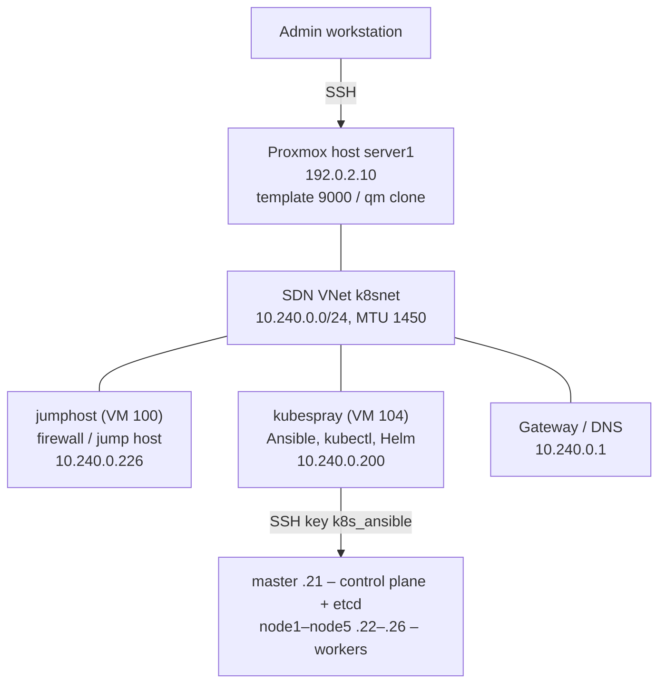

# 01 – Proxmox Cloud-Init Template for the Kubernetes Nodes

> Part 1 of the build series. Next: [02 – Kubernetes cluster with Kubespray](02-kubernetes-cluster-kubespray.md)

| Field | Value |
|---|---|
| Template | VM 9000 `ubuntu2404-k8s-tpl` on Proxmox host `server1` |
| Date | 07.10.2026 |
| Status | Created, verified and successfully used for 6 clones |

> **Note:** Passwords from the original documentation have been replaced with placeholders.

## 0. Overview

### 0.1 Goal

This document describes how the cloud-init template 9000 `ubuntu2404-k8s-tpl` was created on the Proxmox host `server1`, which hardware, option and cloud-init settings it has, and which corrections were necessary along the way. Any number of Kubernetes nodes can be cloned from this template without manual configuration.

[Part 2](02-kubernetes-cluster-kubespray.md) continues with cloning the six VMs (1 control plane + 5 workers) and installing the Kubernetes cluster with Kubespray.

### 0.2 Why a cloud-init template?

| Without template (old VMware guide) | With cloud-init template |
|---|---|
| Install Ubuntu manually on every VM | Clone in a few minutes per VM |
| Set the hostname with `hostnamectl` | Hostname = VM name, automatically |
| Static IP via a Netplan file | IP via `qm set --ipconfig0` |
| Create user `ansible`, edit sudoers | User `k8s` with passwordless sudo, automatically |
| Distribute SSH keys with `ssh-copy-id` | Keys provided via cloud-init |
| Extend LVM, disable swap | Not needed: the cloud image has no LVM and no swap |

### 0.3 Environment



### 0.4 Conventions

- Every step states where it runs (**Run on**). Always check the prompt, e.g. `root@server1`, `jumpuser@jumphost` or `(kubespray-venv) k8s@kubespray:~/kubespray$`.
- Paste heredoc blocks (`<<'EOF'`) completely at once. The closing `EOF` must stand alone on its line.
- Run commands that open a new shell or session (`ssh …`, `tmux new …`) on their own and paste the following commands separately.
- Lines like `calico_veth_mtu: 1400` are **configuration values**, not shell commands.
- Everything between `<` and `>` is a placeholder and must be replaced.

### 0.5 Steps

| Section | Topic | Run on |
|---|---|---|
| 1 | Proxmox environment | – |
| 2 | Create the template | Proxmox host (root) |
| 3 | Cloud-init configuration | Proxmox host (root) |
| 4 | Template profile: all settings | – |
| 5 | Access and keys | – |
| 6 | Adjustments, corrections and notes | – |

## 1. Proxmox environment

### 1.1 Host and storage

| Element | Value |
|---|---|
| Proxmox cluster | pve-cluster |
| Node | server1 |
| Proxmox VE kernel | 7.0.6-2-pve (Debian) |
| Management IP | 192.0.2.10 (SSH as root, web UI on port 8006) |
| VM storage | vm-storage |
| Backup storage | pbs-backup (Proxmox Backup Server) |
| Network for the cluster VMs | SDN VNet k8snet |
| Related VMs on server1 | 100 jumphost, 104 kubespray, 114 AD-DC, 115 FS |

### 1.2 Network k8snet

| Parameter | Value |
|---|---|
| Subnet | 10.240.0.0/24 |
| Gateway | 10.240.0.1 |
| DNS server | 10.240.0.1 |
| MTU | 1450 (VXLAN-based SDN: 1500 minus 50 bytes of encapsulation) |
| DHCP | Active (jumphost gets e.g. 10.240.0.226). Static IPs are outside the DHCP pool. |
| Static IPs | 10.240.0.21 – .26 (cluster), 10.240.0.200 (kubespray) |

> **Important:** The Proxmox host itself has no IP in k8snet. SSH from the Proxmox host to 10.240.0.x therefore hangs (cancel with Ctrl+C). Access the VMs via jumphost or the kubespray VM.

## 2. Create the template

**Run on:** Proxmox host `server1` as root (`ssh root@192.0.2.10`)

### 2.1 Download the cloud image

The template is based on the official Ubuntu 24.04 cloud image. It contains no LVM (the root filesystem grows automatically to the full disk size on first boot) and no swap.

```bash
cd /root
wget https://cloud-images.ubuntu.com/releases/24.04/release/ubuntu-24.04-server-cloudimg-amd64.img
```

### 2.2 Bake packages into the image (recommended)

```bash
apt update && apt install -y libguestfs-tools
virt-customize -a ubuntu-24.04-server-cloudimg-amd64.img \
  --install qemu-guest-agent,chrony \
  --truncate /etc/machine-id
```

This way `qemu-guest-agent` and `chrony` are already present in every cloned VM. `--truncate /etc/machine-id` is important: without it, all clones would share the same machine ID and receive the same IP via DHCP.

> **Note:** During the installation on 07.10.2026, chrony was not yet part of the image. It was installed later on all nodes via Ansible (see [part 2](02-kubernetes-cluster-kubespray.md)). Both ways lead to the same result; use this step for future templates.

### 2.3 Create the VM

```bash
qm create 9000 --name ubuntu2404-k8s-tpl \
  --cores 8 --sockets 1 --cpu x86-64-v3 \
  --memory 16384 --balloon 0 \
  --net0 virtio,bridge=k8snet,mtu=1 \
  --scsihw virtio-scsi-single --machine q35 \
  --ostype l26 --agent enabled=1
```

| Parameter | Effect |
|---|---|
| `--cores 8 --sockets 1` | 8 vCPUs per node |
| `--cpu x86-64-v3` | The same CPU features on every Proxmox host, so VMs can be live-migrated between hosts with different CPUs (section 4.7). `host` would pass every feature of the current host through |
| `--memory 16384` | 16 GB RAM |
| `--balloon 0` | No memory ballooning – Kubernetes does not cope well with fluctuating memory |
| `bridge=k8snet,mtu=1` | Network k8snet; `mtu=1` inherits the MTU of the bridge (1450) |
| `--scsihw virtio-scsi-single` | One SCSI controller per disk, required for `iothread` |
| `--machine q35` | Modern machine type (PCIe) |
| `--agent enabled=1` | QEMU guest agent enabled (clean shutdown, IP shown in Proxmox) |

### 2.4 Import the disk and resize it to 120 GB

```bash
qm set 9000 --scsi0 vm-storage:0,import-from=/root/ubuntu-24.04-server-cloudimg-amd64.img,discard=on,iothread=1
qm disk resize 9000 scsi0 120G
```

- `discard=on`: deleted blocks are returned to the storage (thin provisioning).
- `iothread=1`: dedicated I/O thread for better disk performance.

### 2.5 Cloud-init drive, boot order and console

```bash
qm set 9000 --ide2 vm-storage:cloudinit
qm set 9000 --boot order=scsi0
qm set 9000 --serial0 socket --vga serial0
```

The serial console is required for cloud images so that the Proxmox console (xterm.js) works.

## 3. Cloud-init configuration

**Run on:** Proxmox host `server1` as root

On the first boot of every cloned VM, cloud-init automatically sets up the user, password, SSH keys, hostname (= VM name), IP address and DNS. The values in the template apply to all clones; only the IP is overridden per clone.

### 3.1 User, password, DNS, updates

```bash
qm set 9000 --ciuser k8s --cipassword '<console-password>'
qm set 9000 --nameserver 10.240.0.1
qm set 9000 --ciupgrade 1
qm set 9000 --ipconfig0 ip=dhcp      # overridden per clone
```

> **Important:** Never name the user `kube`. Kubespray creates a system user `kube` with `/sbin/nologin` and overwrites an existing user of that name. `k8s` is safe.

### 3.2 Add the SSH keys

On the Proxmox host, `/root/.ssh/` contains the keys `id_rsa` (comment `root@Server1`) and `k8s_ansible` (comment `ansible@k8s`). Both public keys are merged into one file, one key per line:

```bash
ls /root/.ssh/
cat /root/.ssh/id_rsa.pub /root/.ssh/k8s_ansible.pub > /root/k8s-keys.pub
cat /root/k8s-keys.pub              # 2 lines: ssh-rsa ... and ssh-ed25519 ...
qm set 9000 --sshkeys /root/k8s-keys.pub
```

> **Important:** The file must exist and must not be empty. With an empty file, `qm set` aborts with *"unable to parse value of 'sshkeys' – invalid urlencoded string"*. The message may show up once more as a warning on the next, correct call – what matters is the line `update VM 9000: -sshkeys ssh-rsa%20...`.

### 3.3 Verify the configuration

```bash
grep sshkeys /etc/pve/qemu-server/9000.conf
qm cloudinit dump 9000 user | grep -A 3 ssh_authorized_keys
```

✔ **Expected:** exactly one `sshkeys:` line in the `.conf`; both keys (`root@Server1` and `ansible@k8s`) appear in the dump.

### 3.4 Convert to a template

```bash
qm template 9000
grep template /etc/pve/qemu-server/9000.conf     # expected: template: 1
```

> **Important:** Do not start VM 9000 before the conversion. A template must stay "untouched", otherwise all clones inherit state from the first boot (machine ID, SSH host keys).

> **Note:** Cloud-init settings (e.g. `--net0 … mtu=1`, `--cipassword`, `--sshkeys`) can still be changed after the conversion. They apply to all clones created afterwards.

## 4. Template profile: all settings

### 4.1 Hardware

| Hardware | Value |
|---|---|
| Memory | 16.00 GiB [balloon=0] |
| Processors | 8 (1 socket, 8 cores) [x86-64-v3] |
| BIOS | Default (SeaBIOS) |
| Display | Serial terminal 0 (serial0) |
| Machine | q35 |
| SCSI controller | VirtIO SCSI single |
| CloudInit drive (ide2) | `vm-storage:vm-9000-cloudinit,media=cdrom` |
| Hard disk (scsi0) | `vm-storage:vm-9000-disk-0,discard=on,iothread=1,size=120G` |
| Network device (net0) | `virtio,bridge=k8snet,mtu=1` |
| Serial port (serial0) | socket |

### 4.2 Options

| Option | Value |
|---|---|
| Name | ubuntu2404-k8s-tpl |
| Start at boot | No |
| OS type | Linux 7.x – 2.6 kernel |
| Boot order | scsi0 |
| Use tablet for pointer | Yes |
| Hotplug | Disk, Network, USB |
| ACPI support | Yes |
| KVM hardware virtualization | Yes |
| QEMU guest agent | Enabled |
| Protection | No |
| Template | Yes (`template: 1`) |

### 4.3 Cloud-init

| Setting | Value |
|---|---|
| User | k8s |
| Password | Set – only used for the Proxmox console, not documented here |
| DNS domain | use host settings |
| DNS servers | 10.240.0.1 |
| SSH public keys | `root@Server1` (id_rsa.pub) + `ansible@k8s` (k8s_ansible.pub) |
| Upgrade packages | Yes (package upgrade on first boot) |
| IP config (net0) | `ip=dhcp` – set to a static IP per clone (e.g. `ip=10.240.0.21/24,gw=10.240.0.1`) |

### 4.4 What every clone gets automatically

| Property | Result in the clone |
|---|---|
| Operating system | Ubuntu 24.04.5 LTS (kernel 6.8.0-146-generic after the upgrade) |
| Hostname | Same as the VM name (e.g. `master`, `node1`) |
| Network interface | `eth0`, MTU 1450 |
| User | `k8s`, passwordless sudo |
| SSH | Key-based login only (password login via SSH disabled) |
| Root filesystem | ~115 GB usable, no LVM, grown automatically |
| Swap | None (0B) |
| Updates | Installed on first boot → reboot once afterwards |

### 4.5 Check the configuration

```bash
qm config 9000
qm cloudinit dump 9000 user
qm cloudinit dump 9000 network
```

### 4.6 Change or rebuild the template

- **Change cloud-init values:** simply `qm set 9000 …` (e.g. new password, additional SSH key).
- **Change the image or disk:** delete the template (`qm destroy 9000`) and repeat sections 2–3. Existing full clones are not affected.
- **Clone from the template:** see [part 2](02-kubernetes-cluster-kubespray.md) (`qm clone 9000 <ID> --name <name> --full --storage vm-storage`).

### 4.7 CPU type and live migration

The VMs use the CPU type `x86-64-v3` (`VM_CPU_TYPE` in `lab.env`), not `host`.

**Why:** in a Proxmox cluster whose hosts have different CPUs, a VM with `host` sees the features of the host it is running on. A program reads them once when it starts. If the VM is then live-migrated to a host with an older CPU – for example during maintenance of the hosts – the program uses instructions that do not exist there. Java does this in compiled code: Keycloak crashed hours after such a migration with `SIGILL` in `StubRoutines::multiplyToLen` (instruction set `adx`). `x86-64-v3` gives every VM the same instruction set on every host (Intel since Haswell, AMD since Zen), so migration is safe in all directions.

Check on a node: `grep -o -w -e aes -e avx2 -e adx /proc/cpuinfo | sort | uniq -c` shows `aes` and `avx2`, but no `adx`.

**Changing the CPU type of running VMs:** one VM at a time. The new type only takes effect when Proxmox stops and starts the VM (`qm reboot`); a reboot inside the VM is not enough. About 10 minutes per node, openDesk stays available.

**Run on:** kubespray VM as k8s

```bash
N=node1
B=$(kubectl get node $N -o jsonpath='{.status.nodeInfo.bootID}')
kubectl drain $N --ignore-daemonsets --delete-emptydir-data --timeout=15m
```

**Run on:** Proxmox host as root (VM ID of the node)

```bash
qm set 202 --cpu x86-64-v3 && qm reboot 202 && qm config 202 | grep ^cpu
```

**Run on:** kubespray VM as k8s

```bash
until kubectl get --raw=/readyz >/dev/null 2>&1; do sleep 5; done     # needed for the control plane
until [ "$(kubectl get node $N -o jsonpath='{.status.nodeInfo.bootID}' 2>/dev/null)" != "$B" ]; do sleep 5; done
kubectl wait --for=condition=Ready node/$N --timeout=10m
kubectl uncordon $N
kubectl -n longhorn-system get volumes.longhorn.io -o jsonpath='{range .items[*]}{.status.robustness}{"\n"}{end}' | sort | uniq -c
```

The new boot ID shows that the node really restarted. Wait until Longhorn only shows `healthy`, then continue with the next node; the control plane last. At the end the kubespray VM (`qm set 104 --cpu x86-64-v3 && qm reboot 104`) and the template (`qm set 9000 --cpu x86-64-v3`).

## 5. Access and keys

| System | User | Login |
|---|---|---|
| Proxmox host server1 (192.0.2.10) | root | Existing root password (not documented here) |
| All clones of template 9000 | k8s | Password only for the Proxmox console (kept in a password manager); SSH with key only; passwordless sudo |

| Key | File on the Proxmox host | Purpose |
|---|---|---|
| `id_rsa` (root@Server1) | `/root/.ssh/id_rsa(.pub)` | Access from the Proxmox host |
| `k8s_ansible` (ansible@k8s), ed25519 | `/root/.ssh/k8s_ansible(.pub)` | Main key for SSH and Ansible (copied to jumphost and kubespray) |
| Both public keys | `/root/k8s-keys.pub` | Input for `qm set 9000 --sshkeys` |

Change the password in the template (applies to new clones):

```bash
qm set 9000 --cipassword '<NEW-PASSWORD>'
```

## 6. Adjustments, corrections and notes

### 6.1 Problems and solutions

| # | Problem / message | Cause | Solution |
|---|---|---|---|
| 1 | Network k8snet has MTU 1450 | VXLAN SDN; cloud-init VMs would otherwise use MTU 1500 → large packets get lost | `qm set 9000 --net0 virtio,bridge=k8snet,mtu=1`; later `calico_veth_mtu: 1400` in Kubespray (part 2) |
| 2 | `calico_veth_mtu:: command not found` | Configuration line typed into the Proxmox shell | Not a command; it goes into `k8s-net-calico.yml` in part 2 |
| 3 | `cat: /root/.ssh/id_ed25519.pub: No such file` | The key on the Proxmox host is called `id_rsa` | Check with `ls /root/.ssh/`; use `id_rsa.pub` + `k8s_ansible.pub` |
| 4 | `unable to parse value of 'sshkeys' – invalid urlencoded string` | Empty key file passed | Create the file with valid keys and repeat `qm set`; the follow-up warning is harmless |
| 5 | Template name "ubuntu2404" instead of 26.04 | Ubuntu 24.04 image used | Kept on purpose: Python 3.12 works directly with ansible-core 2.19 |
| 6 | chrony missing in the image | `virt-customize` was not run | Installed via Ansible in part 2; use `virt-customize` for future templates |
| 7 | Password "none" in the cloud-init view | No password set at first | `--cipassword` set so that an emergency login via the console is possible |
| 8 | Keycloak crashes with `SIGILL` in `StubRoutines::multiplyToLen`, hours after maintenance of the Proxmox hosts | The template had `--cpu host`; the VMs were live-migrated to a host with a newer CPU and back | CPU type `x86-64-v3` for template and VMs (section 4.7) |

### 6.2 Checklist

- [x] 8 cores (CPU type x86-64-v3), 16 GB without ballooning, 120 GB on vm-storage
- [x] Network k8snet with `mtu=1`
- [x] Cloud-init: user k8s, console password, DNS 10.240.0.1, upgrade enabled
- [x] SSH keys `root@Server1` and `ansible@k8s` visible in the dump
- [x] QEMU guest agent enabled, boot from scsi0, serial console
- [x] `template: 1`
- [ ] For future templates: bake `qemu-guest-agent` and `chrony` into the image with `virt-customize`

---

Next: [02 – Kubernetes cluster with Kubespray](02-kubernetes-cluster-kubespray.md)