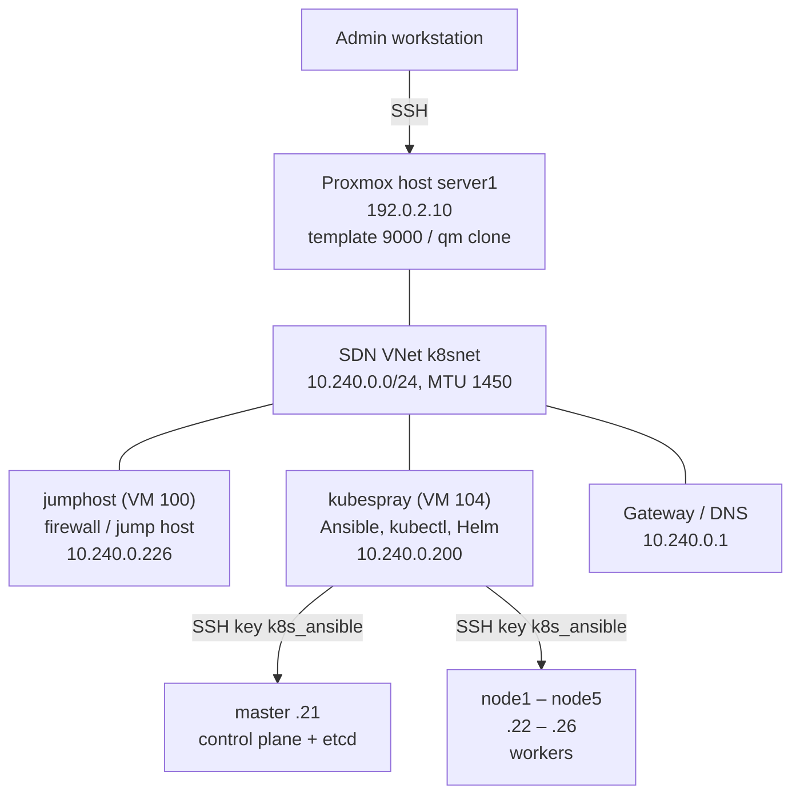

# 02 – Kubernetes Cluster with Kubespray (1 Control Plane + 5 Workers)

> Part 2 of the build series. Previous: [01 – Proxmox cloud-init template](01-proxmox-cloud-init-template.md) · Next: [03 – openDesk deployment](03-opendesk-deployment.md)

| Field | Value |
|---|---|
| Scope | From six cloned VMs to a working Kubernetes cluster |
| Prerequisite | [01](01-proxmox-cloud-init-template.md): template 9000 `ubuntu2404-k8s-tpl` exists |
| Date | 07.10.2026 |
| Network | SDN VNet k8snet · 10.240.0.0/24 · MTU 1450 |
| Status | Installed and tested (including a full reboot test) – all tests passed |

> **Note:** Passwords from the original documentation have been replaced with placeholders.

## 0. Overview

This document describes how six VMs were cloned from template 9000 and turned into a Kubernetes cluster with **1 control plane and 5 workers** using Kubespray – up to the acceptance tests and a full reboot test. All commands were run on 07.10.2026 in exactly this environment.

> **Note:** With a single control plane node, the cluster is suitable for testing, learning and development. Production use requires at least 3 control plane nodes.

### 0.1 Architecture



### 0.2 Roles of the machines

| Machine | VM ID | IP | Role |
|---|---|---|---|
| Proxmox host server1 | – | 192.0.2.10 | Hypervisor; clones the VMs. No IP in k8snet. |
| jumphost | 100 | 10.240.0.226 (DHCP), 192.0.2.15 | Firewall/admin VM; jump host into 10.240.0.x. Not used for Kubespray. |
| kubespray | 104 | 10.240.0.200 | Control machine: Kubespray/Ansible, kubectl, Helm. Not part of the cluster. |
| master | 201 | 10.240.0.21 | Control plane (API server, scheduler, controller manager) + etcd |
| node1 – node5 | 202 – 206 | 10.240.0.22 – .26 | Workers: the application pods run here |

### 0.3 Software versions

| Component | Version / value |
|---|---|
| Operating system (all VMs) | Ubuntu 24.04.5 LTS, kernel 6.8.0-146-generic |
| Kubespray | v2.32.0 |
| Ansible | ansible 12.3.0 / ansible-core 2.19.14 |
| Python (control machine) | 3.12.3, venv `~/kubespray-venv` |
| Kubernetes | v1.36.4 |
| Container runtime | containerd 2.3.5 |
| Network plugin (CNI) | Calico, `calico_veth_mtu` 1400 |
| Add-ons | CoreDNS, nodelocaldns (169.254.25.10), metrics-server, Helm |
| Service network / pod network | 10.233.0.0/18 / 10.233.64.0/18 |
| Cluster domain | cluster.local |

### 0.4 Network k8snet

| Parameter | Value |
|---|---|
| Subnet | 10.240.0.0/24 |
| Gateway | 10.240.0.1 |
| DNS server | 10.240.0.1 |
| MTU | 1450 (VXLAN-based SDN: 1500 minus 50 bytes of encapsulation) |
| DHCP | Active (jumphost gets e.g. 10.240.0.226). Static IPs are outside the DHCP pool. |
| Static IPs | 10.240.0.21 – .26 (cluster), 10.240.0.200 (kubespray) |

### 0.5 Conventions

Same conventions as in [01](01-proxmox-cloud-init-template.md#04-conventions). Most importantly: every step states where it runs (**Run on**), so always check the prompt – e.g. `root@server1`, `jumpuser@jumphost` or `(kubespray-venv) k8s@kubespray:~/kubespray$`. Everything between `<` and `>` is a placeholder.

### 0.6 Steps

| Section | Topic | Run on |
|---|---|---|
| 1 | Clone and check the 6 nodes | Proxmox host, then jumphost |
| 2 | Set up SSH access | jumphost (jumpuser) |
| 3 | Prepare the kubespray VM | jumphost, then kubespray (k8s) |
| 4 | Inventory and node preparation | kubespray (k8s) |
| 5 | Cluster configuration | kubespray (k8s) |
| 6 | Run the installation | kubespray (k8s), in tmux |
| 7 | Set up kubectl and first check | kubespray (k8s) |
| 8 | Acceptance tests | kubespray (k8s) |
| 9 | Reboot test | kubespray (k8s) |
| 10 | Access and keys | – |
| 11 | Adjustments and corrections | – |
| 12 | Troubleshooting and harmless messages | – |
| 13 | Operations and next steps | kubespray (k8s) |

## 1. Clone and check the 6 nodes

**Run on:** Proxmox host `server1` as root

### 1.1 Clone

First check that VM IDs 201–206 are free (no output = free):

```bash
qm list | awk '$1>=201 && $1<=206'
```

Then create the six full clones, set static IPs and start them:

```bash
GW=10.240.0.1
i=0
for name in master node1 node2 node3 node4 node5; do
  id=$((201 + i)); ip=10.240.0.$((21 + i))
  qm clone 9000 $id --name $name --full --storage vm-storage
  qm set $id --ipconfig0 ip=$ip/24,gw=$GW
  qm start $id
  i=$((i + 1))
done
```

> **Note:** `--full` creates clones that are independent of the template. On the HDD storage, each clone takes a few minutes ("transferred … of 120.0 GiB"). The hostname automatically becomes the VM name.

### 1.2 Result: the 6 nodes

| VM ID | Hostname | IP | Role | CPU / RAM / disk |
|---|---|---|---|---|
| 201 | master | 10.240.0.21/24 | Control plane + etcd | 8 / 16 GB / 120 GB |
| 202 | node1 | 10.240.0.22/24 | Worker | 8 / 16 GB / 120 GB |
| 203 | node2 | 10.240.0.23/24 | Worker | 8 / 16 GB / 120 GB |
| 204 | node3 | 10.240.0.24/24 | Worker | 8 / 16 GB / 120 GB |
| 205 | node4 | 10.240.0.25/24 | Worker | 8 / 16 GB / 120 GB |
| 206 | node5 | 10.240.0.26/24 | Worker | 8 / 16 GB / 120 GB |

Common to all 6 nodes: gateway and DNS 10.240.0.1, interface `eth0`, MTU 1450, user `k8s` (console password from the template), the same SSH keys, Ubuntu 24.04.5 LTS, storage vm-storage.

### 1.3 Check and reboot

**Run on:** jumphost as jumpuser (after section 2)

```bash
for i in 21 22 23 24 25 26; do
  echo "== 10.240.0.$i =="
  ssh -o StrictHostKeyChecking=accept-new 10.240.0.$i "hostname; ip -o -4 addr show eth0 | awk '{print \$4}'; ip link show eth0 | grep -o 'mtu [0-9]*'; sudo whoami"
done
```

✔ **Expected:** per VM the correct hostname (`master`, `node1` … `node5`), the correct IP, `mtu 1450` and `root`.

Because of the package upgrade on first boot, Ubuntu reports "System restart required". So all VMs are rebooted once:

```bash
for i in 21 22 23 24 25 26; do ssh 10.240.0.$i "sudo reboot"; done
# wait about 1 minute
for i in 21 22 23 24 25 26; do ssh 10.240.0.$i "hostname; uptime -p"; done
```

Optional MTU test on one VM (1422 + 28 bytes of headers = 1450): `ping -c 1 -M do -s 1422 10.240.0.1`

## 2. Set up SSH access

The VMs only accept logins with an SSH key. Access goes through jumphost, which is connected to k8snet.

**Run on:** jumphost as jumpuser

### 2.1 Copy the Ansible key to jumphost

```bash
scp root@192.0.2.10:/root/.ssh/k8s_ansible ~/.ssh/k8s_ansible
chmod 600 ~/.ssh/k8s_ansible
ssh -i ~/.ssh/k8s_ansible k8s@10.240.0.21
```

### 2.2 SSH configuration on jumphost

> **Important:** Create this file on jumphost – not inside an open SSH session on the master. The prompt must be `jumpuser@jumphost`.

Content of `~/.ssh/config` on jumphost (older entries with `User ansible` were changed to `User k8s`):

```
Host master
  HostName 10.240.0.21
Host node1
  HostName 10.240.0.22
Host node2
  HostName 10.240.0.23
Host node3
  HostName 10.240.0.24
Host node4
  HostName 10.240.0.25
Host node5
  HostName 10.240.0.26
Host master node1 node2 node3 node4 node5
  User k8s
  IdentityFile ~/.ssh/k8s_ansible
Host 10.240.0.*
    User k8s
    IdentityFile ~/.ssh/k8s_ansible
```

```bash
chmod 600 ~/.ssh/config
ssh master hostname        # expected: master
ssh node5 hostname         # expected: node5
```

### 2.3 Access paths

| From | To | Command |
|---|---|---|
| Admin workstation | Proxmox host | `ssh root@192.0.2.10` |
| jumphost | Nodes | `ssh master` … `ssh node5` |
| jumphost | kubespray | `ssh 10.240.0.200` |
| kubespray | Nodes | `ssh k8s@10.240.0.21` … `.26` (key `~/.ssh/id_ed25519`) |
| Emergency (network broken) | Any VM | Proxmox web UI → VM → Console, user `k8s`, console password |

## 3. Prepare the kubespray VM

Kubespray runs on its own VM (VM 104 `kubespray`, 10.240.0.200) – not on the master and not on jumphost (the firewall VM). This keeps the tooling separate from the cluster, keeps the master free, and makes it possible to repair the cluster from here if the master fails.

| Property | Value |
|---|---|
| VM ID / name | 104 / kubespray |
| IP | 10.240.0.200 (eth0) |
| CPU / RAM | 2 cores / 4 GB |
| Operating system | Ubuntu 24.04 LTS |
| User | k8s (passwordless sudo) |
| Python / venv | 3.12.3 / `~/kubespray-venv` (activated automatically at login) |
| Kubespray directory | `~/kubespray` (v2.32.0) |
| Inventory | `~/kubespray/inventory/mycluster/` |
| Installation log | `~/cluster-install.log` |
| kubectl / kubeconfig | `/usr/local/bin/kubectl` / `~/.kube/config` |

### 3.1 Copy the SSH key to the kubespray VM

**Run on:** jumphost as jumpuser

```bash
scp ~/.ssh/k8s_ansible 10.240.0.200:~/.ssh/id_ed25519
```

**Run on:** kubespray as k8s

```bash
chmod 600 ~/.ssh/id_ed25519
for i in 21 22 23 24 25 26; do
  ssh -o StrictHostKeyChecking=accept-new k8s@10.240.0.$i "hostname && sudo whoami"
done
```

✔ **Expected:** every VM reports its hostname and `root`, without a password prompt.

### 3.2 Install Kubespray and Ansible

Ubuntu 24.04 ships Python 3.12, which matches ansible-core 2.19. The detour via `uv` from the old guide is not needed.

```bash
sudo apt update
sudo apt install -y git python3-venv python3-pip tmux
cd ~
git clone --branch v2.32.0 --depth 1 https://github.com/kubernetes-sigs/kubespray.git
python3 -m venv ~/kubespray-venv
source ~/kubespray-venv/bin/activate
pip install -U pip
pip install -r ~/kubespray/requirements.txt
echo 'source ~/kubespray-venv/bin/activate' >> ~/.bashrc
cd ~/kubespray && ansible --version
```

✔ **Expected:** `ansible [core 2.19.14]`, `config file = /home/k8s/kubespray/ansible.cfg`, `python version = 3.12.3`.

> **Note:** If apt reports "Pending kernel upgrade", reboot the kubespray VM once with `sudo reboot` and then continue with `cd ~/kubespray`.

> **Important:** Always run `ansible` and `ansible-playbook` from inside `~/kubespray`. Otherwise Ansible shows `config file = None`. Correct prompt: `(kubespray-venv) k8s@kubespray:~/kubespray$`

## 4. Inventory and node preparation

**Run on:** kubespray as k8s, in `~/kubespray`

### 4.1 Create the inventory

```bash
cd ~/kubespray
cp -rfp inventory/sample inventory/mycluster
cat > inventory/mycluster/inventory.ini <<'EOF'
[kube_control_plane]
master ansible_host=10.240.0.21 ip=10.240.0.21

[etcd:children]
kube_control_plane

[kube_node]
node1 ansible_host=10.240.0.22 ip=10.240.0.22
node2 ansible_host=10.240.0.23 ip=10.240.0.23
node3 ansible_host=10.240.0.24 ip=10.240.0.24
node4 ansible_host=10.240.0.25 ip=10.240.0.25
node5 ansible_host=10.240.0.26 ip=10.240.0.26

[all:vars]
ansible_user=k8s
ansible_python_interpreter=/usr/bin/python3
EOF
```

- `kube_control_plane`: node for the API server, scheduler and controller manager.
- `etcd:children`: etcd runs on the same control plane node.
- `kube_node`: the five workers.
- `ansible_host`: address used for SSH; `ip`: address the Kubernetes components listen on.
- `ansible_user=k8s`: the cloud-init user with passwordless sudo.

### 4.2 Test the connection

```bash
ansible -i inventory/mycluster/inventory.ini all -m ping
```

✔ **Expected:** 6× `pong`.

### 4.3 /etc/hosts and chrony on all nodes

Since v2.29, Kubespray no longer adds the nodes to `/etc/hosts`. In addition, Proxmox cloud-init rewrites `/etc/hosts` on every boot. That is why the entries are also written into the cloud-init template `/etc/cloud/templates/hosts.debian.tmpl`.

```bash
HOSTS='10.240.0.21 master
10.240.0.22 node1
10.240.0.23 node2
10.240.0.24 node3
10.240.0.25 node4
10.240.0.26 node5'
for f in /etc/hosts /etc/cloud/templates/hosts.debian.tmpl; do
  ansible -i inventory/mycluster/inventory.ini all -b -m blockinfile \
    -a "path=$f block='$HOSTS' marker='# {mark} k8s nodes'"
done
ansible -i inventory/mycluster/inventory.ini all -b -m apt -a "name=chrony state=present update_cache=yes"
ansible -i inventory/mycluster/inventory.ini all -b -m command -a "getent hosts node5"
ansible -i inventory/mycluster/inventory.ini all -b -m shell -a "timedatectl | grep synchronized; free -h | grep Swap"
```

✔ **Expected:** on all 6 nodes: `10.240.0.26 node5`, `System clock synchronized: yes`, `Swap 0B`.

> **Note:** chrony automatically replaces systemd-timesyncd. The line `127.0.1.1 node5 node5` on node5 itself is the Ubuntu default and harmless, because Kubespray uses the `ip=` values.

## 5. Cluster configuration

**Run on:** kubespray as k8s, in `~/kubespray`

```bash
G=inventory/mycluster/group_vars

# Calico MTU for the VXLAN network (MTU 1450)
echo 'calico_veth_mtu: 1400' >> $G/k8s_cluster/k8s-net-calico.yml

# metrics-server and Helm
sed -i 's/^metrics_server_enabled: false/metrics_server_enabled: true/' $G/k8s_cluster/addons.yml
sed -i 's/^helm_enabled: false/helm_enabled: true/' $G/k8s_cluster/addons.yml

# kubectl + admin.conf also on the kubespray VM
sed -i 's/^# kubeconfig_localhost: false/kubeconfig_localhost: true/' $G/k8s_cluster/k8s-cluster.yml
sed -i 's/^# kubectl_localhost: false/kubectl_localhost: true/' $G/k8s_cluster/k8s-cluster.yml

grep -E '^(calico_veth_mtu|metrics_server_enabled|helm_enabled|kubeconfig_localhost|kubectl_localhost|kube_pods_subnet|kube_service_addresses|kube_network_plugin):' -r $G/k8s_cluster/
```

Output on 07.10.2026 (correct):

```
.../addons.yml:helm_enabled: true
.../addons.yml:metrics_server_enabled: true
.../k8s-net-calico.yml:calico_veth_mtu: 1400
.../k8s-cluster.yml:kube_network_plugin: calico
.../k8s-cluster.yml:kube_service_addresses: 10.233.0.0/18
.../k8s-cluster.yml:kube_pods_subnet: 10.233.64.0/18
.../k8s-cluster.yml:kubeconfig_localhost: true
.../k8s-cluster.yml:kubectl_localhost: true
```

| Setting | File | Meaning |
|---|---|---|
| `calico_veth_mtu: 1400` | k8s-net-calico.yml | Pod MTU = network MTU 1450 minus 50 bytes of Calico encapsulation |
| `metrics_server_enabled: true` | addons.yml | Required for `kubectl top` |
| `helm_enabled: true` | addons.yml | Helm for later installations |
| `kubeconfig_localhost: true` | k8s-cluster.yml | `admin.conf` is copied to `inventory/mycluster/artifacts/` |
| `kubectl_localhost: true` | k8s-cluster.yml | The kubectl binary is copied to `artifacts/` |
| `kube_service_addresses` / `kube_pods_subnet` | k8s-cluster.yml | Default 10.233.x.x – no overlap with 10.240.0.0/24 |

## 6. Run the installation

**Run on:** kubespray as k8s

With 6 nodes the installation takes about 25–45 minutes. tmux keeps it running if the SSH connection drops. Start the session first (run this command on its own):

```bash
tmux new -s kubespray
```

Inside the tmux window (green bar at the bottom):

```bash
cd ~/kubespray
ansible-playbook -i inventory/mycluster/inventory.ini -b cluster.yml 2>&1 | tee ~/cluster-install.log
```

- Leave tmux without stopping the installation: Ctrl+b, release, then `d`.
- Return: log in to the kubespray VM as k8s, then `tmux attach -t kubespray`.
- Green (ok), yellow (changed) and light blue (skipping) lines are normal; red lines ending with `...ignoring` are normal too.

### 6.1 Result

```bash
grep -A 8 "PLAY RECAP" ~/cluster-install.log
```

Result on 07.10.2026:

```
master : ok=610  changed=138  unreachable=0  failed=0  skipped=764  rescued=0  ignored=4
node1  : ok=474  changed=90   unreachable=0  failed=0  skipped=538  rescued=0  ignored=0
node2  : ok=431  changed=85   unreachable=0  failed=0  skipped=466  rescued=0  ignored=0
node3  : ok=431  changed=85   unreachable=0  failed=0  skipped=466  rescued=0  ignored=0
node4  : ok=431  changed=85   unreachable=0  failed=0  skipped=466  rescued=0  ignored=0
node5  : ok=431  changed=85   unreachable=0  failed=0  skipped=466  rescued=0  ignored=0
```

✔ **Expected:** `unreachable=0` and `failed=0` for all 6 nodes. The `ignored=4` on the master are harmless Calico checks (section 12).

### 6.2 In case of errors

```bash
grep -n -B 5 -A 20 "fatal:" ~/cluster-install.log | tail -n 80
tail -n 40 ~/cluster-install.log
```

A `fatal:` followed by `...ignoring` is not an error. After fixing a real cause, `cluster.yml` can safely be run again. Close tmux afterwards with `tmux kill-session -t kubespray`.

## 7. Set up kubectl and first check

**Run on:** kubespray as k8s, in `~/kubespray`

```bash
ls inventory/mycluster/artifacts/          # admin.conf  kubectl  kubectl.sh
sudo install -m 755 inventory/mycluster/artifacts/kubectl /usr/local/bin/kubectl
mkdir -p ~/.kube
cp inventory/mycluster/artifacts/admin.conf ~/.kube/config
chmod 600 ~/.kube/config
grep server ~/.kube/config                 # server: https://10.240.0.21:6443
kubectl get nodes -o wide
kubectl get pods -A
```

Result on 07.10.2026:

```
NAME     STATUS   ROLES           VERSION   INTERNAL-IP   CONTAINER-RUNTIME
master   Ready    control-plane   v1.36.4   10.240.0.21   containerd://2.3.5
node1    Ready    <none>          v1.36.4   10.240.0.22   containerd://2.3.5
node2    Ready    <none>          v1.36.4   10.240.0.23   containerd://2.3.5
node3    Ready    <none>          v1.36.4   10.240.0.24   containerd://2.3.5
node4    Ready    <none>          v1.36.4   10.240.0.25   containerd://2.3.5
node5    Ready    <none>          v1.36.4   10.240.0.26   containerd://2.3.5
(shortened; OS-IMAGE: Ubuntu 24.04.5 LTS, kernel 6.8.0-146-generic)
```

✔ **Expected:** all 6 nodes `Ready`; all 26 pods in kube-system `Running` with 0 restarts: calico-node (6), calico-kube-controllers, coredns (2), dns-autoscaler, kube-apiserver, kube-controller-manager, kube-scheduler, kube-proxy (6), nodelocaldns (6), metrics-server.

## 8. Acceptance tests

**Run on:** kubespray as k8s, in `~/kubespray`

### 8.1 API server, etcd, metrics-server

```bash
kubectl get --raw='/readyz?verbose' | tail -n 1
ssh k8s@10.240.0.21 "sudo etcdctl --endpoints=https://10.240.0.21:2379 \
  --cacert=/etc/ssl/etcd/ssl/ca.pem \
  --cert=/etc/ssl/etcd/ssl/admin-master.pem \
  --key=/etc/ssl/etcd/ssl/admin-master-key.pem endpoint health"
kubectl top nodes
```

✔ **Expected:** `readyz check passed`; `https://10.240.0.21:2379 is healthy`; CPU/RAM for all 6 nodes.

### 8.2 Test deployment (5 replicas, 1 per worker)

```bash
kubectl create deployment web --image=nginx:stable --replicas=5
kubectl expose deployment web --port=80 --type=NodePort
kubectl rollout status deployment/web
kubectl get pods -l app=web -o wide
POD_IPS=$(kubectl get pods -l app=web -o jsonpath='{.items[*].status.podIP}')
NODE_PORT=$(kubectl get svc web -o jsonpath='{.spec.ports[0].nodePort}')
echo "Pod IPs: $POD_IPS   NodePort: $NODE_PORT"
```

✔ **Expected:** 5 pods `Running`, spread across node1–node5; NodePort between 30000 and 32767 (in the test: 30550).

### 8.3 Internal DNS

```bash
kubectl run dnstest --image=busybox:1.36 --restart=Never --rm -i -- \
  nslookup web.default.svc.cluster.local
```

✔ **Expected:** server 169.254.25.10 (nodelocaldns); an address from the service network 10.233.x.x.

### 8.4 Service by name

```bash
kubectl run curltest --image=busybox:1.36 --restart=Never --rm -i -- \
  wget -qO- -T 5 http://web.default.svc.cluster.local
```

✔ **Expected:** HTML of the nginx page with "Welcome to nginx!".

> **Important:** Run this test without `| grep`. With a pipe, the output can get lost if the pod finishes before kubectl attaches.

### 8.5 Pod-to-pod across nodes and MTU test

The test pod runs on node1 and reaches the nginx pods on all workers. The ping with a payload of 1372 bytes (+ 28 = 1400) checks the Calico MTU.

```bash
kubectl run podtest --image=busybox:1.36 --restart=Never --rm -i \
  --overrides='{"spec":{"nodeName":"node1"}}' \
  -- sh -c "for ip in $POD_IPS; do echo -n \"\$ip: \"; \
  wget -qO- -T 5 http://\$ip | grep -o 'Welcome to nginx' | head -1 || echo FAILED; \
  ping -c 1 -W 2 -s 1372 \$ip >/dev/null && echo '  MTU ok' || echo '  MTU FAILED'; done"
```

✔ **Expected:** `Welcome to nginx` and `MTU ok` for every pod IP.

### 8.6 NodePort from outside (all 6 nodes)

```bash
for i in 21 22 23 24 25 26; do
  echo -n "10.240.0.$i: "
  curl -s -m 5 http://10.240.0.$i:$NODE_PORT | grep -o 'Welcome to nginx' | head -1 || echo FAILED
done
```

✔ **Expected:** all 6 IPs answer – including the master, which runs no nginx pod.

### 8.7 Clean up

```bash
kubectl delete svc web
kubectl delete deployment web
kubectl get pods
```

### 8.8 Test results (07.10.2026)

| Test | Result |
|---|---|
| API server readyz | ✔ readyz check passed |
| etcd | ✔ healthy (11.6 ms) |
| kubectl top nodes | ✔ all 6 nodes |
| Deployment with 5 replicas | ✔ one pod each on node1–node5 |
| DNS | ✔ web.default.svc.cluster.local → 10.233.45.44 |
| Service by name | ✔ nginx page |
| Pod-to-pod across nodes | ✔ 5/5 |
| MTU 1400 in the pod network | ✔ 5/5 |
| NodePort via all nodes | ✔ 6/6 |
| Reboot test | ✔ (section 9) |

## 9. Reboot test

**Run on:** kubespray as k8s, in `~/kubespray`

Simulates a complete power outage. Ansible reboots all 6 nodes and waits until they are reachable again:

```bash
ansible -i inventory/mycluster/inventory.ini all -b -m reboot
```

Check after 2–3 minutes:

```bash
kubectl get nodes
kubectl get pods -A | grep -v Running
ansible -i inventory/mycluster/inventory.ini all -b -m command -a "systemctl is-active containerd kubelet"
ansible -i inventory/mycluster/inventory.ini all -m command -a "getent hosts master"
```

✔ **Expected:** all 6 nodes `Ready`; the second command shows only the header line; `active` twice per node; `10.240.0.21 master` on all nodes.

In the first 1–2 minutes after the reboot, these states are normal:

- `The connection to the server 10.240.0.21:6443 was refused` – the API server is still starting.
- Pods with status `Unknown` – old status from before the reboot.
- `CreateContainerConfigError` or `CrashLoopBackOff` – the pod started before its dependencies and recovers on its own.

## 10. Access and keys

### 10.1 Users

| System | Address | User | Login |
|---|---|---|---|
| Proxmox host server1 | 192.0.2.10 (SSH, web UI :8006) | root | Existing root password (not documented here) |
| jumphost | 10.240.0.226 / 192.0.2.15 | jumpuser | Existing password (not documented here) |
| kubespray (VM 104) | 10.240.0.200 | k8s | SSH key; passwordless sudo |
| master, node1–node5 | 10.240.0.21 – .26 | k8s | Console password only (Proxmox console); SSH with key only; passwordless sudo |
| Kubernetes API | https://10.240.0.21:6443 | kubernetes-admin | Certificate in `~/.kube/config` on kubespray |

All six cluster VMs share the same credentials because they come from template 9000. Only the hostname and IP differ.

### 10.2 SSH keys

| Key | Location (private) | Deployed on | Purpose |
|---|---|---|---|
| `id_rsa` (root@Server1) | Proxmox: `/root/.ssh/id_rsa` | All cluster VMs | Access from the Proxmox host |
| `k8s_ansible` (ansible@k8s), ed25519 | Proxmox: `/root/.ssh/k8s_ansible`<br>jumphost: `~/.ssh/k8s_ansible`<br>kubespray: `~/.ssh/id_ed25519` | All cluster VMs | Main key for SSH and Ansible |

### 10.3 Important files

| File | Machine | Content |
|---|---|---|
| `~/.ssh/config` | jumphost | Short names master … node5, user k8s |
| `~/kubespray/inventory/mycluster/inventory.ini` | kubespray | Inventory of the 6 nodes |
| `~/kubespray/inventory/mycluster/group_vars/` | kubespray | Cluster settings |
| `~/kubespray/inventory/mycluster/artifacts/admin.conf` | kubespray | Admin kubeconfig (original) |
| `~/.kube/config` | kubespray | Active kubeconfig for kubectl |
| `~/cluster-install.log` | kubespray | Installation log |
| `/etc/kubernetes/admin.conf` | master | Admin kubeconfig on the control plane |
| `/etc/ssl/etcd/ssl/` | master | etcd certificates |

### 10.4 Change the password

```bash
# single VM (on the VM itself)
sudo passwd k8s

# all nodes (on kubespray, in ~/kubespray)
ansible -i inventory/mycluster/inventory.ini all -b -m shell -a "echo 'k8s:<NEW-PASSWORD>' | chpasswd"
```

## 11. Adjustments and corrections

### 11.1 Compared to the old guide

| Topic | Old guide | This environment |
|---|---|---|
| Platform | VMware, VMs installed manually | Proxmox, 6 full clones from template 9000 |
| Cluster size | 1 master + 2 workers | 1 master + 5 workers |
| Operating system | Ubuntu 26.04 (Python 3.14, `uv` needed) | Ubuntu 24.04.5 (Python 3.12, no `uv`) |
| Network | VMware NAT 192.168.147.0/24, MTU 1500 | SDN k8snet 10.240.0.0/24, MTU 1450, Calico MTU 1400 |
| Ansible user | `ansible` (created manually) | `k8s` (cloud-init) |
| Control machine | master | Dedicated VM kubespray (10.240.0.200) |
| kubectl | On the master, `admin.conf` copied manually | On kubespray via `kubeconfig_localhost` / `kubectl_localhost` |
| /etc/hosts | Overwritten with `tee` | Ansible `blockinfile` + cloud-init template |
| Tests | For 3 nodes | For 6 nodes, plus an MTU test |

### 11.2 Problems and solutions during the installation

| # | Problem / message | Cause | Solution |
|---|---|---|---|
| 1 | SSH from the Proxmox host to 10.240.0.21 hangs | The Proxmox host has no IP in k8snet | Ctrl+C; access via jumphost or kubespray |
| 2 | `Permission denied (publickey)` from jumphost | jumphost's key not deployed on the VMs | Copied key `k8s_ansible` from the Proxmox host to jumphost |
| 3 | `~/.ssh/config` accidentally created on the master | Command run inside an open SSH session | Deleted on the master, recreated on jumphost; always check the prompt |
| 4 | Old entries with `User ansible` in `~/.ssh/config` on jumphost | Leftovers from an earlier environment | `sed -i 's/User ansible/User k8s/' ~/.ssh/config` |
| 5 | "System restart required" / "Pending kernel upgrade" | Package upgrade by cloud-init on first boot | All nodes and the kubespray VM rebooted once |
| 6 | jumphost unsuitable as control machine | jumphost is the firewall VM | Created a dedicated VM 104 kubespray |
| 7 | `/etc/hosts` would be overwritten after a reboot | Proxmox cloud-init manages `/etc/hosts` | Entries also added to `/etc/cloud/templates/hosts.debian.tmpl` |
| 8 | chrony missing on the nodes | Not baked into the image | Installed via Ansible apt (replaces systemd-timesyncd) |
| 9 | MTU 1450 in the network | VXLAN SDN | `calico_veth_mtu: 1400`; MTU test in the pod network passed |
| 10 | `curltest` without output | Output lost through `\| grep` | Repeated the test without the pipe – successful |

## 12. Troubleshooting and harmless messages

### 12.1 Harmless messages

| Message | Explanation |
|---|---|
| `[WARNING]: Module remote_tmp /root/.ansible/tmp did not exist ...` | Only on the first Ansible call with `-b` |
| `fatal: [master]: ... FelixConfiguration/IPPool/BGPConfiguration not found ... ...ignoring` | Kubespray checks whether the Calico resource exists; on a fresh install it doesn't, so it is created in the next task |
| `Warning: Permanently added '10.240.0.x' ... to the list of known hosts` | Only on the first SSH connection |
| `couldn't attach to pod` / `container ... not found` | The pod finished before kubectl attached; the output comes from the log, sometimes twice |
| `All commands and output from this session will be recorded ...` | Standard notice from `kubectl run -i` |
| `127.0.1.1 <hostname>` in `/etc/hosts` | Ubuntu/cloud-init default |
| `Host master not found in known_hosts` (`ssh-keygen -R`) | There was no old entry – nothing to do |
| States right after a reboot (`Unknown`, `CrashLoopBackOff`, connection refused) | Disappear after 1–2 minutes |

### 12.2 Typical errors

| Symptom | Check / solution |
|---|---|
| `config file = None` with ansible | `cd ~/kubespray` and run again |
| `Permission denied (publickey)` | Correct key? `ssh -i ~/.ssh/k8s_ansible k8s@<IP>` |
| `REMOTE HOST IDENTIFICATION HAS CHANGED` | The VM was recreated: `ssh-keygen -R <IP or name>` |
| Sporadic connection drops, pods stuck in `ContainerCreating` | Check the MTU: `ip link show eth0` (1450) and `ping -M do -s 1422 10.240.0.1` |
| Node `NotReady` | `ssh <node> "sudo systemctl status kubelet containerd"`; `kubectl describe node <node>` |
| Time not synchronized | `timedatectl`; `sudo systemctl restart chrony` |
| VM not reachable over the network | Proxmox console (user `k8s`, console password); `ip a`, `cloud-init status --long` |
| Installation aborts with a real `fatal` | Fix the cause, run `cluster.yml` again (idempotent) |

## 13. Operations and next steps

**Run on:** kubespray as k8s, in `~/kubespray` (for Kubespray playbooks)

### 13.1 Backup

- Back up all 6 cluster VMs and the kubespray VM to pbs-backup – a clean starting point.
- Do not delete the kubespray VM: the inventory, configuration and tools are needed for extensions and upgrades.
- Back up etcd regularly:

```bash
ssh k8s@10.240.0.21 "sudo etcdctl --endpoints=https://10.240.0.21:2379 \
  --cacert=/etc/ssl/etcd/ssl/ca.pem \
  --cert=/etc/ssl/etcd/ssl/admin-master.pem \
  --key=/etc/ssl/etcd/ssl/admin-master-key.pem \
  snapshot save /var/backups/etcd-$(date +%F).db"
```

### 13.2 Add a worker (e.g. node6)

- Proxmox: `qm clone 9000 207 --name node6 --full --storage vm-storage`, `qm set 207 --ipconfig0 ip=10.240.0.27/24,gw=10.240.0.1`, `qm start 207`.
- Add node6 to the inventory under `[kube_node]` and redistribute the `/etc/hosts` block (section 4.3).
- Reboot after the package upgrade, check chrony, then:

```bash
ansible-playbook -i inventory/mycluster/inventory.ini -b scale.yml --limit=node6
```

The complete procedure, including the problems that came up, is documented in [06 – Adding a worker node](06-add-worker-node.md).

### 13.3 Remove a node

```bash
ansible-playbook -i inventory/mycluster/inventory.ini -b remove-node.yml -e node=node5
```

### 13.4 Upgrade Kubernetes

Check out the new Kubespray version (read the release notes, only one minor version at a time), reinstall `requirements.txt`, then:

```bash
ansible-playbook -i inventory/mycluster/inventory.ini -b upgrade-cluster.yml
```

### 13.5 Useful commands

| Purpose | Command |
|---|---|
| Nodes | `kubectl get nodes -o wide` |
| All pods | `kubectl get pods -A` |
| Find problems | `kubectl get pods -A \| grep -v Running` |
| Resources | `kubectl top nodes` / `kubectl top pods -A` |
| Events | `kubectl get events -A --sort-by=.lastTimestamp \| tail -20` |
| Command on all nodes | `ansible -i inventory/mycluster/inventory.ini all -b -m command -a "<command>"` |

### 13.6 Final checklist

- [x] 6 nodes cloned, hostname/IP/MTU 1450 checked, rebooted
- [x] SSH from jumphost and kubespray without a password
- [x] Kubespray v2.32.0 with ansible-core 2.19.14 on the kubespray VM
- [x] `/etc/hosts` persistent, chrony synchronized, no swap
- [x] Installation: `failed=0` on all nodes
- [x] All nodes `Ready`, all pods `Running`
- [x] API, etcd, metrics-server, DNS, service, pod-to-pod, MTU, NodePort
- [x] Reboot test passed
- [ ] Back up all VMs to PBS
- [ ] Replace the lab console password with a strong one (for production use)

---

Previous: [01 – Proxmox cloud-init template](01-proxmox-cloud-init-template.md) · Next: [03 – openDesk deployment](03-opendesk-deployment.md)