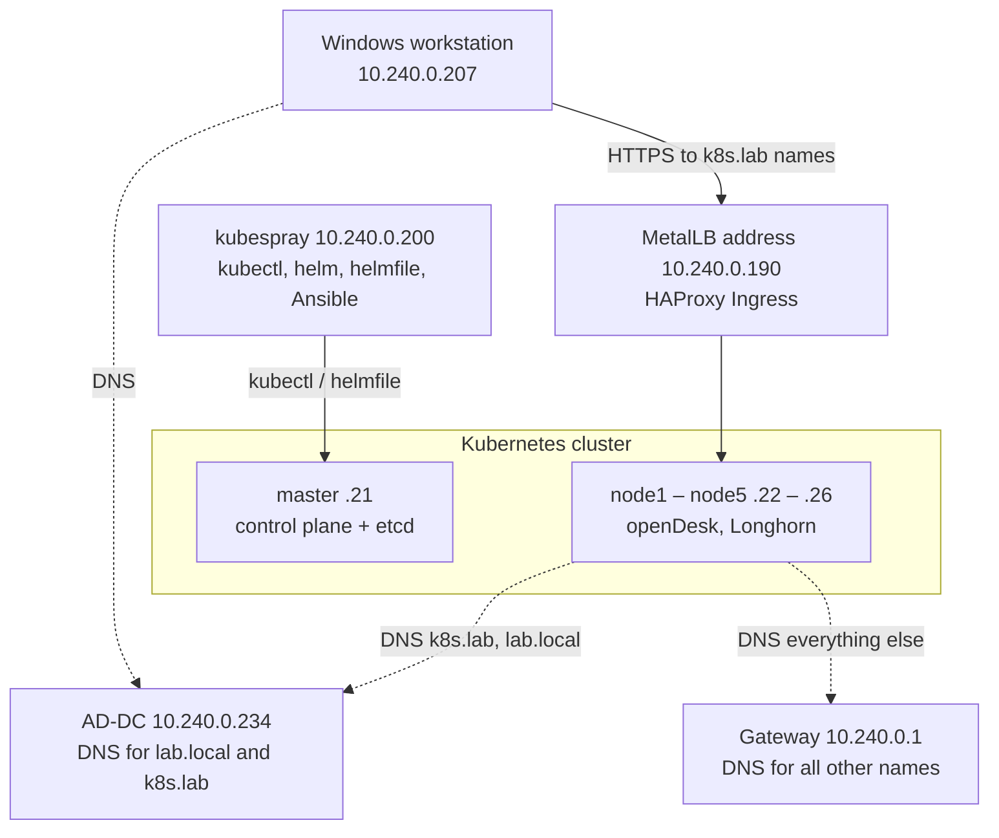

# 03 – openDesk on the Kubernetes Cluster (Kubespray)

> Part 3 of the build series. Previous: [02 – Kubernetes cluster with Kubespray](02-kubernetes-cluster-kubespray.md) · Next: [04 – Active Directory and SSO](04-active-directory-sso.md)

| Field | Value |
|---|---|
| Scope | Installation, access, troubleshooting and normal behavior of openDesk |
| Prerequisite | [01](01-proxmox-cloud-init-template.md): template 9000; [02](02-kubernetes-cluster-kubespray.md): cluster with 1 master + 5 workers (Kubespray v2.32.0) |
| Basis | Earlier guide "openDesk on a kubeadm cluster", adapted to Kubespray |
| Date | 08.10.2026 |
| openDesk version | v1.17.2 (namespace `opendesk`, environment `dev`) |
| Network | SDN VNet vl5000 · 10.240.0.0/24 · MTU 1450 |
| Status | Installed and accepted – portal, Nextcloud and Collabora reachable, certificate trusted on the workstation |

> **Note:** Passwords from the original documentation have been removed. The search domain inherited from the hosting environment is shown as `<host-domain>`.

## 0. Overview

### 0.1 Goal

This document describes how openDesk was installed on the Kubernetes cluster from [part 2](02-kubernetes-cluster-kubespray.md). It is based on an earlier guide for a cluster built with kubeadm. Because the new cluster was built with Kubespray, several steps had to be adapted – above all name resolution, kube-proxy and where the tools run. All commands were run on 08.10.2026 in exactly this environment.

Enabled: Nubus (UMS, portal, Keycloak), Nextcloud and Collabora Online. Disabled: OpenProject, OX App Suite, XWiki, Element, Jitsi and CryptPad. (OX App Suite was enabled later, see [05](05-ox-app-suite.md).)

> **Note:** With a single control plane node, this environment is suitable for testing, learning and development. Production use would still need high availability, a Longhorn backup target and adjusted volume sizes (section 18).

### 0.2 Architecture



### 0.3 Roles of the machines

| Machine | VM ID | IP | Role |
|---|---|---|---|
| Proxmox host server1 | – | 192.168.1.201 | Hypervisor; no IP in vl5000 |
| Z01 | 100 | 10.240.0.226 / 192.168.1.215 | Firewall/admin VM; jump host between 192.168.1.x and 10.240.0.x |
| kubespray | 104 | 10.240.0.200 | Control machine: Ansible, kubectl, helm, helmfile, yq; all openDesk commands run here |
| AD-DC | 114 | 10.240.0.234 | Domain controller `lab.local`; DNS server with zone `k8s.lab` |
| FS | 115 | 10.240.0.223 | File server (target for backup copies) |
| master | 201 | 10.240.0.21 | Control plane + etcd; taint NoSchedule, no openDesk pods |
| node1 – node5 | 202 – 206 | 10.240.0.22 – .26 | Workers: openDesk pods, Longhorn volumes |
| Windows workstation | – | 10.240.0.207 | Browser access to openDesk, root CA imported |
| MetalLB address | – | 10.240.0.190 | HAProxy Ingress (LoadBalancer); range .190 – .199 |

### 0.4 Names and domains

| Purpose | Value | Used for |
|---|---|---|
| openDesk cluster domain | `k8s.lab` | `global.domain`, all ingresses, certificates |
| AD domain | `lab.local` | Domain controller AD-DC, LDAPS (see [04](04-active-directory-sso.md)) |
| Kubernetes cluster domain | `cluster.local` | Internal service names |
| DNS zone `k8s.lab` on AD-DC | `*.k8s.lab` and `k8s.lab` → 10.240.0.190 | The wildcard covers all current and future subdomains |
| Search domain of the nodes | `<host-domain>` | Inherited from the Proxmox host via cloud-init; `k8s.lab` is deliberately not included |
| LoadBalancer range | 10.240.0.190 – 10.240.0.199 | MetalLB IPAddressPool `cluster-pool` |

### 0.5 Software versions

| Component | Version / value |
|---|---|
| Kubernetes / containerd | v1.36.4 / 2.3.5 (from part 2) |
| Kubespray / ansible-core | v2.32.0 / 2.19.14 |
| kube-proxy | Mode ipvs, strictARP true |
| CNI | Calico, `calico_veth_mtu` 1400 |
| DNS in the cluster | CoreDNS + nodelocaldns (169.254.25.10) |
| etcd | 3.6.0 (etcdctl/etcdutl 3.6.14 on the master) |
| Helm (kubespray VM and master) | v3.22.0 |
| MetalLB | Chart 0.16.1 (FRR mode) |
| Longhorn | Chart 1.12.1 |
| HAProxy Ingress | Chart 0.16.1 |
| cert-manager | Chart v1.21.1 |
| helmfile / helm-diff / yq | 1.7.3 / 3.11.0 / v4.53.3 |
| openDesk | v1.17.2 (commit ea728bb7) |
| Kubernetes requirement of openDesk | ≥ v1.24 (met) |

### 0.6 What changed compared to the kubeadm guide

| Topic | Old environment (kubeadm) | New environment (Kubespray) |
|---|---|---|
| Tools | kubectl, helm, helmfile on k8s-master | Everything on the kubespray VM (10.240.0.200) |
| Commands on all nodes | Via SSH on every machine | Via Ansible from `~/kubespray` |
| IPs / interface | .217, .248 … / ens18 | .21 – .26 / eth0 |
| DNS in the cluster | Node name servers switched to AD-DC, CoreDNS with `policy sequential` | Only the zones `k8s.lab` and `lab.local` go to AD-DC, via `coredns_external_zones` and `nodelocaldns_external_zones`; nodes unchanged |
| DNS dependency on AD-DC | All names depend on AD-DC | Only `k8s.lab` and `lab.local`; everything else goes through the gateway |
| kube-proxy | iptables | ipvs; strictARP required for MetalLB |
| etcd certificates | `/etc/kubernetes/pki/etcd/` | `/etc/ssl/etcd/ssl/` (`admin-master.pem`) |
| etcdctl access | Locally on k8s-master | Via SSH from the kubespray VM to the master |
| metrics-server, Helm | Had to be installed | Already installed by Kubespray |
| DNS zone on AD-DC | Had to be created | Already existed (same AD-DC) |
| Kernel module iscsi_tcp | Not considered | Loaded permanently |
| Storage acceptance test | Only "PVC Bound" | Additionally a pod with the volume mounted |

### 0.7 Conventions

Same conventions as in [01](01-proxmox-cloud-init-template.md#04-conventions). In addition:

- Always run Ansible commands from inside `~/kubespray`, otherwise Ansible cannot find the inventory.
- In PowerShell, paste multi-line pipelines as a single line.
- Times in Linux output are UTC (08:00 UTC = 10:00 CEST).

### 0.8 Steps

| Section | Topic | Run on |
|---|---|---|
| 1 | Inventory of the current state | kubespray (k8s) |
| 2 | DNS forwarding and strictARP via Kubespray | kubespray (k8s) |
| 3 | Node preparation via Ansible | kubespray (k8s) |
| 4 | Helm and MetalLB | kubespray (k8s) |
| 5 | Longhorn | kubespray (k8s) |
| 6 | HAProxy Ingress and DNS on the kubespray VM | kubespray (k8s) |
| 7 | cert-manager and ClusterIssuer | kubespray (k8s) |
| 8 | Acceptance test of the base services and etcd backup | kubespray (k8s) |
| 9 | Tools and openDesk repository | kubespray (k8s) |
| 10 | Configuration and master password | kubespray (k8s) |
| 11 | Dry run and backup before the rollout | kubespray (k8s), tmux |
| 12 | Rollout | kubespray (k8s), tmux |
| 13 | Acceptance and administrator access | kubespray (k8s) |
| 14 | Windows workstation | Z01, Windows PC |
| 15 | Access and data | – |
| 16 | Troubleshooting | – |
| 17 | Not an error – normal behavior | – |
| 18 | Operations, dates and open items | kubespray (k8s) |

---

# Part A – Prepare the cluster and base services

## 1. Inventory of the current state

**Run on:** kubespray VM as k8s, in `~/kubespray`

Before changing anything, I checked how Kubespray had set up the cluster and whether there were conflicts with the old installation (the old environment was in the same network and also used 10.240.0.190 and `k8s.lab`).

```bash
cd ~/kubespray
kubectl get nodes -o wide
kubectl describe nodes | grep -E '^Name:|^Taints:'
which helm; helm version 2>/dev/null
kubectl -n kube-system get cm kube-proxy -o yaml | grep -E 'mode:|strictARP'
kubectl -n kube-system get cm coredns -o jsonpath='{.data.Corefile}'; echo
kubectl -n kube-system get cm nodelocaldns -o jsonpath='{.data.Corefile}'; echo
ansible -i inventory/mycluster/inventory.ini all -m shell -a "grep -E 'nameserver|search' /run/systemd/resolve/resolv.conf"
ansible -i inventory/mycluster/inventory.ini all -m shell -a "df -h /var/lib | tail -1"
ping -c1 -W1 10.240.0.234
nslookup lab.local 10.240.0.234
nslookup portal.k8s.lab 10.240.0.234
nslookup doesnotexist.lab.local 10.240.0.234
for i in 217 248 224 211 218 209; do echo -n "10.240.0.$i: "; ping -c1 -W1 10.240.0.$i >/dev/null 2>&1 && echo "IN USE" || echo "free"; done
for i in $(seq 190 199); do echo -n "10.240.0.$i: "; ping -c1 -W1 10.240.0.$i >/dev/null 2>&1 && echo "IN USE" || echo "free"; done
ssh k8s@10.240.0.21 "which etcdctl etcdutl"
```

Result on 08.10.2026:

| Check | Result | Meaning |
|---|---|---|
| Nodes | 6 × Ready, v1.36.4 | Cluster from part 2 intact |
| Taint on master | `control-plane:NoSchedule` | openDesk runs only on the 5 workers |
| helm on the kubespray VM | Not installed | Installed in section 4 |
| kube-proxy | Mode ipvs, strictARP false | strictARP must be true for MetalLB |
| CoreDNS | `forward . /etc/resolv.conf` | Asks the name servers of the node |
| nodelocaldns, block `.:53` | `forward . /etc/resolv.conf` | External names go directly to the node, not through CoreDNS – both must be adjusted |
| Name servers of the nodes | 169.254.25.10, 10.240.0.1 | Only the gateway as upstream; it does not know `k8s.lab` |
| Search domains of the nodes | … `<host-domain>` | `k8s.lab` is not in it (intended) |
| Disk space | 111 GB free per node | Enough for the functional test |
| AD-DC | Reachable; zone `k8s.lab` with wildcard → .190 exists | Step "create DNS zone" not needed |
| AD zone `lab.local` | `doesnotexist.lab.local` → NXDOMAIN | No wildcard, prerequisite met |
| Old environment (.217 …) | All free | No conflicts |
| MetalLB range .190 – .199 | All free | Usable |
| etcdctl / etcdutl | `/usr/local/bin` on the master | Backups possible |

## 2. DNS forwarding and strictARP via Kubespray

### 2.1 Concept

Instead of switching the name servers of the nodes to AD-DC (old guide), only the zones `k8s.lab` and `lab.local` are forwarded to AD-DC – in CoreDNS **and** in nodelocaldns, because nodelocaldns forwards external names directly to the node. All other names keep going through the gateway. Advantages: the nodes and cloud-init stay unchanged, and an AD-DC outage does not take down all name resolution. The `policy sequential` from the old guide is no longer needed.

The values are set in the Kubespray configuration and not directly in the ConfigMaps, because every later Kubespray run (`scale.yml`, `upgrade-cluster.yml`) would overwrite manual changes.

### 2.2 Check and set the variables

**Run on:** kubespray VM as k8s, in `~/kubespray`

```bash
grep -rn 'external_zones' roles/ | grep -v '^roles/.*defaults' | head
cp inventory/mycluster/group_vars/k8s_cluster/k8s-cluster.yml ~/k8s-cluster.yml.vor-opendesk
G=inventory/mycluster/group_vars/k8s_cluster/k8s-cluster.yml
sed -i 's/^kube_proxy_strict_arp: false/kube_proxy_strict_arp: true/' $G
cat >> $G <<'EOF'
# openDesk: forward the zones k8s.lab and lab.local to the domain controller AD-DC
coredns_external_zones:
- zones:
  - k8s.lab
  - lab.local
  nameservers:
  - 10.240.0.234
  cache: 30
nodelocaldns_external_zones:
- zones:
  - k8s.lab
  - lab.local
  nameservers:
  - 10.240.0.234
  cache: 30
EOF
grep -n 'kube_proxy_strict_arp' $G
tail -n 16 $G
python3 -c "import yaml,sys; yaml.safe_load(open('$G')); print('YAML OK')"
```

✔ **Expected:** both variables are used in the templates `coredns-config.yml.j2` and `nodelocaldns-config.yml.j2`; `kube_proxy_strict_arp: true`; `YAML OK`. Backup of the original file: `~/k8s-cluster.yml.vor-opendesk`.

### 2.3 Run Kubespray again

`cluster.yml` is idempotent and only changes what differs from the configuration. Runtime: about 20 minutes.

```bash
tmux new -s kubespray
```

```bash
cd ~/kubespray
ansible-playbook -i inventory/mycluster/inventory.ini -b cluster.yml 2>&1 | tee ~/cluster-opendesk-dns.log
grep -A 8 "PLAY RECAP" ~/cluster-opendesk-dns.log
```

Result on 08.10.2026:

```
master : ok=576  changed=45  unreachable=0  failed=0  skipped=774  rescued=0  ignored=0
node1  : ok=453  changed=27  unreachable=0  failed=0  skipped=547  rescued=0  ignored=0
node2  : ok=406  changed=22  unreachable=0  failed=0  skipped=479  rescued=0  ignored=0
node3  : ok=406  changed=22  unreachable=0  failed=0  skipped=479  rescued=0  ignored=0
node4  : ok=406  changed=22  unreachable=0  failed=0  skipped=479  rescued=0  ignored=0
node5  : ok=406  changed=22  unreachable=0  failed=0  skipped=479  rescued=0  ignored=0
```

### 2.4 Set strictARP directly

Kubespray only writes the kube-proxy configuration (via kubeadm) during the initial installation and during `upgrade-cluster.yml`. After the `cluster.yml` run, strictARP was therefore still `false` (error F2, section 16). The value was set directly in the ConfigMap; because it is also in the Kubespray configuration, it survives future upgrades.

```bash
kubectl -n kube-system get cm kube-proxy -o yaml | \
  sed -e 's/strictARP: false/strictARP: true/' | \
  kubectl -n kube-system apply -f -
kubectl -n kube-system get cm kube-proxy -o yaml | grep strictARP
kubectl -n kube-system rollout restart ds kube-proxy
kubectl -n kube-system rollout status ds kube-proxy
ansible -i inventory/mycluster/inventory.ini all -m command -a "sysctl net.ipv4.conf.all.arp_ignore net.ipv4.conf.all.arp_announce"
kubectl get nodes
kubectl get pods -A | grep -v Running
```

✔ **Expected:** `strictARP: true`; `arp_ignore = 1` and `arp_announce = 2` on all 6 nodes; all nodes `Ready`; no pods outside `Running`.

### 2.5 Verify name resolution

```bash
kubectl -n kube-system get cm coredns -o jsonpath='{.data.Corefile}' | grep -B1 -A6 'k8s.lab'
kubectl -n kube-system get cm nodelocaldns -o jsonpath='{.data.Corefile}' | grep -B1 -A6 'k8s.lab'
for n in node1 node2 node3 node4 node5; do
  kubectl run dnstest-$n --image=alpine:3.20 --restart=Never \
    --overrides="{\"spec\":{\"nodeName\":\"$n\"}}" --command -- sh -c \
    'grep search /etc/resolv.conf; getent hosts portal.k8s.lab; getent hosts lab.local; getent hosts github.com'
done
sleep 20
for n in node1 node2 node3 node4 node5; do echo "== $n"; kubectl logs dnstest-$n; done
for n in node1 node2 node3 node4 node5; do kubectl delete pod dnstest-$n; done
```

Result on each of the five workers:

```
search default.svc.cluster.local svc.cluster.local cluster.local <host-domain>
10.240.0.190      portal.k8s.lab  portal.k8s.lab
10.240.0.234      lab.local  lab.local
140.82.121.4      github.com  github.com
```

✔ **Expected:** a block `k8s.lab lab.local { … forward . 10.240.0.234 }` in both Corefiles. From every pod: `portal.k8s.lab` → 10.240.0.190, `lab.local` → 10.240.0.234, external names via the gateway, `k8s.lab` not in the search line.

## 3. Node preparation via Ansible

Corresponds to two sections of the old guide, but with a single Ansible call for all six nodes. In addition, the kernel module `iscsi_tcp` is loaded permanently.

**Run on:** kubespray VM as k8s, in `~/kubespray`

```bash
INV=inventory/mycluster/inventory.ini
ansible -i $INV all -b -m apt -a "name=open-iscsi,nfs-common,cryptsetup,dmsetup state=present update_cache=yes" -o
ansible -i $INV all -b -m shell -a "systemctl enable --now iscsid; modprobe iscsi_tcp; echo iscsi_tcp > /etc/modules-load.d/iscsi_tcp.conf; systemctl disable --now multipathd.service multipathd.socket 2>/dev/null; true"
ansible -i $INV all -b -m shell -a "printf 'fs.inotify.max_user_instances = 8192\nfs.inotify.max_user_watches = 524288\n' > /etc/sysctl.d/98-inotify.conf && sysctl --system >/dev/null"
ansible -i $INV all -m shell -a "echo iscsid=\$(systemctl is-active iscsid) multipathd=\$(systemctl is-active multipathd) iscsi_tcp=\$(lsmod | grep -c '^iscsi_tcp'); sysctl fs.inotify.max_user_instances fs.inotify.max_user_watches"
```

✔ **Expected** on all 6 nodes: `iscsid=active multipathd=inactive iscsi_tcp=1`; `fs.inotify.max_user_instances = 8192`; `fs.inotify.max_user_watches = 524288`.

| Setting | Purpose |
|---|---|
| open-iscsi, iscsid, iscsi_tcp | Longhorn attaches volumes to the pods via iSCSI |
| multipathd disabled | Would otherwise claim the Longhorn devices, so volumes could not be mounted |
| nfs-common, cryptsetup, dmsetup | RWX volumes and encrypted volumes in Longhorn |
| `/etc/sysctl.d/98-inotify.conf` | openDesk starts many containers that watch files; the Ubuntu default limits otherwise lead to "no space left on device" |

> **Note:** Kubespray already sets `fs.inotify.max_user_instances=8192` in `/etc/sysctl.conf` – same value, no conflict. With `-o` at the end of an Ansible call, each node prints a single line instead of long JSON output.

## 4. Helm and MetalLB

### 4.1 Helm on the kubespray VM

Kubespray installed Helm on the master; the same version is used on the kubespray VM.

**Run on:** kubespray VM as k8s

```bash
ssh k8s@10.240.0.21 "helm version --short"        # v3.22.0+g144ca65
HELM_VER="v3.22.0"
cd /tmp
curl -fLO https://get.helm.sh/helm-${HELM_VER}-linux-amd64.tar.gz
tar xzf helm-${HELM_VER}-linux-amd64.tar.gz
sudo install linux-amd64/helm /usr/local/bin/
hash -r
helm version --short
helm repo add metallb https://metallb.github.io/metallb
helm repo add longhorn https://charts.longhorn.io
helm repo add haproxy-ingress https://haproxy-ingress.github.io/charts
helm repo add jetstack https://charts.jetstack.io
helm repo update
```

### 4.2 MetalLB

```bash
helm install metallb metallb/metallb \
  --namespace metallb-system --create-namespace \
  --version 0.16.1 \
  --timeout 10m \
  --wait
kubectl get pods -n metallb-system -o wide
helm -n metallb-system list -a
```

✔ **Expected:** release `deployed`; 1 controller, 6 speakers (including the master), 6 frr-k8s, 1 frr-k8s-statuscleaner, all `Running`.

Only create the address range once the controller is running:

```bash
cat <<'EOF' | kubectl apply -f -
apiVersion: metallb.io/v1beta1
kind: IPAddressPool
metadata:
  name: cluster-pool
  namespace: metallb-system
spec:
  addresses:
    - 10.240.0.190-10.240.0.199
---
apiVersion: metallb.io/v1beta1
kind: L2Advertisement
metadata:
  name: cluster-l2
  namespace: metallb-system
spec:
  ipAddressPools:
    - cluster-pool
EOF
kubectl get ipaddresspool,l2advertisement -n metallb-system
```

> **Important:** The range 10.240.0.190 – 10.240.0.199 must be excluded in the DHCP server of the vl5000 network. This cannot be checked from Linux; a conflict shows up as a service that is sporadically unreachable.

> **Important:** `--timeout` is mandatory for every `helm install`. The default of 5 minutes is not enough with six nodes; helm then stores the release as `failed` even though the installation succeeds in the background. Check `helm list -a` after every installation.

## 5. Longhorn

**Run on:** kubespray VM as k8s

```bash
kubectl get storageclass                     # before: No resources found
helm install longhorn longhorn/longhorn \
  --namespace longhorn-system --create-namespace \
  --version 1.12.1 \
  --timeout 15m \
  --wait
helm -n longhorn-system list -a
kubectl get pods -n longhorn-system -o wide
kubectl get pods -n longhorn-system | grep -v Running
kubectl get storageclass
kubectl -n longhorn-system get nodes.longhorn.io
```

✔ **Expected:** release `deployed`; all pods `Running` (after about 8 minutes); StorageClass `longhorn (default)`; engine-image and instance-manager 5× each (workers only); `nodes.longhorn.io`: node1 – node5 `READY True`, `SCHEDULABLE True`.

> **Note:** Longhorn stores its data under `/var/lib/longhorn` on the system disk (120 GB per worker). From about 85 percent usage, the kubelet puts the node under DiskPressure and evicts pods. For real data, Longhorn belongs on a separate disk.

## 6. HAProxy Ingress and DNS on the kubespray VM

### 6.1 HAProxy Ingress

**Run on:** kubespray VM as k8s, in `~/opendesk-setup`

```bash
mkdir -p ~/opendesk-setup && cd ~/opendesk-setup
cat > haproxy-values.yaml <<'EOF'
controller:
  kind: Deployment
  replicaCount: 2
  service:
    type: LoadBalancer
    annotations:
      metallb.io/loadBalancerIPs: 10.240.0.190
  ingressClassResource:
    enabled: true
    name: haproxy
    default: true
  config:
    max-connections: "10000"
    config-global: |
      tune.bufsize 65536
      tune.http.maxhdr 256
EOF
helm install haproxy-ingress haproxy-ingress/haproxy-ingress \
  --namespace ingress-controller --create-namespace \
  --version 0.16.1 \
  -f haproxy-values.yaml \
  --timeout 10m \
  --wait
helm -n ingress-controller list -a
kubectl get pods -n ingress-controller -o wide
kubectl get svc -n ingress-controller
kubectl get ingressclass
kubectl -n ingress-controller get svc haproxy-ingress -o jsonpath='{.spec.externalTrafficPolicy}{"\n"}'
curl -s -o /dev/null -w "%{http_code}\n" http://10.240.0.190
```

✔ **Expected:** release `deployed`; 2 pods on node1 and node4; EXTERNAL-IP 10.240.0.190 (ports 80:32250, 443:30448); `haproxy (default)`; externalTrafficPolicy `Local`; curl via the IP → `404`.

> **Note:** `default: true` is important – the openDesk ingresses do not specify a class and inherit it this way.

### 6.2 Split DNS on the kubespray VM

The kubespray VM only asked the gateway and could not resolve `k8s.lab` (error F4). As in the cluster, only `k8s.lab` and `lab.local` are sent to AD-DC, here via systemd-resolved. The file is outside of Netplan and cloud-init and is not overwritten.

```bash
sudo mkdir -p /etc/systemd/resolved.conf.d
cat <<'EOF' | sudo tee /etc/systemd/resolved.conf.d/opendesk.conf
[Resolve]
DNS=10.240.0.234
Domains=~k8s.lab ~lab.local
EOF
sudo systemctl restart systemd-resolved
resolvectl status | head -n 12
getent hosts portal.k8s.lab
getent hosts lab.local
getent hosts github.com
curl -s -o /dev/null -w "%{http_code}\n" http://portal.k8s.lab
```

✔ **Expected:** Global: DNS servers 10.240.0.234, DNS domain `~lab.local ~k8s.lab`; link eth0: 10.240.0.1; `portal.k8s.lab` → 10.240.0.190; `lab.local` → 10.240.0.234; `github.com` → public address; curl → `404`.

## 7. cert-manager and ClusterIssuer

**Run on:** kubespray VM as k8s, in `~/opendesk-setup`

```bash
helm install cert-manager jetstack/cert-manager \
  --namespace cert-manager --create-namespace \
  --version v1.21.1 \
  --set crds.enabled=true \
  --timeout 10m \
  --wait
helm -n cert-manager list -a
kubectl get pods -n cert-manager
```

✔ **Expected:** release `deployed`; cert-manager, cert-manager-cainjector and cert-manager-webhook each `1/1 Running`.

Only once the webhook is ready:

```bash
cat <<'EOF' | kubectl apply -f -
apiVersion: cert-manager.io/v1
kind: ClusterIssuer
metadata:
  name: selfsigned-issuer
spec:
  selfSigned: {}
EOF
kubectl get clusterissuer
```

✔ **Expected:** `selfsigned-issuer READY True`.

## 8. Acceptance test of the base services and etcd backup

### 8.1 Acceptance test

Compared to the old guide, the volume is additionally mounted into a pod and written to – only then is iSCSI actually used. Run the blocks one after another.

**Run on:** kubespray VM as k8s, in `~/opendesk-setup`

```bash
cat <<'EOF' | kubectl apply -f -
apiVersion: v1
kind: PersistentVolumeClaim
metadata:
  name: smoke-pvc
spec:
  accessModes: [ReadWriteOnce]
  resources:
    requests:
      storage: 1Gi
---
apiVersion: v1
kind: Pod
metadata:
  name: smoke-vol
spec:
  containers:
  - name: test
    image: busybox:1.36
    command: ["sh", "-c", "echo longhorn-ok > /data/test.txt && cat /data/test.txt && sleep 3600"]
    volumeMounts:
    - name: data
      mountPath: /data
  volumes:
  - name: data
    persistentVolumeClaim:
      claimName: smoke-pvc
---
apiVersion: cert-manager.io/v1
kind: Certificate
metadata:
  name: smoke-cert
spec:
  secretName: smoke-cert-tls
  commonName: smoke.k8s.lab
  dnsNames:
    - smoke.k8s.lab
  issuerRef:
    name: selfsigned-issuer
    kind: ClusterIssuer
EOF
kubectl create deployment smoke-nginx --image=nginx
kubectl expose deployment smoke-nginx --port=80
cat <<'EOF' | kubectl apply -f -
apiVersion: networking.k8s.io/v1
kind: Ingress
metadata:
  name: smoke-ingress
spec:
  rules:
    - host: smoke.k8s.lab
      http:
        paths:
          - path: /
            pathType: Prefix
            backend:
              service:
                name: smoke-nginx
                port:
                  number: 80
EOF
```

After about one minute:

```bash
kubectl get pvc smoke-pvc
kubectl get pod smoke-vol -o wide
kubectl logs smoke-vol
kubectl get certificate smoke-cert
kubectl get ingress smoke-ingress
curl -s -o /dev/null -w "%{http_code}\n" http://smoke.k8s.lab
```

| Test | Result on 08.10.2026 |
|---|---|
| PVC | ✔ Bound, StorageClass longhorn, 1Gi |
| Volume in a pod (iSCSI) | ✔ smoke-vol Running on node4, log "longhorn-ok" |
| Certificate | ✔ smoke-cert READY True |
| Ingress without a class | ✔ CLASS haproxy |
| Full chain DNS → MetalLB → HAProxy → service → pod | ✔ HTTP 200 |

Clean up:

```bash
kubectl delete ingress smoke-ingress
kubectl delete svc smoke-nginx
kubectl delete deployment smoke-nginx
kubectl delete pod smoke-vol
kubectl delete pvc smoke-pvc
kubectl delete certificate smoke-cert
kubectl delete secret smoke-cert-tls
```

### 8.2 Baseline etcd backup

Using the Kubespray certificates on the master, with a copy on the kubespray VM (outside the cluster):

```bash
ssh k8s@10.240.0.21 "sudo mkdir -p /var/backups/etcd && sudo etcdctl --endpoints=https://10.240.0.21:2379 \
  --cacert=/etc/ssl/etcd/ssl/ca.pem \
  --cert=/etc/ssl/etcd/ssl/admin-master.pem \
  --key=/etc/ssl/etcd/ssl/admin-master-key.pem \
  snapshot save /var/backups/etcd/basis.db"
ssh k8s@10.240.0.21 "sudo etcdutl --write-out=table snapshot status /var/backups/etcd/basis.db"
mkdir -p ~/backups/etcd
ssh k8s@10.240.0.21 "sudo cat /var/backups/etcd/basis.db" > ~/backups/etcd/basis-$(date +%F-%H%M).db
chmod 600 ~/backups/etcd/*.db
ls -lh ~/backups/etcd/
```

```
+----------+----------+------------+------------+---------+
|   HASH   | REVISION | TOTAL KEYS | TOTAL SIZE | VERSION |
+----------+----------+------------+------------+---------+
| 328d0815 |   155377 |       1756 |      44 MB |   3.6.0 |
+----------+----------+------------+------------+---------+
```

> **Important:** An etcd snapshot contains all secrets of the cluster. That is why it gets `chmod 600`, and copies only go to trusted systems (e.g. FS).

---

# Part B – Roll out openDesk

## 9. Tools and openDesk repository

**Run on:** kubespray VM as k8s – run the commands one by one, curl lines without line breaks

```bash
cd /tmp
HELMFILE_VER=1.7.3
echo "$HELMFILE_VER"
curl -fLO https://github.com/helmfile/helmfile/releases/download/v${HELMFILE_VER}/helmfile_${HELMFILE_VER}_linux_amd64.tar.gz
ls -lh helmfile_${HELMFILE_VER}_linux_amd64.tar.gz      # 46M
tar xzf helmfile_${HELMFILE_VER}_linux_amd64.tar.gz helmfile
sudo install helmfile /usr/local/bin/
helm plugin install https://github.com/databus23/helm-diff --version v3.11.0
YQ_VER=v4.53.3
sudo curl -fL -o /usr/local/bin/yq https://github.com/mikefarah/yq/releases/download/${YQ_VER}/yq_linux_amd64
sudo chmod +x /usr/local/bin/yq
helmfile version
helm plugin list
yq --version
git --version
cd ~
git clone https://gitlab.opencode.de/bmi/opendesk/deployment/opendesk.git
cd ~/opendesk
git checkout v1.17.2
git describe --tags
grep -rniE 'kubernetes.*1\.[0-9]{2}|1\.[0-9]{2}.*kubernetes' docs/requirements.md docs/getting-started.md | head
curl -I https://registry.opencode.de/v2/
```

✔ **Expected:** helmfile 1.7.3; diff 3.11.0; yq v4.53.3; git 2.43.0; `HEAD at ea728bb7 chore(release): 1.17.2`; openDesk requires Kubernetes ≥ v1.24; the registry answers `HTTP/2 401` with `www-authenticate` (= reachable).

> **Note:** Always use curl with `-f`. Without the flag, curl saves the error page as a file on an HTTP error, and the problem only shows up later as a cryptic tar error. helm-diff is mandatory – without the plugin, `helmfile apply` aborts.

## 10. Configuration and master password

### 10.1 Configuration file

**Run on:** kubespray VM as k8s, in `~/opendesk`

```bash
cd ~/opendesk
mkdir -p helmfile/environments/dev
cat > helmfile/environments/dev/values.yaml.gotmpl <<'EOF'
global:
  domain: "k8s.lab"
cluster:
  service:
    type: "NodePort"
  container:
    engine: "containerd"
ingress:
  ingressClassName: "haproxy"
persistence:
  storageClassNames:
    RWO: "longhorn"
certificate:
  issuerRef:
    name: "selfsigned-issuer"
  selfSigned: true
apps:
  openproject:
    enabled: false
  oxAppSuite:
    enabled: false
  xwiki:
    enabled: false
  element:
    enabled: false
  jitsi:
    enabled: false
  cryptpad:
    enabled: false
EOF
yq eval '.' helmfile/environments/dev/values.yaml.gotmpl > /dev/null && echo 'YAML OK'
git -C ~/opendesk check-ignore -v helmfile/environments/dev/values.yaml.gotmpl
```

✔ **Expected:** `YAML OK`; check-ignore reports `.gitignore:8:helmfile/environments/dev/*.yaml.gotmpl` – the file never ends up in the repository.

> **Note:** The directory also contains `sample.yaml.gotmpl` from the repository. It only sets the unused key `sample` and stays unchanged. helmfile reads all `*.yaml.gotmpl` files in this directory.

> **Note:** `cluster.service.type: NodePort` was deliberately taken over from the working old environment. Whether ClusterIP fits better is an open item (section 18).

### 10.2 Master password

openDesk derives the passwords for databases, Keycloak, object storage and other services from `MASTER_PASSWORD`. A new password was generated for the new environment.

```bash
openssl rand -base64 32 | tr -d '\n' > ~/opendesk-master-password.txt
chmod 600 ~/opendesk-master-password.txt
export MASTER_PASSWORD="$(cat ~/opendesk-master-password.txt)"
echo "${#MASTER_PASSWORD}"          # 44
```

> **Important:** This file is the most critical value of the deployment. If a different value is used in a later apply, the derived passwords no longer match the databases and no component comes up again. Store the content in a password manager and in the backup – never in the Git repository and never in `.bashrc`. Repeat the export line in every new session.

## 11. Dry run and backup before the rollout

**Run on:** kubespray VM as k8s, in tmux, in `~/opendesk`

```bash
tmux new -s opendesk
```

```bash
cd ~/opendesk
export MASTER_PASSWORD="$(cat ~/opendesk-master-password.txt)"
helmfile -e dev list
helmfile -e dev template > /tmp/opendesk-render.yaml
ls -lh /tmp/opendesk-render.yaml                        # 1.4M
grep -c "storageClassName: longhorn" /tmp/opendesk-render.yaml    # 7
grep -ohE '[a-z0-9.-]+\.k8s\.lab' /tmp/opendesk-render.yaml | sort -u
```

> **Important:** The first helmfile call downloads all charts and prints nothing for 5 to 15 minutes. Do not cancel it (error F5). Progress in a second session: `watch -n 10 'du -sh ~/.cache/helmfile'`.

Backup before the rollout:

```bash
ssh k8s@10.240.0.21 "sudo etcdctl --endpoints=https://10.240.0.21:2379 \
  --cacert=/etc/ssl/etcd/ssl/ca.pem \
  --cert=/etc/ssl/etcd/ssl/admin-master.pem \
  --key=/etc/ssl/etcd/ssl/admin-master-key.pem \
  snapshot save /var/backups/etcd/vor-opendesk.db"
ssh k8s@10.240.0.21 "sudo cat /var/backups/etcd/vor-opendesk.db" > ~/backups/etcd/vor-opendesk-$(date +%F-%H%M).db
chmod 600 ~/backups/etcd/*.db
```

## 12. Rollout

**Run on:** kubespray VM as k8s, in tmux, in `~/opendesk`

```bash
cd ~/opendesk
export MASTER_PASSWORD="$(cat ~/opendesk-master-password.txt)"
echo "${#MASTER_PASSWORD}"
kubectl create namespace opendesk
helmfile -e dev apply -n opendesk 2>&1 | tee ~/opendesk-apply.log
```

> **Important:** `-n opendesk` is mandatory. Without the flag, around 60 releases end up in the `default` namespace; deleting without the namespace flag would also remove cluster-wide components.

Watch in a second SSH session:

```bash
watch -n 10 'kubectl -n opendesk get pods | grep -v "Running\|Completed"'
```

The rollout runs in stages: `010-migrations-pre` → `030-services-external` (PostgreSQL, MariaDB, Redis, SeaweedFS, Postfix) → `030-opendesk-services` → `050-components` (Nubus/UMS, Nextcloud, Collabora) → `090-migrations-post`. On 08.10.2026 it took about 55 minutes; the last release was `opendesk-migrations-post` (chart opendesk-migrations 1.9.0, 10:31 UTC).

After the end:

```bash
tail -n 20 ~/opendesk-apply.log
helm -n opendesk list -a | grep -v deployed
kubectl -n opendesk get pods | grep -v "Running\|Completed"
kubectl -n opendesk get pods --sort-by=.metadata.creationTimestamp | grep register-consumers
kubectl -n opendesk get jobs | grep register-consumers
curl -k -s -o /dev/null -w "%{http_code}\n" https://portal.k8s.lab
```

✔ **Expected:** helm list shows only the header line (all releases `deployed`); `portal.k8s.lab` → `301`. Two old pods `ums-provisioning-register-consumers-1-…` in `Init:Error`; the most recent run is `Completed`, the job shows `1/1` – not an error (section 17).

## 13. Acceptance and administrator access

**Run on:** kubespray VM as k8s, in `~/opendesk`

```bash
kubectl -n opendesk delete pod --field-selector status.phase=Failed
kubectl -n opendesk get pods | grep -v "Running\|Completed"
kubectl -n opendesk get ingress
kubectl -n opendesk get certificate
curl -k -I https://portal.k8s.lab
curl -k -I https://objectstorage.k8s.lab
curl -k -s -o /dev/null -w "%{http_code}\n" https://files.k8s.lab
kubectl -n opendesk run nettest --image=curlimages/curl:8.10.1 --restart=Never -- \
  curl -k -s -o /dev/null -w "%{http_code}\n" --max-time 10 https://objectstorage.k8s.lab
sleep 15
kubectl -n opendesk logs nettest
kubectl -n opendesk delete pod nettest
```

Ingresses (15, all with class `haproxy`, ports 80/443):

| Ingress | Host |
|---|---|
| collabora | office.k8s.lab |
| ingress-seaweedfs-s3 | objectstorage.k8s.lab |
| intercom-service | ics.k8s.lab |
| opendesk-home-basedomain | k8s.lab |
| opendesk-nextcloud-aio | files.k8s.lab |
| opendesk-nextcloud-notifypush | files.k8s.lab |
| opendesk-static-files-collabora | office.k8s.lab |
| opendesk-static-files-keycloak | id.k8s.lab |
| opendesk-static-files-nextcloud | files.k8s.lab |
| opendesk-static-files-portal | portal.k8s.lab |
| ums-keycloak-extensions-proxy | id.k8s.lab |
| ums-portal-frontend-static | portal.k8s.lab |
| ums-portal-server | portal.k8s.lab |
| ums-umc-gateway | portal.k8s.lab |
| ums-umc-server | portal.k8s.lab |

| Test | Result on 08.10.2026 |
|---|---|
| Failed pods | ✔ none (delete reports "No resources found") |
| Releases | ✔ all `deployed` |
| Certificates | ✔ opendesk-certificates and opendesk-certificates-ca READY True |
| Portal | ✔ HTTP 301, `location: /univention/portal/` |
| Object storage from outside | ✔ HTTP 405 (HEAD rejected, the service answers) |
| Nextcloud | ✔ HTTP 302 → `/login` |
| Object storage from a pod | ✔ HTTP 403 |

Backup after the rollout:

```bash
ssh k8s@10.240.0.21 "sudo etcdctl --endpoints=https://10.240.0.21:2379 \
  --cacert=/etc/ssl/etcd/ssl/ca.pem \
  --cert=/etc/ssl/etcd/ssl/admin-master.pem \
  --key=/etc/ssl/etcd/ssl/admin-master-key.pem \
  snapshot save /var/backups/etcd/nach-opendesk.db"
ssh k8s@10.240.0.21 "sudo cat /var/backups/etcd/nach-opendesk.db" > ~/backups/etcd/nach-opendesk-$(date +%F-%H%M).db
chmod 600 ~/backups/etcd/*.db
```

Read the administrator password (do not paste the output anywhere):

```bash
kubectl -n opendesk get secret ums-nubus-credentials \
  -o jsonpath='{.data.administrator_password}' | base64 -d; echo
```

> **Note:** The user name is `Administrator` with a capital A – not `default.admin`. The accounts `default` and `default-admin` are only created by the openDesk user importer.

## 14. Windows workstation

### 14.1 Reachability and DNS

**Run on:** Windows PC, PowerShell as administrator

```powershell
Test-NetConnection 10.240.0.190 -Port 443
Test-NetConnection 10.240.0.234 -Port 53
ipconfig /flushdns
Resolve-DnsName portal.k8s.lab
```

✔ **Expected:** both `TcpTestSucceeded True` (source address 10.240.0.207); `portal.k8s.lab` → 10.240.0.190. The workstation already uses AD-DC as its DNS server, so nothing needs to be set up.

> **Note:** An NRPT rule for `.k8s.lab` was also created. It is unnecessary and should be removed (error F9):
> `Get-DnsClientNrptRule | Where-Object { $_.Namespace -eq ".k8s.lab" } | Remove-DnsClientNrptRule -Force`

### 14.2 Export the root CA

**Run on:** kubespray VM as k8s

```bash
kubectl -n opendesk get secret opendesk-certificates-ca-tls \
  -o jsonpath='{.data.ca\.crt}' | base64 -d > ~/opendesk-ca.crt
openssl x509 -in ~/opendesk-ca.crt -noout -fingerprint -sha1
openssl x509 -in ~/opendesk-ca.crt -noout -subject -enddate
```

```
sha1 Fingerprint=72:B4:21:CC:BE:06:7C:69:A4:D7:AB:A7:FD:43:BE:A7:BB:1E:93:E0
subject=O = European Company that Makes Everything (ECME) Inc., OU = Datacenter Operations, CN = k8s.lab
notAfter=Jan  6 10:01:30 2027 GMT
```

### 14.3 Transfer via Z01

**Run on:** Z01 as support

```bash
scp 10.240.0.200:opendesk-ca.crt ~/opendesk-ca.crt
```

**Run on:** Windows PC, PowerShell

```powershell
New-Item -ItemType Directory -Force C:\Temp | Out-Null
scp support@192.168.1.215:~/opendesk-ca.crt C:\Temp\opendesk-ca.crt
```

> **Note:** On the first scp, Windows asks about the host key of Z01. Compare the fingerprint before accepting.

### 14.4 Check and import

**Run on:** Windows PC, PowerShell as administrator – each line on its own

```powershell
Get-ChildItem Cert:\LocalMachine\Root | Where-Object { $_.Subject -like "*k8s*" } | Format-List Subject, Thumbprint, NotAfter
(Get-PfxCertificate -FilePath "C:\Temp\opendesk-ca.crt").Thumbprint
Import-Certificate -FilePath "C:\Temp\opendesk-ca.crt" -CertStoreLocation Cert:\LocalMachine\Root
curl.exe --ssl-no-revoke -I https://portal.k8s.lab
curl.exe --ssl-no-revoke -I https://files.k8s.lab
```

✔ **Expected:** thumbprint `72B421CCBE067C69A4D7ABA7FD43BEA7BB1E93E0` = SHA1 fingerprint from 14.2; exactly one k8s CA in the store (no leftovers); portal `HTTP/1.1 301`, files `HTTP/1.1 302` – both without certificate errors.

> **Note:** Never skip the thumbprint comparison. Always remove an old CA by its thumbprint, not by its name. `--ssl-no-revoke` is needed because the internal CA has no CRL/OCSP address. Use `curl.exe` instead of `curl`, because `curl` in PowerShell is an alias for `Invoke-WebRequest`.

Finally, close the browser completely, reopen it and open https://portal.k8s.lab. Log in as `Administrator` with the password from section 13.

## 15. Access and data

### 15.1 Users and passwords

| System | Address | User | Password / login |
|---|---|---|---|
| openDesk portal (Nubus) | https://portal.k8s.lab | Administrator | Generated by openDesk, read from the secret `ums-nubus-credentials` (section 13); must be changed after the first login, kept in a password manager |
| openDesk master password | `~/opendesk-master-password.txt` on kubespray | – | 44 characters, base64; kept in a password manager – never in Git or in documentation |
| Derived service passwords | Secrets in the namespace `opendesk` | – | Derived from the master password, e.g. `kubectl -n opendesk get secret ums-nubus-credentials` |
| Proxmox host server1 | 192.168.1.201 (SSH, :8006) | root | Existing password (not documented here) |
| Z01 | 192.168.1.215 / 10.240.0.226 | support | Existing password (not documented here) |
| kubespray (VM 104) | 10.240.0.200 | k8s | SSH key; passwordless sudo |
| master, node1 – node5 | 10.240.0.21 – .26 | k8s | Console password only (Proxmox console); SSH with key only; passwordless sudo |
| Kubernetes API | https://10.240.0.21:6443 | kubernetes-admin | Certificate in `~/.kube/config` on kubespray |
| Longhorn UI | Service `longhorn-frontend` (no ingress) | – | Only reachable via `kubectl port-forward` |

### 15.2 IP addresses and ports

| Service | Address | Note |
|---|---|---|
| HAProxy Ingress (LoadBalancer) | 10.240.0.190 | Ports 80, 443; NodePorts 32250 (HTTP), 30448 (HTTPS) |
| MetalLB range | 10.240.0.190 – .199 | .191 – .199 free for more LoadBalancers |
| Domain controller / DNS | 10.240.0.234 | Zones `lab.local` and `k8s.lab` |
| Gateway / DNS | 10.240.0.1 | All other names |
| nodelocaldns | 169.254.25.10 | DNS cache on every node |
| CoreDNS service | 10.233.0.3 | Target of nodelocaldns for `cluster.local` |
| Service network / pod network | 10.233.0.0/18 / 10.233.64.0/18 | From part 2 |
| etcd | https://10.240.0.21:2379 | Only from the master or via SSH |
| Kubernetes API | https://10.240.0.21:6443 | Via `~/.kube/config` on kubespray |
| Windows workstation | 10.240.0.207 | Uses AD-DC as DNS server |

### 15.3 Certificates and backups

| Object | Value |
|---|---|
| openDesk root CA, SHA1 | `72:B4:21:CC:BE:06:7C:69:A4:D7:AB:A7:FD:43:BE:A7:BB:1E:93:E0` |
| openDesk root CA, Windows thumbprint | `72B421CCBE067C69A4D7ABA7FD43BEA7BB1E93E0` |
| openDesk root CA, subject | CN=k8s.lab, OU=Datacenter Operations, O=European Company that Makes Everything (ECME) Inc. |
| openDesk root CA, valid until | 06.01.2027 10:01:30 UTC |
| openDesk root CA, secret | `opendesk-certificates-ca-tls` (namespace `opendesk`) |
| etcd snapshot `basis.db` | HASH 328d0815, REVISION 155377, 1756 keys, 44 MB, etcd 3.6.0 |

### 15.4 SSH keys

| Key | Location (private) | Purpose |
|---|---|---|
| `k8s_ansible` (ed25519, ansible@k8s) | Proxmox `/root/.ssh/k8s_ansible`, Z01 `~/.ssh/k8s_ansible`, kubespray `~/.ssh/id_ed25519` | SSH and Ansible to all cluster VMs |
| `id_rsa` (root@Server1) | Proxmox `/root/.ssh/id_rsa` | Access from the Proxmox host |

### 15.5 Important files

| File | Machine | Content |
|---|---|---|
| `~/opendesk-master-password.txt` | kubespray | Master password (chmod 600) |
| `~/opendesk/helmfile/environments/dev/values.yaml.gotmpl` | kubespray | openDesk configuration |
| `~/opendesk-apply.log` | kubespray | Rollout log |
| `~/opendesk-setup/haproxy-values.yaml` | kubespray | HAProxy Ingress values |
| `~/opendesk-ca.crt` | kubespray, Z01, `C:\Temp` | Root CA (public) |
| `~/backups/etcd/basis-2026-10-08-0828.db` | kubespray | etcd after the base services |
| `~/backups/etcd/vor-opendesk-2026-10-08-0950.db` | kubespray | etcd before the rollout |
| `~/backups/etcd/nach-opendesk-2026-10-08-1053.db` | kubespray | etcd after the rollout |
| `/var/backups/etcd/*.db` | master | Originals of the snapshots |
| `~/kubespray/inventory/mycluster/group_vars/k8s_cluster/k8s-cluster.yml` | kubespray | strictARP, external_zones |
| `~/k8s-cluster.yml.vor-opendesk` | kubespray | Original before the changes |
| `~/cluster-opendesk-dns.log` | kubespray | Log of the Kubespray run |
| `/etc/systemd/resolved.conf.d/opendesk.conf` | kubespray | Split DNS for `k8s.lab`, `lab.local` |
| `/etc/sysctl.d/98-inotify.conf` | all nodes | inotify limits |
| `/etc/modules-load.d/iscsi_tcp.conf` | all nodes | Load the iSCSI module at boot |
| `~/.cache/helmfile` | kubespray | helmfile chart cache |

## 16. Troubleshooting

Errors and problems that actually occurred during the installation on 08.10.2026:

| # | Problem / message | Cause | Solution |
|---|---|---|---|
| F1 | Ansible: `Unable to parse /home/k8s/inventory/mycluster/inventory.ini as an inventory source; provided hosts list is empty` | Command run in the home directory instead of `~/kubespray`; the relative path pointed nowhere | `cd ~/kubespray` and run again; the prompt must end in `…:~/kubespray$` |
| F2 | `strictARP: false` after a successful `cluster.yml`; `arp_ignore = 0`, `arp_announce = 0` | Kubespray only changes the kube-proxy ConfigMap of an existing cluster during `upgrade-cluster.yml` | ConfigMap patched with sed + `kubectl apply` to `strictARP: true`, then `rollout restart ds kube-proxy`; check `arp_ignore = 1`, `arp_announce = 2` |
| F3 | `-bash: syntax error near unexpected token 'newline'` | Placeholder line `HELM_VER=<version …>` typed literally | Replace the placeholder: `HELM_VER="v3.22.0"` |
| F4 | `curl http://portal.k8s.lab` returns `000` on the kubespray VM | The kubespray VM only asked the gateway 10.240.0.1, which does not know the zone `k8s.lab` | Split DNS with `/etc/systemd/resolved.conf.d/opendesk.conf` (`DNS=10.240.0.234`, `Domains=~k8s.lab ~lab.local`) |
| F5 | `helmfile -e dev list` shows nothing for minutes; the first call was cancelled with Ctrl+C | The first call downloads all charts without output; later calls evaluate ~60 releases | Do not cancel, wait 5–15 minutes; watch progress with `du -sh ~/.cache/helmfile` in a second session |
| F6 | Two pods `ums-provisioning-register-consumers-1-…` in `Init:Error`; log: `Provisioning API is not reachable, status code: 000 … Timeout reached` | Early attempts waited 240 s for the provisioning API, which had not started yet | Kubernetes restarted the job; the third run was `Completed`, job `1/1`. Old pods removed with `delete pod --field-selector status.phase=Failed` |
| F7 | PowerShell: `An empty pipe element is not allowed` (EmptyPipeElement) | Multi-line pipeline pasted line by line | Paste the command as a single line |
| F8 | `curl.exe: SEC_E_UNTRUSTED_ROOT (0x80090325)` | curl ran before `Import-Certificate`, because several lines were pasted at once | Run again after the import → `301` without errors |
| F9 | NRPT rule for `.k8s.lab` created although not needed | The workstation already used AD-DC as its DNS server; resolution already worked | Remove the rule so that DNS is maintained in one place only |
| F10 | Administrator password visible in a chat history | The full output of the password command was copied into a chat | Change the password after the first login; never share outputs that contain passwords |
| F11 | `grep -c "ingressClassName: haproxy"` returned only 1 in the rendered YAML | Most charts probably quote the value (`"haproxy"`) | No impact: all 15 ingresses have class `haproxy` (section 13). Check with `grep -E 'ingressClassName' /tmp/opendesk-render.yaml`, then `sort` and `uniq -c` |

### 16.1 Typical errors and checks

| Symptom | Check / solution |
|---|---|
| Pods in `Init:Error`, "Could not connect to the endpoint URL" | Check DNS from a pod (section 2.5); check the Corefiles for `external_zones` |
| Internal names work, `k8s.lab` does not | After a Kubespray run: `kubectl -n kube-system get cm nodelocaldns -o yaml`, the `k8s.lab` block must be there |
| LoadBalancer address sporadically unreachable | Check strictARP and arp_ignore (section 2.4); check the DHCP exclusion .190 – .199 |
| helm release shows `failed` | `helm -n <ns> list -a`; uninstall the release and reinstall with a higher `--timeout` |
| `Error: jobs.batch "…" not found` during apply | A follow-up error: first find the stuck component with `kubectl -n opendesk get pods`; then uninstall the release and repeat `helmfile -e dev apply -n opendesk` |
| Volumes stuck in `FailedAttachVolume` | multipathd inactive? iscsid active? `lsmod` |
| DiskPressure, pods evicted | `df -h /var/lib` on every worker; free up space from 85 % |
| Browser shows a certificate warning | Compare the thumbprint in the Windows store with the SHA1 of the current CA (section 14); the CA is renewed after 90 days |

## 17. Not an error – normal behavior

Messages and states that look like errors but are normal:

| Message / state | Explanation |
|---|---|
| Ping to 10.240.0.190: "From 10.240.0.190 … Destination Port Unreachable" | kube-proxy in IPVS mode only forwards the service ports 80/443 and rejects ICMP. The address answers; the curl test (404/200) is what counts |
| `Warning: … missing the kubectl.kubernetes.io/last-applied-configuration annotation` | Appears on the first `kubectl apply` to a resource that was not created declaratively; the annotation is added automatically |
| Long JSON when grepping for strictARP | Content of the new last-applied-configuration annotation |
| `Warning: unrecognized format "cidr"` (MetalLB installation) | Note about the CRD schema, no impact |
| metallb-frr-k8s-statuscleaner with 1 restart | Started before the webhook and retried |
| Longhorn pods in `ContainerCreating` for minutes | Images are pulled on every worker one by one |
| csi-attacher / csi-provisioner / csi-snapshotter with 1–2 restarts | They start before longhorn-manager is ready |
| StorageClass `longhorn-static` | Additional class of the Longhorn chart for existing volumes |
| engine-image and instance-manager only 5×, not 6× | The DaemonSets do not tolerate the master's taint – correct |
| ADDRESS column empty in `kubectl get ingress` | HAProxy does not write the status back (`--publish-service`); routing works |
| apt: "Running kernel seems to be up-to-date … No services need to be restarted" | Info from needrestart |
| `names>` while pasting a heredoc | Display artifact in the terminal; not in the file |
| 43M in `ls`, 44 MB in `etcdutl` | Same value, MiB versus MB |
| etcd snapshot after the rollout also ~44 MB | etcd only releases free space after compaction/defragmentation |
| Registry: `HTTP/2 401` with `www-authenticate` | A Docker registry always answers like this on `/v2/` – proof that it is reachable |
| helmfile: "A new release is available: 1.7.3 → v1.8.1" | Notice; 1.7.3 kept on purpose |
| git checkout: "You are in 'detached HEAD' state" | Normal when checking out a tag |
| `git status` shows nothing after creating the configuration | `.gitignore` excludes `helmfile/environments/dev/*.yaml.gotmpl` – intended |
| `sample.yaml.gotmpl` in the dev directory | Example file from the repository; only sets the unused key `sample` |
| helmfile list / template without output for several minutes | Charts are being downloaded or evaluated |
| `namespace: default` in the rendered YAML | `helmfile template` renders without cluster context; the namespace comes from `apply -n opendesk` |
| Names of disabled apps in the render list | `template` renders regardless of installation status; only ingresses of enabled components are created |
| Pods in `Error` / `Init:Error` / `CrashLoopBackOff` during the rollout | Components wait for databases, LDAP and NATS and restart |
| Old job pods in `Init:Error` after the rollout | Failed earlier attempts stay around so their logs can be read; the most recent run (`Completed`) is what counts |
| `Error from server (BadRequest): container … is waiting to start: PodInitializing` | Log requested for a container that never started in this pod (`--all-containers`) |
| `No resources found` for `delete --field-selector status.phase=Failed` | There were no more failed pods |
| Object storage: HTTP 405 (from outside) or 403 (from a pod) | HEAD is rejected, or GET without login is denied – the service answers |
| files.k8s.lab: HTTP 302 | Redirect to the Nextcloud login |
| portal.k8s.lab: HTTP 301 to `/univention/portal/` | Redirect to the portal start page |
| `pod "…" deleted from default namespace` | New output format of kubectl |
| Windows: "The authenticity of host '192.168.1.215' can't be established" | First SSH connection to Z01; compare the fingerprint |
| `helm ls -a` times out right after the rollout | Reads all release secrets at once; `kubectl get pods` is gentler |
| `FailedAttachVolume` in the first minutes after restarts | The volume must be detached from the old node before it can attach to the new one |

## 18. Operations, dates and open items

### 18.1 Dates

| Event | Deadline | Action |
|---|---|---|
| Administrator password | Immediately | Change it in the portal and update the password manager |
| openDesk CA expires | 06.01.2027 | cert-manager renews it automatically in the cluster; repeat sections 14.2 – 14.4 on every workstation, remove the old CA by thumbprint |
| Kubernetes certificates | 1 year after installation (before 07.10.2027) | `ssh k8s@10.240.0.21 "sudo kubeadm certs check-expiration"`; renew via Kubespray (`upgrade-cluster.yml`) or `kubeadm certs renew all` |
| Longhorn disk space | Ongoing | `df -h /var/lib` on every worker; from 85 % the kubelet evicts pods |

### 18.2 Recurring checks

**Run on:** kubespray VM as k8s, in `~/kubespray`

```bash
kubectl get nodes
kubectl -n opendesk get pods | grep -v "Running\|Completed"
helm -n opendesk list -a | grep -v deployed
kubectl -n opendesk get certificate
curl -k -I https://portal.k8s.lab
kubectl -n kube-system get cm coredns -o jsonpath='{.data.Corefile}' | grep -A3 'k8s.lab'
kubectl -n kube-system get cm nodelocaldns -o jsonpath='{.data.Corefile}' | grep -A6 'k8s.lab'
kubectl -n kube-system get cm kube-proxy -o yaml | grep strictARP
```

> **Important:** After every Kubespray run (`scale.yml`, `upgrade-cluster.yml`), repeat the last three checks: `external_zones` in CoreDNS and nodelocaldns, and strictARP.

### 18.3 Restarting components

Never restart the whole namespace at once. Dependencies, volume moves and image downloads add up to 30 – 60 minutes of downtime. If all pods need a restart, do it in two stages:

```bash
BASIS="statefulset/postgresql statefulset/mariadb statefulset/redis-master statefulset/ums-ldap-server-primary statefulset/ums-ldap-server-secondary statefulset/ums-provisioning-nats deployment/seaweedfs-all-in-one deployment/memcached"
for r in $BASIS; do kubectl -n opendesk rollout restart $r; done
for r in $BASIS; do kubectl -n opendesk rollout status $r --timeout=30m; done
```

Only once stage 1 has completed:

```bash
kubectl -n opendesk get deploy,statefulset -o name \
  | grep -vE "postgresql|mariadb|redis-master|ums-ldap-server-primary|ums-ldap-server-secondary|ums-provisioning-nats|seaweedfs|memcached" \
  | xargs kubectl -n opendesk rollout restart
```

### 18.4 Rolling out or updating openDesk again

```bash
cd ~/opendesk
export MASTER_PASSWORD="$(cat ~/opendesk-master-password.txt)"
helmfile -e dev apply -n opendesk 2>&1 | tee ~/opendesk-apply-$(date +%F).log
```

> **Important:** Always use the same master password and always `-n opendesk`. Create an etcd backup beforehand (section 11).

### 18.5 What is still missing for production

- **Longhorn backup target** (NFS or S3): application data lives in Longhorn volumes, not in etcd. Only with a backup target can a single PVC be restored.
- **High availability:** a single control plane is a single point of failure. AD-DC is in the critical path for `k8s.lab` and `lab.local` (external names no longer depend on it).
- **PVC sizes:** created with the chart defaults; adjust them for real data.
- **cluster.service.type:** check whether ClusterIP should be used instead of NodePort (NodePort occupies many ports in 30000 – 32767).
- **Longhorn on a separate disk** instead of the system disk.
- **Consistent VM backup:** shut down all machines, then back them up to PBS-5Tib.

### 18.6 Final checklist

- [x] Inventory: no conflicts with the old environment, AD-DC with zone `k8s.lab`
- [x] DNS forwarding of `k8s.lab` / `lab.local` in CoreDNS and nodelocaldns, verified from all workers
- [x] strictARP true, arp_ignore/arp_announce on all nodes
- [x] iscsid, iscsi_tcp, multipathd off, inotify on all nodes
- [x] MetalLB, Longhorn, HAProxy Ingress, cert-manager installed and accepted
- [x] Split DNS on the kubespray VM
- [x] openDesk v1.17.2 rolled out, all releases deployed, acceptance passed
- [x] etcd backups basis, vor-opendesk, nach-opendesk
- [x] Root CA on the Windows workstation, no certificate warning
- [ ] Administrator password changed
- [ ] Browser login confirmed
- [ ] NRPT rule on Windows removed
- [ ] DHCP exclusion 10.240.0.190 – .199 checked
- [ ] Master password in the password manager, etcd backups copied to FS
- [ ] All VMs backed up to PBS-5Tib
- [ ] CA expiry date (06.01.2027) in the calendar

---

Previous: [02 – Kubernetes cluster with Kubespray](02-kubernetes-cluster-kubespray.md) · Next: [04 – Active Directory and SSO](04-active-directory-sso.md)