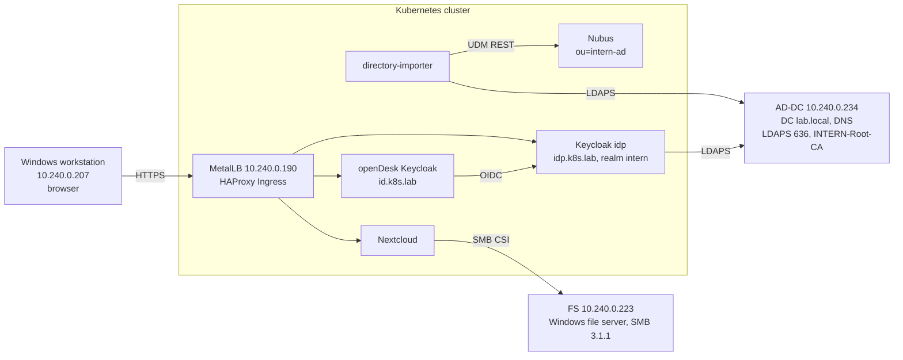

# 04 – Active Directory Integration and Single Sign-On

> Part 4 of the build series. Previous: [03 – openDesk deployment](03-opendesk-deployment.md) · Next: [05 – OX App Suite](05-ox-app-suite.md)

| Field | Value |
|---|---|
| Scope | Import AD users into Nubus, mount the Windows file server in Nextcloud, "Login with AD account" via Keycloak |
| Prerequisite | [03](03-opendesk-deployment.md): openDesk v1.17.2 running; existing AD domain `lab.local` and file server FS |
| Date | 08. – 09.10.2026 |
| Status | Directory Importer, file server integration and SSO working; first test account accepted in the browser |

> **Note:** All passwords and client secrets from the original documentation have been removed. The 500 AD users are generated test data.

## 0. Overview

### 0.1 Goal

This document is both a record of the work done and a guide for rebuilding it:

- **Parts A – D** (sections 1 – 20): step-by-step documentation of all commands and configurations.
- **Section 21:** access, IP addresses, certificates and important files.
- **Section 22:** errors that actually occurred, with cause and solution.
- **Section 23:** messages and states that look like errors but are normal.
- **Section 24:** operations, dates, open items and final checklist.

### 0.2 Architecture



**Login flow:** the user opens **portal.k8s.lab** and chooses "Login with AD account". The openDesk Keycloak (id.k8s.lab) forwards to a dedicated Keycloak **idp.k8s.lab** (realm `intern`), which checks the user name and password via LDAPS directly against AD-DC. After a successful login, the user returns to openDesk and is linked by email address to the Nubus account that the Directory Importer created.

### 0.3 Roles of the machines

| Machine | VM ID | IP | Role in this part |
|---|---|---|---|
| Proxmox host server1 | – | 192.0.2.10 | VM backups of AD-DC and FS (vzdump to pbs-backup) |
| jumphost | 100 | 10.240.0.226 / 192.0.2.15 | Jump host; SSH to AD-DC, FS and kubespray |
| kubespray | 104 | 10.240.0.200 | All cluster commands (user k8s) |
| AD-DC | 114 | 10.240.0.234 | Domain controller `lab.local`, DNS, AD CS (INTERN-Root-CA), LDAPS; OpenSSH (cmd.exe as default shell) |
| FS | 115 | 10.240.0.223 | File server, shares under `F:\Shares`; OpenSSH |
| master | 201 | 10.240.0.21 | Control plane + etcd (etcd backups via SSH) |
| node1 – node5 | 202 – 206 | 10.240.0.22 – .26 | Workers: importer, Keycloak, Nextcloud, SMB mounts |
| Windows workstation | – | 10.240.0.207 | Browser tests, Keycloak admin console |

### 0.4 Names

| Purpose | Value |
|---|---|
| AD domain / NetBIOS | `lab.local` / `INTERN` (`DC=lab,DC=local`) |
| User OU (subtree, 10 department OUs) | `OU=Benutzer,OU=Firma,DC=lab,DC=local` |
| Group OU | `OU=Gruppen,OU=Firma,DC=lab,DC=local` (22 `G-*`, 31 `DL-FS-*`) |
| Service account OU | `OU=Services,OU=Firma,DC=lab,DC=local` |
| Service accounts | `svc-nubus-import` (importer), `svc-nextcloud` (SMB), `svc-keycloak` (LDAP federation) |
| Service group for FS | `G-Nextcloud-Dienst` (member of all `DL-FS-*-RW` plus `DL-FS-Abteilungen-TR` and `DL-FS-Projekte-TR`, 22 groups) |
| Nubus target OU / LDAP base | `ou=intern-ad` / `dc=swp-ldap,dc=internal` |
| Nubus mail domains | `k8s.lab` (existing), `lab.local` (new) |
| Namespaces | `directory-importer`, `idp` (Keycloak), `opendesk`, `kube-system` (SMB driver) |
| Dedicated Keycloak / realm / client | `https://idp.k8s.lab/auth` · realm `intern` · client `opendesk` |
| IdP key in openDesk | `internIdP` → alias `sso-federation-idp-internIdP`, display name "Anmeldung mit AD-Konto" (Login with AD account) |
| Redirect URI | `https://id.k8s.lab/realms/opendesk/broker/sso-federation-idp-internIdP/endpoint` |
| SMB volumes in the Nextcloud pod | `/mnt/fs-allgemein`, `/mnt/fs-austausch`, `/mnt/fs-abteilungen`, `/mnt/fs-projekte` |
| Test accounts | 8 accounts from `C:\testkonten.txt` (AD-DC) or `~/testkonten.txt` (kubespray), section 5 |

### 0.5 Software versions

| Component | Version / value |
|---|---|
| openDesk | v1.17.2 (from [03](03-opendesk-deployment.md)) |
| Kubernetes / node kernel | v1.36.4 / 6.8.0-146-generic |
| Directory Importer (chart, OCI) | 1.7.2 – `artifacts.software-univention.de/nubus-dev/charts/directory-importer` |
| SMB CSI driver (chart) | csi-driver-smb 1.20.3 |
| Extra package on all nodes | `linux-modules-extra-6.8.0-146-generic` (kernel module `nls_utf8`) |
| Nextcloud chart / app files_external | opendesk-nextcloud 4.10.2 / files_external 1.24.1 |
| Keycloak (idp) | Chart codecentric/keycloakx 7.3.1, Keycloak 26.7.3 |
| PostgreSQL for Keycloak | postgres:16.4, 8 GiB on Longhorn |
| opendesk-keycloak-bootstrap (chart) | 2.9.0 (revision 2 after the change) |
| Helper images | alpine:3.20, busybox:1.36, curlimages/curl:8.10.1 |

### 0.6 What changed compared to the earlier (kubeadm) guide

| Topic | Earlier guide | This environment |
|---|---|---|
| Where commands run | k8s-master, user `jumpuser` | kubespray VM, user `k8s`; master only via SSH for etcd |
| AD/FS preparation | Had to be done completely | Already in place (inventory in section 3); only passwords and test accounts checked |
| etcd snapshot | `/etc/kubernetes/pki/etcd`, 127.0.0.1 | `/etc/ssl/etcd/ssl/admin-master*.pem`, `https://10.240.0.21:2379` |
| DNS in the cluster | Search `lab.local`, CoreDNS `policy sequential` | `external_zones` (`k8s.lab`, `lab.local` → AD-DC) from [03](03-opendesk-deployment.md); FQDNs everywhere |
| VM ID of AD-DC | 122 | 114 (according to `qm list`) |
| VM backup | `vzdump --mode stop` | `vzdump --mode snapshot` to pbs-backup (DNS stays available) |
| Kernel module `nls_utf8` | Not mentioned | `linux-modules-extra` needed on all nodes (error F7) |
| `helm install` | Without timeout | Always `--timeout 10m --wait`, then `helm list -a` |
| Keycloak DB / admin passwords | Typed in with `read` | Generated with `openssl rand`, stored in `~/keycloak-*-password.txt` (chmod 600) |
| Keycloak client correction | – | Via the admin REST API (section 19.4) |
| openDesk CA | Valid until 24.12.2026 | Valid until 06.01.2027 |

### 0.7 Conventions

Same conventions as in [01](01-proxmox-cloud-init-template.md#04-conventions). In addition:

- The SSH login on AD-DC and FS opens **cmd.exe**. Always type `powershell` first before PowerShell commands.
- Variables like `$L`, `$OCC`, `$U` only exist in the current session; set them again after a new login.
- Times in Linux logs are UTC (13:45 UTC = 15:45 CEST).
- Never copy passwords into a chat, a ticket or a log.

### 0.8 Steps

| Section | Topic | Run on |
|---|---|---|
| 1 – 2 | Pre-check, DNS and ports | kubespray (k8s) |
| 3 | Inventory of AD-DC and FS | AD-DC, FS (PowerShell) |
| 4 | Backups (VM, etcd) | Proxmox (root), kubespray |
| 5 | Root CA, passwords, test accounts | AD-DC, kubespray |
| 6 – 8 | Part B: Directory Importer | kubespray |
| 9 – 15 | Part C: SMB driver, volumes, Nextcloud mounts | kubespray |
| 16 – 20 | Part D: Keycloak, LDAP federation, SSO, acceptance | kubespray, browser, AD-DC |
| 21 – 24 | Access, errors, normal behavior, operations | – |

---

# Part A – Preparation

## 1. Pre-check

**Run on:** kubespray VM as k8s (from jumphost: `ssh 10.240.0.200`)

```bash
cd ~/opendesk
git describe --tags
git status --short
kubectl get nodes
kubectl get ns | grep -E 'opendesk|idp|directory-importer'
kubectl get csidriver smb.csi.k8s.io
which jq || sudo apt-get install -y jq
openssl x509 -in ~/opendesk-ca.crt -noout -subject -enddate -fingerprint -sha256
```

Result on 08.10.2026:

| Check | Result |
|---|---|
| `git describe --tags` | v1.17.2 |
| `git status --short` | No output (`dev/*.yaml.gotmpl` excluded by `.gitignore`) |
| Nodes | 6 × Ready, v1.36.4 |
| Namespaces | Only `opendesk` |
| csidriver `smb.csi.k8s.io` | NotFound (correct, installed in section 9) |
| jq | `/usr/bin/jq` present |
| openDesk CA | CN = k8s.lab, notAfter = Jan 6 10:01:30 2027 GMT |

## 2. Name resolution and ports

The importer, Nextcloud and Keycloak run as pods. That is why the names are checked from inside a pod (nodelocaldns 169.254.25.10 → external_zones → AD-DC).

**Run on:** kubespray VM as k8s

```bash
kubectl run dnstest --image=alpine:3.20 --restart=Never --command -- sh -c \
  'getent hosts AD-DC.lab.local; getent hosts FS.lab.local; getent hosts idp.k8s.lab; nslookup -type=SRV _ldap._tcp.dc._msdcs.lab.local'
sleep 20
kubectl logs dnstest
kubectl delete pod dnstest
```

```
10.240.0.234      AD-DC.lab.local  AD-DC.lab.local
10.240.0.223      FS.lab.local  FS.lab.local
10.240.0.190      idp.k8s.lab  idp.k8s.lab
_ldap._tcp.dc._msdcs.lab.local  service = 0 100 389 ad-dc.lab.local
```

```bash
getent hosts AD-DC.lab.local FS.lab.local
nc -zv -w 3 AD-DC.lab.local 389
nc -zv -w 3 AD-DC.lab.local 636
nc -zv -w 3 10.240.0.223 445
```

✔ **Expected:** `AD-DC.lab.local` → 10.240.0.234, `FS.lab.local` → 10.240.0.223, `idp.k8s.lab` → 10.240.0.190 (wildcard), SRV record pointing to `ad-dc.lab.local:389`; ports 389, 636 and 445 "succeeded". Port 636 was already open because AD CS had been installed in an earlier phase.

## 3. Inventory of AD-DC and FS

**Run on:** AD-DC via SSH from jumphost, then start PowerShell

```bash
ssh "lab.local\administrator"@10.240.0.234
```

```powershell
powershell
$b = "OU=Benutzer,OU=Firma,DC=lab,DC=local"
$g = "OU=Gruppen,OU=Firma,DC=lab,DC=local"
"NetBIOS:        " + (Get-ADDomain).NetBIOSName
"Users:          " + (Get-ADUser -SearchBase $b -Filter *).Count
"G groups:       " + (Get-ADGroup -SearchBase $g -Filter 'Name -like "G-*"').Count
"DL-FS groups:   " + (Get-ADGroup -SearchBase $g -Filter 'Name -like "DL-FS-*"').Count
"With mail:      " + (Get-ADUser -SearchBase $b -Filter * -Properties mail | Where-Object mail).Count
Get-WindowsFeature ADCS-Cert-Authority | Select-Object Name, InstallState
Get-ADOrganizationalUnit -Filter 'Name -eq "Services"' | Select-Object DistinguishedName
Get-ADUser -Filter 'Name -like "svc-*"' | Select-Object SamAccountName, Enabled
$ng = Get-ADGroup -Filter 'Name -eq "G-Nextcloud-Dienst"'
if ($ng) { "G-Nextcloud-Dienst member of: " + (Get-ADPrincipalGroupMembership $ng).Count } else { "G-Nextcloud-Dienst: not found" }
"testkonten.txt exists: " + (Test-Path C:\testkonten.txt)
Get-ChildItem Cert:\LocalMachine\My | Select-Object Subject, NotAfter
```

**Run on:** FS (`ssh "lab.local\administrator"@10.240.0.223`, then `powershell`)

```powershell
Get-SmbShare | Where-Object Path -like 'F:\Shares*' | Select-Object Name, Path, FolderEnumerationMode
Get-ChildItem F:\Shares\Abteilungen, F:\Shares\Projekte -Directory | Select-Object FullName
foreach ($s in "Allgemein","Austausch","Abteilungen","Projekte") {
  Get-SmbShareAccess -Name $s | Select-Object Name, AccountName, AccessRight }
```

Result on 08.10.2026 – the AD and FS side from an earlier phase was complete:

| Area | Finding | Consequence |
|---|---|---|
| Users / groups | INTERN, 500 users, 22 G groups, 31 DL-FS groups | As documented |
| Email addresses | 500 accounts with `mail` | Setting addresses not needed |
| AD CS | ADCS-Cert-Authority installed; CN=INTERN-Root-CA until 28.09.2036; CN=AD-DC.lab.local until 28.09.2027 | CA setup not needed |
| OU Services, service accounts | Present; svc-keycloak, svc-nextcloud, svc-nubus-import enabled | Account creation not needed |
| G-Nextcloud-Dienst | Member of 22 groups | Not needed |
| `C:\testkonten.txt` | Present | Only checked (section 5) |
| FS shares | Abteilungen, Allgemein, Austausch, Home$, Projekte – all AccessBased | As documented |
| FS folders | 10 under Abteilungen, 7 under Projekte | As documented |
| Share permissions per share | NT AUTHORITY\Authenticated Users Full and INTERN\G-Nextcloud-Dienst Change | Share setup not needed |

## 4. Backups before the changes

### 4.1 VM backup of AD-DC and FS

**Run on:** Proxmox host server1 as root (`ssh root@192.0.2.10`)

```bash
qm list | grep -Ei 'ad-dc|fs'
pvesm status | grep -i pbs
vzdump 114 115 --mode snapshot --storage pbs-backup --notes-template "{{guestname}} before AD integration (Kubespray)"
```

✔ **Expected:** "Finished Backup of VM 114 (00:12:50)", "Finished Backup of VM 115 (00:00:33)", "Backup job finished successfully". Archives `vm/114/2026-10-08T13:22:27Z` and `vm/115/2026-10-08T13:35:17Z` on pbs-backup.

> **Note:** `--mode snapshot` backs up while the VM keeps running, so AD-DC stays reachable as DNS server. The backup is crash-consistent because filesystem freeze is disabled in the VM options (section 23).

### 4.2 etcd snapshot

**Run on:** kubespray VM as k8s – run each line on its own, without line breaks

```bash
ssh k8s@10.240.0.21 "sudo etcdctl --endpoints=https://10.240.0.21:2379 --cacert=/etc/ssl/etcd/ssl/ca.pem --cert=/etc/ssl/etcd/ssl/admin-master.pem --key=/etc/ssl/etcd/ssl/admin-master-key.pem snapshot save /var/backups/etcd/vor-ad-anbindung.db"
ssh k8s@10.240.0.21 "sudo etcdutl --write-out=table snapshot status /var/backups/etcd/vor-ad-anbindung.db"
ssh k8s@10.240.0.21 "sudo cat /var/backups/etcd/vor-ad-anbindung.db" > ~/backups/etcd/vor-ad-anbindung-$(date +%F-%H%M).db
chmod 600 ~/backups/etcd/*.db
ls -lh ~/backups/etcd/
```

```
+----------+----------+------------+------------+---------+
|   HASH   | REVISION | TOTAL KEYS | TOTAL SIZE | VERSION |
+----------+----------+------------+------------+---------+
| f04a1b89 |   233980 |       1710 |      44 MB |   3.6.0 |
+----------+----------+------------+------------+---------+
```

✔ **Expected:** copy `~/backups/etcd/vor-ad-anbindung-2026-10-08-1325.db` (43M); four snapshot files in the directory afterwards.

## 5. Root CA, passwords and test accounts

### 5.1 On AD-DC

**Run on:** AD-DC, PowerShell (prompt `PS C:\Users\Administrator>`)

```powershell
certutil -f "-ca.cert" C:\intern-root-ca.cer
certutil -f -encode C:\intern-root-ca.cer C:\intern-root-ca.pem
```

Check the passwords of the three service accounts (input is hidden):

```powershell
foreach ($n in "svc-nubus-import","svc-nextcloud","svc-keycloak") {
  $pw = Read-Host -AsSecureString "Password $n"
  $plain = [Runtime.InteropServices.Marshal]::PtrToStringBSTR([Runtime.InteropServices.Marshal]::SecureStringToBSTR($pw))
  try {
    $r = (New-Object System.DirectoryServices.DirectoryEntry("LDAP://AD-DC.lab.local", "$n@lab.local", $plain)).name
    if ($r) { "{0,-18} OK" -f $n } else { "{0,-18} ERROR" -f $n }
  } catch { "{0,-18} ERROR: {1}" -f $n, $_.Exception.InnerException.Message }
  Remove-Variable plain, pw
}
```

✔ **Expected:** `svc-nubus-import OK`, `svc-nextcloud OK`, `svc-keycloak OK`.

```powershell
Get-Content C:\testkonten.txt
Get-Content C:\testkonten.txt | ForEach-Object { ($_ -split ';')[1] } | ForEach-Object { Get-ADUser $_ -Properties pwdLastSet, mail | Select-Object SamAccountName, mail, @{n='ChangeAtLogon';e={$_.pwdLastSet -eq 0}} }
```

Content of `testkonten.txt` (role; login name; G groups):

```
G-Produktion-Mitarbeiter;alexander.braun;G-Alle-Mitarbeiter,G-Drucker-Halle,G-Produktion-Mitarbeiter
G-Vertrieb-Mitarbeiter;alexander.lorenz;G-Alle-Mitarbeiter,G-CRM-Zugriff,G-Vertrieb-Mitarbeiter,G-VPN
G-Geschaeftsleitung;daniel.weber;G-Alle-Mitarbeiter,G-Geschaeftsleitung,G-Vertraulich,G-VPN
G-IT-Mitarbeiter;antje.wolf;G-Alle-Mitarbeiter,G-IT-Mitarbeiter,G-Softwareverteilung,G-VPN
G-Entwicklung-Mitarbeiter;alexander.martin;G-Alle-Mitarbeiter,G-Entwicklung-Mitarbeiter,G-Quellcode,G-VPN
G-Personal-Mitarbeiter;alexander.winter;G-Alle-Mitarbeiter,G-Personalakten,G-Personal-Mitarbeiter
Namesake with digit;andrea.krause1;G-Alle-Mitarbeiter,G-Marketing-Mitarbeiter,G-Social-Media
Namesake without digit;andrea.krause;G-Alle-Mitarbeiter,G-Marketing-Mitarbeiter,G-Social-Media
```

All eight accounts had an `@lab.local` address and no forced password change (`ChangeAtLogon = False`).

### 5.2 On the kubespray VM

**Run on:** kubespray VM as k8s

```bash
cd ~
scp 'lab.local\administrator@AD-DC.lab.local:C:/intern-root-ca.pem' ~/intern-root-ca.pem
scp 'lab.local\administrator@AD-DC.lab.local:C:/testkonten.txt' ~/testkonten.txt
sed -i 's/\r$//' ~/intern-root-ca.pem ~/testkonten.txt
iconv -f UTF-16 -t UTF-8 ~/testkonten.txt | tr -d '\r' > ~/testkonten.tmp && mv ~/testkonten.tmp ~/testkonten.txt
file ~/testkonten.txt
grep -c $'\r' ~/intern-root-ca.pem
openssl x509 -in ~/intern-root-ca.pem -noout -subject -enddate
openssl s_client -connect AD-DC.lab.local:636 -servername AD-DC.lab.local -CAfile ~/intern-root-ca.pem </dev/null 2>/dev/null | grep -E 'subject=|issuer=|Verify return code'
```

✔ **Expected:** `file` → ASCII text (after iconv; before it was UTF-16, error F4); `grep -c` → 0; subject `DC=local, DC=lab, CN=INTERN-Root-CA`, notAfter Sep 28 06:31:29 2036 GMT; s_client: subject `CN=AD-DC.lab.local`, issuer INTERN-Root-CA, `Verify return code: 0 (ok)`.

> **Note:** On the first scp, SSH asks about the host key of AD-DC. The password is the one of the domain administrator.

---

# Part B – Directory Importer (AD → Nubus)

## 6. Secrets, target OU and mail domain

**Run on:** kubespray VM as k8s, everything in the same session (`UDM_PW` is reused)

```bash
kubectl create namespace directory-importer
kubectl -n directory-importer create secret generic ad-root-ca --from-file=ca-certificates-ad.crt=$HOME/intern-root-ca.pem
read -rsp "Password svc-nubus-import: " AD_PW; echo
kubectl -n directory-importer create secret generic ad-bind-credentials --from-literal=password="$AD_PW"
unset AD_PW
UDM_PW=$(kubectl -n opendesk get secret ums-nubus-credentials -o jsonpath='{.data.administrator_password}' | base64 -d)
kubectl -n directory-importer create secret generic udm-credentials --from-literal=password="$UDM_PW"
kubectl -n directory-importer get secret ad-bind-credentials -o jsonpath='{.data.password}' | base64 -d | wc -c   # length of the AD password
kubectl -n directory-importer get secret udm-credentials -o jsonpath='{.data.password}' | base64 -d | wc -c       # length of the Nubus password
```

Create the target OU `ou=intern-ad` and the mail domain `lab.local` in Nubus:

```bash
kubectl -n directory-importer run udmpost --image=curlimages/curl:8.10.1 \
  --restart=Never --command --env="PW=$UDM_PW" -- \
  sh -c 'curl -sS -i -u "Administrator:$PW" \
    -H "Accept: application/json" -H "Content-Type: application/json" \
    -X POST -d "{\"properties\":{\"name\":\"intern-ad\"},\"position\":\"dc=swp-ldap,dc=internal\"}" \
    http://ums-udm-rest-api.opendesk.svc.cluster.local:9979/univention/udm/container/ou/'
kubectl -n directory-importer wait --for=jsonpath='{.status.phase}'=Succeeded pod/udmpost --timeout=60s
kubectl -n directory-importer logs udmpost | head -3
kubectl -n directory-importer delete pod udmpost

kubectl -n directory-importer run udmmail --image=curlimages/curl:8.10.1 \
  --restart=Never --command --env="PW=$UDM_PW" -- \
  sh -c 'curl -sS -i -u "Administrator:$PW" \
    -H "Accept: application/json" -H "Content-Type: application/json" \
    -X POST -d "{\"properties\":{\"name\":\"lab.local\"}}" \
    http://ums-udm-rest-api.opendesk.svc.cluster.local:9979/univention/udm/mail/domain/'
kubectl -n directory-importer wait --for=jsonpath='{.status.phase}'=Succeeded pod/udmmail --timeout=60s
kubectl -n directory-importer logs udmmail | head -3
kubectl -n directory-importer delete pod udmmail
unset UDM_PW
```

✔ **Expected:** twice `HTTP/1.1 201 Created`.

> **Note:** The importer owns `ou=intern-ad` exclusively: it deletes objects created there by hand. The mail domain `lab.local` is required, otherwise Nubus rejects every `mailPrimaryAddress` `@lab.local` with 422.

## 7. Configuration and rollout

**Run on:** kubespray VM as k8s, in `~`

```bash
mkdir -p ~/directory-importer
cat > ~/directory-importer/custom-values.yaml <<'EOF'
sourceDirectory:
  auth:
    existingSecret:
      name: "ad-bind-credentials"
      keyMapping:
        password: "password"
udm:
  auth:
    existingSecret:
      name: "udm-credentials"
      keyMapping:
        password: "password"
config:
  logLevel: "INFO"
  repeat: true
  repeatDelay: 300
configFile:
  udm:
    uri: "http://ums-udm-rest-api.opendesk.svc.cluster.local:9979/univention/udm/"
    user: "Administrator"
    skip_writes: false
    user_ou: "ou=intern-ad"
    group_ou: "ou=intern-ad"
    user_primary_key_property: "univentionObjectIdentifier"
    group_primary_key_property: "univentionObjectIdentifier"
    deletion_grace_period_days: 7
  source:
    ldap_uri: "ldaps://AD-DC.lab.local"
    bind_dn: "svc-nubus-import@lab.local"
    ca_cert: "/etc/ssl/ad/ca-certificates-ad.crt"
    timeout: 5
    search_pagesize: 500
    user_base: "OU=Benutzer,OU=Firma,DC=lab,DC=local"
    user_scope: "sub"
    user_filter: "(&(objectClass=user)(sAMAccountType=805306368)(givenName=*)(sn=*)(!(userAccountControl:1.2.840.113556.1.4.803:=2)))"
    user_attrs:
      - "objectGUID"
      - "sAMAccountName"
      - "givenName"
      - "sn"
      - "mail"
      - "description"
    user_trans:
      sanitizer:
        objectGUID:
          - univention.directory_importer.sanitize:guid2uuid
        mail:
          - univention.directory_importer.sanitize:mail_sanitizer
          - bytes.lower
      rename_attrs:
        univentionObjectIdentifier: "objectGUID"
        username: "sAMAccountName"
        firstname: "givenName"
        lastname: "sn"
        "e-mail": "mail"
      compose_attrs:
        mailPrimaryAddress:
          - "{e-mail}"
          - "{username}@lab.local"
      remove_attrs:
        - "objectGUID"
    group_base: "OU=Gruppen,OU=Firma,DC=lab,DC=local"
    group_scope: "sub"
    group_filter: "(&(objectClass=group)(cn=G-*))"
    group_attrs:
      - "objectGUID"
      - "cn"
      - "description"
      - "member"
    group_trans:
      sanitizer:
        objectGUID:
          - univention.directory_importer.sanitize:guid2uuid
      rename_attrs:
        univentionObjectIdentifier: "objectGUID"
        name: "cn"
        users: "member"
      remove_attrs:
        - "objectGUID"
extraVolumes:
  - name: "ad-ca"
    secret:
      secretName: "ad-root-ca"
extraVolumeMounts:
  - name: "ad-ca"
    mountPath: "/etc/ssl/ad"
    readOnly: true
EOF
yq eval '.' ~/directory-importer/custom-values.yaml > /dev/null && echo "YAML OK"
helm upgrade --install directory-importer \
  oci://artifacts.software-univention.de/nubus-dev/charts/directory-importer \
  --version 1.7.2 --namespace directory-importer \
  --values ~/directory-importer/custom-values.yaml \
  --timeout 10m --wait
helm -n directory-importer list -a
kubectl -n directory-importer get pods -o wide
```

✔ **Expected:** `YAML OK`; release `directory-importer` deployed (revision 1, 08.10.2026 13:45:54 UTC); pod `1/1 Running` on node2; "Added users/user …" lines in the log.

| Setting | Meaning |
|---|---|
| `user_scope: sub` | Searches the ten department OUs below `OU=Benutzer` |
| `user_filter` | Only enabled user accounts with first and last name |
| `group_filter: cn=G-*` | Only the 22 global groups; the DL-FS groups only contain groups (AGDLP) and would arrive empty |
| `compose_attrs mailPrimaryAddress` | `mail` from AD, otherwise `<login name>@lab.local` |
| `repeatDelay: 300` | Sync every 5 minutes |
| `deletion_grace_period_days: 7` | Objects removed from AD are deleted only after 7 days |
| `OU=Services` | Outside both search bases – service accounts and `G-Nextcloud-Dienst` are not imported |

## 8. Acceptance of the importer

The first run took about 13 minutes (approx. 1.4 s per account, 13:46 – 13:59 UTC). Watch the progress:

```bash
watch -n 30 'kubectl -n directory-importer logs deployment/directory-importer --tail=-1 | grep -cE "Added (users/user|groups/group)"; kubectl -n directory-importer logs deployment/directory-importer --tail=1 | cut -c1-120'
```

After the first run ("Sleeping 300 seconds") count – refill `$L` first (error F5):

```bash
L=$(kubectl -n directory-importer logs deployment/directory-importer --tail=-1)
echo "$L" | grep -c "Added users/user"
echo "$L" | grep -c "Added groups/group"
echo "$L" | grep -iE "error|traceback|status=4" | cut -c1-200 | head -10
```

Result: 499 users, 22 groups, one 422 "Password policy error" for nicole.berger (error F6). Wait for the second cycle and check:

```bash
until [ "$(kubectl -n directory-importer logs deployment/directory-importer --tail=-1 | grep -c 'Sleeping 300')" -ge 2 ]; do sleep 20; done; echo "Cycle 2 done"
kubectl -n directory-importer logs deployment/directory-importer --since=5m | grep -E "Added|Modified|ERROR|Sleeping" | cut -c1-160
L=$(kubectl -n directory-importer logs deployment/directory-importer --tail=-1)
echo "$L" | grep -c "Added users/user"
```

```
INFO Added users/user entry uid=nicole.berger,ou=intern-ad,...
INFO Modified groups/group entry cn=G-Alle-Mitarbeiter,...
INFO Modified groups/group entry cn=G-Drucker-Halle,...
INFO Modified groups/group entry cn=G-Produktion-Mitarbeiter,...
INFO Sleeping 300 seconds
500
```

✔ **Expected:** Part B complete: 500 users and 22 groups in Nubus; nicole.berger added in the second cycle and added to G-Alle-Mitarbeiter, G-Drucker-Halle and G-Produktion-Mitarbeiter.

---

# Part C – File server FS in Nextcloud

## 9. SMB CSI driver, user ID and SMB secret

**Run on:** kubespray VM as k8s

```bash
helm repo add csi-driver-smb https://raw.githubusercontent.com/kubernetes-csi/csi-driver-smb/master/charts
helm repo update csi-driver-smb
helm install csi-driver-smb csi-driver-smb/csi-driver-smb --namespace kube-system --version 1.20.3 --timeout 10m --wait
helm -n kube-system list -a | grep csi
kubectl -n kube-system get pods -o wide | grep csi-smb
kubectl get csidriver smb.csi.k8s.io
```

✔ **Expected:** release `csi-driver-smb` deployed; csi-smb-controller `4/4 Running` (on the master), six csi-smb-node `3/3 Running` (one restart each on first start); csidriver `smb.csi.k8s.io` present.

```bash
NCPOD=$(kubectl -n opendesk get pod -l app.kubernetes.io/name=aio --field-selector=status.phase=Running -o jsonpath='{.items[0].metadata.name}')
kubectl -n opendesk exec $NCPOD -- id          # uid=101(nginx) gid=101(nginx)
read -rsp "Password svc-nextcloud: " SMB_PW; echo
kubectl -n opendesk create secret generic smb-fs-creds \
  --from-literal=username='svc-nextcloud' \
  --from-literal=password="$SMB_PW" \
  --from-literal=domain='INTERN'
unset SMB_PW
kubectl -n opendesk get secret smb-fs-creds -o jsonpath='{.data.password}' | base64 -d | wc -c   # length of the password
```

## 10. Kernel module nls_utf8 on all nodes

The first write test (section 11) got stuck in `ContainerCreating`. Cause: the mount option `iocharset=utf8` needs the kernel module `nls_utf8`, which is missing in the Ubuntu cloud image (error F7).

**Run on:** kubespray VM as k8s, in `~/kubespray`

Diagnosis:

```bash
ansible -i inventory/mycluster/inventory.ini node4 -b -m shell -a "dmesg | grep -iE 'cifs|nls' | tail -8"
ansible -i inventory/mycluster/inventory.ini all -b -m shell -a "modinfo -n nls_utf8 2>&1 | head -1; dpkg -l | grep -c '^ii  linux-modules-extra'; true" -o
```

dmesg showed "CIFS: VFS: CIFS mount error: iocharset utf8 not found", all nodes reported "Module nls_utf8 not found" and 0 installed `linux-modules-extra`. Solution (one line):

```bash
cd ~/kubespray
ansible -i inventory/mycluster/inventory.ini all -b -m shell -a "apt-get update -qq && DEBIAN_FRONTEND=noninteractive apt-get install -y -qq linux-modules-extra-\$(uname -r) >/dev/null && modprobe nls_utf8 && echo nls_utf8 > /etc/modules-load.d/nls_utf8.conf && echo \$(uname -r) nls_utf8=\$(lsmod | grep -c '^nls_utf8')" -o
```

✔ **Expected:** "6.8.0-146-generic nls_utf8=1" on every node. `/etc/modules-load.d/nls_utf8.conf` loads the module on every boot.

> **Important:** `linux-modules-extra` only applies to the currently running kernel. After every kernel update with reboot, the command must run again – otherwise `nls_utf8` is missing, the SMB mounts fail and Nextcloud does not start (stuck in `ContainerCreating`). Check in section 24.2.

## 11. PersistentVolumes and write test

**Run on:** kubespray VM as k8s, in `~`

```bash
: > ~/smb-fs.yaml
for s in Allgemein Austausch Abteilungen Projekte; do
  n=$(echo "$s" | tr 'A-Z' 'a-z')
  cat >> ~/smb-fs.yaml <<EOF
---
apiVersion: v1
kind: PersistentVolume
metadata:
  name: pv-fs-$n
spec:
  capacity:
    storage: 100Gi
  accessModes: ["ReadWriteMany"]
  persistentVolumeReclaimPolicy: Retain
  storageClassName: ""
  mountOptions:
    - dir_mode=0770
    - file_mode=0770
    - uid=101
    - gid=101
    - noserverino
    - vers=3.1.1
    - iocharset=utf8
  csi:
    driver: smb.csi.k8s.io
    volumeHandle: fs-$n
    volumeAttributes:
      source: //10.240.0.223/$s
    nodeStageSecretRef:
      name: smb-fs-creds
      namespace: opendesk
---
apiVersion: v1
kind: PersistentVolumeClaim
metadata:
  name: pvc-fs-$n
  namespace: opendesk
spec:
  accessModes: ["ReadWriteMany"]
  storageClassName: ""
  volumeName: pv-fs-$n
  resources:
    requests:
      storage: 100Gi
EOF
done
grep -c 'kind: PersistentVolume$' ~/smb-fs.yaml        # 4
kubectl apply -f ~/smb-fs.yaml
kubectl -n opendesk get pvc pvc-fs-allgemein pvc-fs-austausch pvc-fs-abteilungen pvc-fs-projekte
```

✔ **Expected:** 4 PersistentVolumes; four PVCs `Bound`.

Write test as uid 101 in all 20 folders (the roots `Abteilungen` and `Projekte` only allow traversal, so the folders are listed explicitly):

```bash
cat <<'EOF' | kubectl apply -f -
apiVersion: v1
kind: Pod
metadata:
  name: smbtest
  namespace: opendesk
spec:
  restartPolicy: Never
  securityContext:
    runAsUser: 101
    runAsGroup: 101
  containers:
    - name: t
      image: busybox:1.36
      command:
        - sh
        - -c
        - |
          for p in allgemein austausch \
                   abteilungen/Buchhaltung abteilungen/Einkauf abteilungen/Entwicklung \
                   abteilungen/Geschaeftsleitung abteilungen/IT abteilungen/Logistik \
                   abteilungen/Marketing abteilungen/Personal abteilungen/Personal/Personalakten \
                   abteilungen/Produktion abteilungen/Vertrieb \
                   projekte/CRM projekte/DATEV projekte/Lager projekte/Lieferanten \
                   projekte/Quellcode projekte/Social-Media projekte/Vertraulich; do
            if touch "/mnt/$p/.nc-test" 2>/dev/null && rm "/mnt/$p/.nc-test"
            then echo "OK      $p"; else echo "FAILED  $p"; fi
          done
      volumeMounts:
        - { name: allgemein,   mountPath: /mnt/allgemein }
        - { name: austausch,   mountPath: /mnt/austausch }
        - { name: abteilungen, mountPath: /mnt/abteilungen }
        - { name: projekte,    mountPath: /mnt/projekte }
  volumes:
    - { name: allgemein,   persistentVolumeClaim: { claimName: pvc-fs-allgemein } }
    - { name: austausch,   persistentVolumeClaim: { claimName: pvc-fs-austausch } }
    - { name: abteilungen, persistentVolumeClaim: { claimName: pvc-fs-abteilungen } }
    - { name: projekte,    persistentVolumeClaim: { claimName: pvc-fs-projekte } }
EOF
kubectl -n opendesk wait --for=jsonpath='{.status.phase}'=Succeeded pod/smbtest --timeout=180s
kubectl -n opendesk logs smbtest
kubectl -n opendesk logs smbtest | grep -c '^OK'          # 20
kubectl -n opendesk delete pod smbtest
```

✔ **Expected:** 20 lines `OK` (09.10.2026, after section 10), then `20`.

> **Note:** If the pod is stuck in `ContainerCreating`, do NOT delete it – first check `kubectl -n opendesk describe pod smbtest | tail -15` (error F8).

## 12. Mount the volumes into the Nextcloud pod

This is the only change to a versioned file in the openDesk repository. The replacement works with line numbers, so check them first.

**Run on:** kubespray VM as k8s, in `~/opendesk`

```bash
cd ~/opendesk
F=helmfile/apps/nextcloud/values-nextcloud.yaml.gotmpl
cp "$F" ~/values-nextcloud.yaml.gotmpl.orig
grep -n -E 'extraVolumes:|extraVolumeMounts:|certificate.selfSigned' "$F"
awk 'NR>=156 && NR<=172 {printf "%3d: %s\n", NR, $0}' "$F"
```

✔ **Expected:** line 158 `{{- if .Values.certificate.selfSigned }}`, 159 `extraVolumes:`, 166 `extraVolumeMounts:`, 170 `{{- end }}`.

```bash
cat > /tmp/nc-volumes.yaml <<'EOF'
  extraVolumes:
    {{- if .Values.certificate.selfSigned }}
    - name: "trusted-cert-secret-volume"
      secret:
        secretName: "opendesk-certificates-ca-tls"
        items:
          - key: "ca.crt"
            path: "ca-certificates.crt"
    {{- end }}
    - name: "fs-allgemein"
      persistentVolumeClaim:
        claimName: "pvc-fs-allgemein"
    - name: "fs-austausch"
      persistentVolumeClaim:
        claimName: "pvc-fs-austausch"
    - name: "fs-abteilungen"
      persistentVolumeClaim:
        claimName: "pvc-fs-abteilungen"
    - name: "fs-projekte"
      persistentVolumeClaim:
        claimName: "pvc-fs-projekte"
  extraVolumeMounts:
    {{- if .Values.certificate.selfSigned }}
    - name: "trusted-cert-secret-volume"
      mountPath: "/etc/ssl/certs/ca-certificates.crt"
      subPath: "ca-certificates.crt"
    {{- end }}
    - name: "fs-allgemein"
      mountPath: "/mnt/fs-allgemein"
    - name: "fs-austausch"
      mountPath: "/mnt/fs-austausch"
    - name: "fs-abteilungen"
      mountPath: "/mnt/fs-abteilungen"
    - name: "fs-projekte"
      mountPath: "/mnt/fs-projekte"
EOF
sed -i -e '157r /tmp/nc-volumes.yaml' -e '158,170d' "$F"
git -C ~/opendesk diff --stat          # 1 file changed, 24 insertions(+), 2 deletions(-)
```

✔ **Expected:** `1 file changed, 24 insertions(+), 2 deletions(-)`. The condition now sits inside the lists, so the four mounts stay in place even with real certificates.

Roll out (Nextcloud restarts and is unavailable for a few minutes):

```bash
tmux new -s opendesk
```

```bash
cd ~/opendesk
export MASTER_PASSWORD="$(cat ~/opendesk-master-password.txt)"
echo "${#MASTER_PASSWORD}"             # 44
helmfile -e dev apply -n opendesk -l name=opendesk-nextcloud 2>&1 | tee ~/opendesk-apply-nextcloud.log
kubectl -n opendesk get pods -l app.kubernetes.io/name=aio
NCPOD=$(kubectl -n opendesk get pod -l app.kubernetes.io/name=aio --field-selector=status.phase=Running -o jsonpath='{.items[0].metadata.name}')
for p in fs-allgemein fs-austausch fs-abteilungen/Vertrieb fs-projekte/CRM; do
  kubectl -n opendesk exec $NCPOD -- sh -c "touch /mnt/$p/.t && rm /mnt/$p/.t && echo $p OK"
done
git -C ~/opendesk diff > ~/opendesk-lokale-aenderungen.patch
ls -l ~/opendesk-lokale-aenderungen.patch      # 1803 bytes
```

✔ **Expected:** "Updated Releases: opendesk-nextcloud" (chart 4.10.2); one aio pod `1/1 Running`; four times `OK`; patch `~/opendesk-lokale-aenderungen.patch` (1803 bytes).

> **Important:** If FS is not reachable when the Nextcloud pod starts, Nextcloud does not start. Do not roll out `opendesk-nextcloud` while FS is under maintenance.

## 13. Enable files_external and release the groups

Nextcloud only reads groups with `opendeskFileshareEnabled=TRUE`. 18 groups are released; G-VPN, G-Drucker-Halle, G-Softwareverteilung and G-Personalakten stay invisible in Nextcloud.

**Run on:** kubespray VM as k8s, one session

```bash
NCPOD=$(kubectl -n opendesk get pod -l app.kubernetes.io/name=aio --field-selector=status.phase=Running -o jsonpath='{.items[0].metadata.name}')
OCC="kubectl -n opendesk exec $NCPOD -- php /var/www/html/occ"
$OCC app:enable files_external                   # files_external 1.24.1 enabled
$OCC group:list --output=json | jq -r 'to_entries[] | "\(.key)\t\(.value|length)"'
```

Before: admin 1, managed-by-attribute-Fileshare 500, managed-by-attribute-FileshareAdmin 0.

```bash
UDM_PW=$(kubectl -n opendesk get secret ums-nubus-credentials -o jsonpath='{.data.administrator_password}' | base64 -d)
kubectl -n directory-importer run udmcli --image=curlimages/curl:8.10.1 --restart=Never --command --env="PW=$UDM_PW" -- sleep 1800
unset UDM_PW
kubectl -n directory-importer wait --for=condition=Ready pod/udmcli --timeout=60s
U=http://ums-udm-rest-api.opendesk.svc.cluster.local:9979/univention/udm/groups/group
GROUP_LIST="G-Alle-Mitarbeiter G-Buchhaltung-Mitarbeiter G-CRM-Zugriff G-DATEV G-Einkauf-Mitarbeiter G-Entwicklung-Mitarbeiter G-Geschaeftsleitung G-IT-Mitarbeiter G-Lagerverwaltung G-Lieferantenportal G-Logistik-Mitarbeiter G-Marketing-Mitarbeiter G-Personal-Mitarbeiter G-Produktion-Mitarbeiter G-Quellcode G-Social-Media G-Vertraulich G-Vertrieb-Mitarbeiter"
echo $GROUP_LIST | wc -w                         # 18
for g in $GROUP_LIST; do
  dn="cn%3D${g}%2Cou%3Dintern-ad%2Cdc%3Dswp-ldap%2Cdc%3Dinternal"
  kubectl -n directory-importer exec udmcli -- sh -c \
    "curl -sS -o /dev/null -w '$g %{http_code}\n' -u \"Administrator:\$PW\" \
     -H 'Accept: application/json' -H 'Content-Type: application/json' \
     -X PATCH -d '{\"properties\":{\"opendeskFileshareEnabled\":true}}' $U/$dn"
done
```

✔ **Expected:** 18 lines "… 204".

Checked again after two importer cycles – the value is kept. Visibility in Nextcloud:

```bash
kubectl -n directory-importer exec udmcli -- sh -c \
  "curl -sS -u \"Administrator:\$PW\" -H 'Accept: application/json' \
   '$U/?filter=cn%3DG-*&properties=name&properties=opendeskFileshareEnabled'" \
  | jq -r '._embedded["udm:object"][] | "\(.properties.name)\t\(.properties.opendeskFileshareEnabled)"' | sort
$OCC ldap:search --group "G-" --limit 50 | wc -l                 # 18
$OCC group:list --output=json > /tmp/nc-groups.json
jq -r 'to_entries[] | "\(.key)\t\(.value|length)"' /tmp/nc-groups.json | sort
kubectl -n directory-importer delete pod udmcli
```

| Group | Members | Group | Members |
|---|---|---|---|
| G-Alle-Mitarbeiter | 500 | G-Lieferantenportal | 23 |
| G-Buchhaltung-Mitarbeiter | 43 | G-Logistik-Mitarbeiter | 68 |
| G-CRM-Zugriff | 87 | G-Marketing-Mitarbeiter | 38 |
| G-DATEV | 43 | G-Personal-Mitarbeiter | 23 |
| G-Einkauf-Mitarbeiter | 23 | G-Produktion-Mitarbeiter | 121 |
| G-Entwicklung-Mitarbeiter | 53 | G-Quellcode | 53 |
| G-Geschaeftsleitung | 7 | G-Social-Media | 38 |
| G-IT-Mitarbeiter | 37 | G-Vertraulich | 7 |
| G-Lagerverwaltung | 68 | G-Vertrieb-Mitarbeiter | 87 |

The group IDs in Nextcloud match the group names exactly, so the mount list could be used unchanged.

## 14. Mount list and script

**Run on:** kubespray VM as k8s, in `~`

```bash
cat > ~/nc-mounts.csv <<'EOF'
mountpoint;datadir;type;target;mode;sharing
/Allgemein;/mnt/fs-allgemein;group;G-Alle-Mitarbeiter;rw;true
/Austausch;/mnt/fs-austausch;group;G-Alle-Mitarbeiter;rw;true
/Abteilungen/Buchhaltung;/mnt/fs-abteilungen/Buchhaltung;group;G-Buchhaltung-Mitarbeiter;rw;false
/Abteilungen/Einkauf;/mnt/fs-abteilungen/Einkauf;group;G-Einkauf-Mitarbeiter;rw;true
/Abteilungen/Entwicklung;/mnt/fs-abteilungen/Entwicklung;group;G-Entwicklung-Mitarbeiter;rw;true
/Abteilungen/Geschaeftsleitung;/mnt/fs-abteilungen/Geschaeftsleitung;group;G-Geschaeftsleitung;rw;false
/Abteilungen/IT;/mnt/fs-abteilungen/IT;group;G-IT-Mitarbeiter;rw;true
/Abteilungen/Logistik;/mnt/fs-abteilungen/Logistik;group;G-Logistik-Mitarbeiter;rw;true
/Abteilungen/Marketing;/mnt/fs-abteilungen/Marketing;group;G-Marketing-Mitarbeiter;rw;true
/Abteilungen/Personal;/mnt/fs-abteilungen/Personal;group;G-Personal-Mitarbeiter;rw;false
/Abteilungen/Produktion;/mnt/fs-abteilungen/Produktion;group;G-Produktion-Mitarbeiter;rw;true
/Abteilungen/Vertrieb;/mnt/fs-abteilungen/Vertrieb;group;G-Vertrieb-Mitarbeiter;rw;true
/Abteilungen/Buchhaltung-GL;/mnt/fs-abteilungen/Buchhaltung;group;G-Geschaeftsleitung;ro;false
/Abteilungen/Einkauf-GL;/mnt/fs-abteilungen/Einkauf;group;G-Geschaeftsleitung;ro;false
/Abteilungen/Entwicklung-GL;/mnt/fs-abteilungen/Entwicklung;group;G-Geschaeftsleitung;ro;false
/Abteilungen/Logistik-GL;/mnt/fs-abteilungen/Logistik;group;G-Geschaeftsleitung;ro;false
/Abteilungen/Marketing-GL;/mnt/fs-abteilungen/Marketing;group;G-Geschaeftsleitung;ro;false
/Abteilungen/Produktion-GL;/mnt/fs-abteilungen/Produktion;group;G-Geschaeftsleitung;ro;false
/Abteilungen/Vertrieb-GL;/mnt/fs-abteilungen/Vertrieb;group;G-Geschaeftsleitung;ro;false
/Projekte/CRM;/mnt/fs-projekte/CRM;group;G-CRM-Zugriff;rw;true
/Projekte/DATEV;/mnt/fs-projekte/DATEV;group;G-DATEV;rw;false
/Projekte/Lager;/mnt/fs-projekte/Lager;group;G-Lagerverwaltung;rw;true
/Projekte/Lieferanten;/mnt/fs-projekte/Lieferanten;group;G-Lieferantenportal;rw;true
/Projekte/Quellcode;/mnt/fs-projekte/Quellcode;group;G-Quellcode;rw;true
/Projekte/Quellcode-Lesen;/mnt/fs-projekte/Quellcode;group;G-IT-Mitarbeiter;ro;true
/Projekte/Social-Media;/mnt/fs-projekte/Social-Media;group;G-Social-Media;rw;true
/Projekte/Vertraulich;/mnt/fs-projekte/Vertraulich;group;G-Vertraulich;rw;false
EOF
tail -n +2 ~/nc-mounts.csv | wc -l               # 27
```

```bash
cat > ~/nc-mounts.sh <<'EOF'
#!/bin/bash
# Creates Nextcloud external storage mounts (files_external, backend "local") from a CSV.
# Usage:  ./nc-mounts.sh nc-mounts.csv            (dry run, changes nothing)
#         ./nc-mounts.sh nc-mounts.csv --apply    (create)
# Existing mount points are skipped -> can be run any number of times.
set -uo pipefail
CSV="${1:?CSV file required}"
APPLY=0; [ "${2:-}" = "--apply" ] && APPLY=1
NCPOD=$(kubectl -n opendesk get pod -l app.kubernetes.io/name=aio \
        --field-selector=status.phase=Running -o jsonpath='{.items[0].metadata.name}')
occ() { kubectl -n opendesk exec "$NCPOD" -- php /var/www/html/occ "$@" </dev/null; }
GROUPS_JSON=$(occ group:list --output=json)
USERS_JSON=$(occ user:list --output=json)
MOUNTS_JSON=$(occ files_external:list --output=json)
tail -n +2 "$CSV" | tr -d '\r' | while IFS=';' read -r mp dir type target mode sharing; do
  [ -z "$mp" ] && continue
  if jq -e --arg mp "$mp" '.[] | select(.mount_point==$mp)' <<<"$MOUNTS_JSON" >/dev/null; then
    echo "SKIP    $mp (already exists)"; continue
  fi
  # Resolve and check the target BEFORE the mount is created
  case "$type" in
    group)
      jq -e --arg g "$target" 'has($g)' <<<"$GROUPS_JSON" >/dev/null \
        || { echo "ERROR   $mp: group '$target' not found in Nextcloud"; continue; }
      arg=(--add-group "$target") ;;
    user)
      uid=$(jq -r --arg u "($target@" 'to_entries[] | select(.value|contains($u)) | .key' <<<"$USERS_JSON")
      [ "$(wc -w <<<"$uid")" -eq 1 ] \
        || { echo "ERROR   $mp: user '$target' not found or not unique"; continue; }
      arg=(--add-user "$uid") ;;
    *) echo "ERROR   $mp: unknown type '$type'"; continue ;;
  esac
  if [ $APPLY -eq 0 ]; then
    echo "PLAN    $mp -> $dir  [$mode, sharing=$sharing]  ${arg[*]}"; continue
  fi
  id=$(occ files_external:create "$mp" local null::null -c datadir="$dir" | grep -oE '[0-9]+$')
  [ -n "$id" ] || { echo "ERROR   $mp: create failed"; continue; }
  # Without an applicable user/group the mount would be visible to EVERYONE -> delete on failure
  if ! occ files_external:applicable "$id" "${arg[@]}" >/dev/null; then
    occ files_external:delete --yes "$id" >/dev/null
    echo "ERROR   $mp: applicable failed, mount deleted"; continue
  fi
  occ files_external:option "$id" filesystem_check_changes 1
  occ files_external:option "$id" enable_sharing "$sharing"
  [ "$mode" = "ro" ] && occ files_external:option "$id" readonly true
  occ files_external:verify "$id" | grep -q 'status: ok' \
    && echo "OK      $mp = $id" || echo "WARNING $mp = $id: verify not ok"
done
echo
echo "Check: mounts without assignment (would be visible to everyone):"
occ files_external:list --output=json \
  | jq -r '.[] | select((.applicable_users|length)==0 and (.applicable_groups|length)==0) | "  \(.mount_id)  \(.mount_point)"'
EOF
chmod +x ~/nc-mounts.sh
bash -n ~/nc-mounts.sh && echo "Syntax OK"
~/nc-mounts.sh ~/nc-mounts.csv            # dry run: 27x PLAN
~/nc-mounts.sh ~/nc-mounts.csv --apply    # create: 27x OK, IDs 1-27
```

✔ **Expected:** dry run 27 × `PLAN`, no `ERROR`; `--apply` 27 × `OK` (IDs 1 – 27); the list "mounts without assignment" is empty.

## 15. Check the options and run the first scan

```bash
NCPOD=$(kubectl -n opendesk get pod -l app.kubernetes.io/name=aio --field-selector=status.phase=Running -o jsonpath='{.items[0].metadata.name}')
OCC="kubectl -n opendesk exec $NCPOD -- php /var/www/html/occ"
ML=$($OCC files_external:list --output=json)
echo "Count: $(jq length <<<"$ML")"
for id in $(jq -r '.[].mount_id' <<<"$ML"); do
  mp=$(jq -r --argjson i "$id" '.[] | select(.mount_id==$i) | .mount_point' <<<"$ML")
  gr=$(jq -r --argjson i "$id" '.[] | select(.mount_id==$i) | .applicable_groups | join(",")' <<<"$ML")
  ro=$($OCC files_external:option $id readonly 2>/dev/null)
  sh=$($OCC files_external:option $id enable_sharing 2>/dev/null)
  printf "%-3s %-31s ro=%-5s sharing=%-5s %s\n" "$id" "$mp" "${ro:-false}" "${sh:-?}" "$gr"
done
```

| ID | Mount | Group | readonly | sharing |
|---|---|---|---|---|
| 1 | /Allgemein | G-Alle-Mitarbeiter | – | true |
| 2 | /Austausch | G-Alle-Mitarbeiter | – | true |
| 3 | /Abteilungen/Buchhaltung | G-Buchhaltung-Mitarbeiter | – | false |
| 4 | /Abteilungen/Einkauf | G-Einkauf-Mitarbeiter | – | true |
| 5 | /Abteilungen/Entwicklung | G-Entwicklung-Mitarbeiter | – | true |
| 6 | /Abteilungen/Geschaeftsleitung | G-Geschaeftsleitung | – | false |
| 7 | /Abteilungen/IT | G-IT-Mitarbeiter | – | true |
| 8 | /Abteilungen/Logistik | G-Logistik-Mitarbeiter | – | true |
| 9 | /Abteilungen/Marketing | G-Marketing-Mitarbeiter | – | true |
| 10 | /Abteilungen/Personal | G-Personal-Mitarbeiter | – | false |
| 11 | /Abteilungen/Produktion | G-Produktion-Mitarbeiter | – | true |
| 12 | /Abteilungen/Vertrieb | G-Vertrieb-Mitarbeiter | – | true |
| 13 – 19 | /Abteilungen/&lt;Dept&gt;-GL (Buchhaltung, Einkauf, Entwicklung, Logistik, Marketing, Produktion, Vertrieb) | G-Geschaeftsleitung | true | false |
| 20 | /Projekte/CRM | G-CRM-Zugriff | – | true |
| 21 | /Projekte/DATEV | G-DATEV | – | false |
| 22 | /Projekte/Lager | G-Lagerverwaltung | – | true |
| 23 | /Projekte/Lieferanten | G-Lieferantenportal | – | true |
| 24 | /Projekte/Quellcode | G-Quellcode | – | true |
| 25 | /Projekte/Quellcode-Lesen | G-IT-Mitarbeiter | true | true |
| 26 | /Projekte/Social-Media | G-Social-Media | – | true |
| 27 | /Projekte/Vertraulich | G-Vertraulich | – | false |

"–" stands for the output value `null` (option not set = writable). All mounts have `filesystem_check_changes = 1`: changes made directly on FS are detected by Nextcloud when the folder is opened.

```bash
$OCC list files_external | grep -E 'files_external:scan'
for id in $(jq -r '.[].mount_id' <<<"$ML"); do
  echo "== $id"; $OCC files_external:scan "$id" 2>&1 | tail -3
done
```

✔ **Expected:** `files_external:scan` exists; one line per mount without errors (the folders are almost empty: Personal 2 folders, Produktion and Produktion-GL 1 file each).

---

# Part D – Keycloak idp.k8s.lab and "Login with AD account"

## 16. Database and certificate

**Run on:** kubespray VM as k8s

```bash
kubectl create namespace idp
openssl rand -base64 32 | tr -d '/+=\n' | cut -c1-32 > ~/keycloak-db-password.txt
chmod 600 ~/keycloak-db-password.txt
kubectl -n idp create secret generic keycloak-db --from-literal=password="$(cat ~/keycloak-db-password.txt)"
cat > ~/keycloak-postgres.yaml <<'EOF'
apiVersion: v1
kind: Service
metadata:
  name: keycloak-postgres
  namespace: idp
spec:
  clusterIP: None
  selector:
    app: keycloak-postgres
  ports:
    - port: 5432
---
apiVersion: apps/v1
kind: StatefulSet
metadata:
  name: keycloak-postgres
  namespace: idp
spec:
  serviceName: keycloak-postgres
  replicas: 1
  selector:
    matchLabels:
      app: keycloak-postgres
  template:
    metadata:
      labels:
        app: keycloak-postgres
    spec:
      containers:
        - name: postgres
          image: postgres:16.4
          env:
            - name: POSTGRES_DB
              value: keycloak
            - name: POSTGRES_USER
              value: keycloak
            - name: POSTGRES_PASSWORD
              valueFrom:
                secretKeyRef:
                  name: keycloak-db
                  key: password
            - name: PGDATA
              value: /var/lib/postgresql/data/pgdata
          ports:
            - containerPort: 5432
          volumeMounts:
            - name: data
              mountPath: /var/lib/postgresql/data
  volumeClaimTemplates:
    - metadata:
        name: data
      spec:
        accessModes: ["ReadWriteOnce"]
        storageClassName: longhorn
        resources:
          requests:
            storage: 8Gi
EOF
kubectl apply -f ~/keycloak-postgres.yaml
kubectl -n idp rollout status statefulset keycloak-postgres --timeout=5m
kubectl -n idp get pods,pvc
```

✔ **Expected:** `keycloak-postgres-0 1/1 Running`; PVC `data-keycloak-postgres-0 Bound` (longhorn, 8Gi).

Copy the openDesk CA into the `idp` namespace and issue a certificate for idp.k8s.lab:

```bash
kubectl -n opendesk get secret opendesk-certificates-ca-tls -o json \
  | jq '{apiVersion, kind, type,
         data: {"tls.crt": .data["tls.crt"], "tls.key": .data["tls.key"]},
         metadata: {name: "opendesk-ca-copy", namespace: "idp"}}' \
  | kubectl apply -f -
cat > ~/idp-cert.yaml <<'EOF'
apiVersion: cert-manager.io/v1
kind: Issuer
metadata:
  name: idp-ca-issuer
  namespace: idp
spec:
  ca:
    secretName: opendesk-ca-copy
---
apiVersion: cert-manager.io/v1
kind: Certificate
metadata:
  name: idp-tls
  namespace: idp
spec:
  secretName: idp-tls
  commonName: idp.k8s.lab
  dnsNames:
    - idp.k8s.lab
  duration: 720h
  renewBefore: 240h
  issuerRef:
    name: idp-ca-issuer
    kind: Issuer
EOF
kubectl apply -f ~/idp-cert.yaml
kubectl -n idp wait --for=condition=Ready certificate/idp-tls --timeout=2m
kubectl -n idp get secret idp-tls -o jsonpath='{.data.tls\.crt}' | base64 -d | openssl x509 -noout -subject -issuer -enddate
```

✔ **Expected:** subject `CN = idp.k8s.lab`; issuer `… CN = k8s.lab` (openDesk CA); notAfter Nov 8 06:46:04 2026 GMT. Lifetime 30 days, renewed 10 days before expiry by cert-manager.

## 17. Roll out Keycloak

```bash
kubectl -n idp create secret generic ad-root-ca --from-file=intern-root-ca.pem=$HOME/intern-root-ca.pem
openssl rand -base64 32 | tr -d '/+=\n' | cut -c1-24 > ~/keycloak-admin-password.txt
chmod 600 ~/keycloak-admin-password.txt
kubectl -n idp create secret generic keycloak-admin --from-literal=username='admin' --from-literal=password="$(cat ~/keycloak-admin-password.txt)"
cat > ~/keycloak-values.yaml <<'EOF'
command:
  - "/opt/keycloak/bin/kc.sh"
  - "start"
  - "--http-enabled=true"
  - "--http-port=8080"
  - "--hostname=https://idp.k8s.lab/auth"
  - "--hostname-strict=false"
database:
  vendor: postgres
  hostname: keycloak-postgres.idp.svc.cluster.local
  port: 5432
  database: keycloak
  username: keycloak
  existingSecret: keycloak-db
  existingSecretKey: password
dbchecker:
  enabled: true
extraEnv: |
  - name: KC_BOOTSTRAP_ADMIN_USERNAME
    valueFrom:
      secretKeyRef:
        name: keycloak-admin
        key: username
  - name: KC_BOOTSTRAP_ADMIN_PASSWORD
    valueFrom:
      secretKeyRef:
        name: keycloak-admin
        key: password
  - name: KC_TRUSTSTORE_PATHS
    value: /opt/keycloak/conf/truststores
extraVolumes: |
  - name: ad-ca
    secret:
      secretName: ad-root-ca
extraVolumeMounts: |
  - name: ad-ca
    mountPath: /opt/keycloak/conf/truststores
    readOnly: true
ingress:
  enabled: true
  ingressClassName: haproxy
  rules:
    - host: idp.k8s.lab
      paths:
        - path: /auth/
          pathType: Prefix
  tls:
    - hosts:
        - idp.k8s.lab
      secretName: idp-tls
resources:
  requests:
    cpu: "200m"
    memory: "1Gi"
  limits:
    memory: "2Gi"
proxy:
  enabled: true
  mode: xforwarded
  http:
    enabled: true
EOF
yq eval '.' ~/keycloak-values.yaml > /dev/null && echo "YAML OK"
helm repo add codecentric https://codecentric.github.io/helm-charts
helm repo update codecentric
helm install keycloak codecentric/keycloakx --version 7.3.1 -n idp --values ~/keycloak-values.yaml --timeout 10m --wait
helm -n idp list -a
kubectl -n idp get pods,ingress
kubectl -n idp logs keycloak-keycloakx-0 | grep -i -A1 truststore | head -6
curl -s --cacert ~/opendesk-ca.crt https://idp.k8s.lab/auth/realms/master/.well-known/openid-configuration | jq -r .issuer
kubectl -n opendesk run nettest --image=curlimages/curl:8.10.1 --restart=Never -- \
  curl -k -s -o /dev/null -w "%{http_code}\n" --max-time 10 https://idp.k8s.lab/auth/realms/master/.well-known/openid-configuration
sleep 15
kubectl -n opendesk logs nettest              # 200
kubectl -n opendesk delete pod nettest
```

✔ **Expected:** release `keycloak` deployed (keycloakx-7.3.1, Keycloak 26.7.3); `keycloak-keycloakx-0 1/1 Running`; ingress idp.k8s.lab with class haproxy; truststore contains `intern-root-ca.pem`; issuer `https://idp.k8s.lab/auth/realms/master`; HTTP 200 from the `opendesk` namespace.

> **Note:** `/auth` comes from the chart default `http.relativePath`. If the path is changed, `--hostname`, the ingress path and all URLs in section 19 must be adjusted.

## 18. Realm intern and LDAP federation

**Run on:** Windows workstation, browser: `https://idp.k8s.lab/auth/admin/` as `admin` (password: `cat ~/keycloak-admin-password.txt` on kubespray)

Realm menu (master) → **Create realm** → realm name `intern` → **Create**. Then in the realm `intern`: **User federation** → **Add Ldap providers**. Choose the vendor first, then fill in the other fields:

| Field | Value |
|---|---|
| UI display name | AD intern (left empty here → provider is called "ldap", cosmetic only) |
| Vendor | Active Directory |
| Connection URL | `ldaps://AD-DC.lab.local:636` |
| Use Truststore SPI | Always / On |
| Bind type / Bind DN | simple / `svc-keycloak@lab.local` |
| Bind credentials | Password of svc-keycloak |
| Edit mode | READ_ONLY |
| Users DN | `OU=Benutzer,OU=Firma,DC=lab,DC=local` (no spaces, error F10) |
| Username LDAP attribute | sAMAccountName |
| RDN LDAP attribute | cn |
| UUID LDAP attribute | objectGUID |
| User object classes | person, organizationalPerson, user |
| User LDAP filter | Empty |
| Search scope | **Subtree** (the default One Level finds 0 users, error F12) |
| Import users | On |
| Sync Registrations | Off |
| Periodic changed users sync | On, 900 seconds |
| Trust Email | On |

**Test connection** and **Test authentication** → both green → **Save**.

**Mapper username** (tab Mappers → username): LDAP Attribute `sAMAccountName`, Read Only On, Always Read Value From LDAP On, Is Mandatory In LDAP On → Save. Check that the mappers first name / last name / email point to givenName / sn / mail.

**Synchronize:** in the User federation overview, click the provider name → on the detail page, top right **Action** → **Sync all users** (error F13).

✔ **Expected:** "Sync of users finished successfully. 500 users added, 0 users updated, 0 users removed, 0 users failed."

## 19. Test accounts, OIDC client and SSO in openDesk

### 19.1 Reset the test password and intermediate acceptance

**Run on:** AD-DC, PowerShell (prompt `PS C:\Users\Administrator>`, not FS – error F3)

```powershell
$pwTest = Read-Host -AsSecureString "New test password"
Get-Content C:\testkonten.txt | ForEach-Object { ($_ -split ';')[1] } | ForEach-Object {
  Set-ADAccountPassword $_ -Reset -NewPassword $pwTest
  Set-ADUser $_ -ChangePasswordAtLogon $false
  "set: $_" }
Remove-Variable pwTest
```

✔ **Expected:** 8 lines "set: …" (09.10.2026, 10:55). Store the password in a password manager.

Private browser window: `https://idp.k8s.lab/auth/realms/intern/account/` → `alexander.braun` + test password. Result: account page with username alexander.braun, email alexander.braun@lab.local, first name Alexander, last name Braun.

On "Invalid username or password", the Keycloak log shows the reason (`user_not_found` = DN/scope/mapper, `data 52e` = password, `data 773` = forced password change, `data 775` = locked):

```bash
kubectl -n idp logs keycloak-keycloakx-0 --since=5m | grep -iE "user_not_found|data 52e|data 773|data 775|LDAP" | tail -5
```

### 19.2 OIDC client opendesk

```bash
kubectl -n opendesk get ingress -o jsonpath='{range .items[*]}{.spec.rules[*].host}{"\n"}{end}' | sort -u | grep '^id\.'
```

Admin console, realm `intern` → **Clients** → **Create client**:

| Page / field | Value |
|---|---|
| Client type / Client ID | OpenID Connect / `opendesk` |
| Client authentication | On |
| Standard flow | On |
| Direct access grants | Off (all others off) |
| Valid redirect URIs | `https://id.k8s.lab/realms/opendesk/broker/sso-federation-idp-internIdP/endpoint` |
| Web origins | `https://id.k8s.lab` |
| Client secret | Tab Credentials; never copy it into chats or tickets |

### 19.3 ssoFederation in the openDesk configuration

**Run on:** kubespray VM as k8s, in `~/opendesk`

```bash
cd ~/opendesk
V=helmfile/environments/dev/values.yaml.gotmpl
cp "$V" ~/values-dev.yaml.gotmpl.orig
grep -n '^functional:' "$V" || echo "no functional block yet - OK"
read -rsp "Client secret (realm intern, client opendesk): " CS; echo; echo "Length: ${#CS}"
cat >> "$V" <<'EOF'
functional:
  authentication:
    ssoFederation:
      enabled: true
      enforceFederatedLogin: ""
      idps:
        internIdP:
          name: "Anmeldung mit AD-Konto"
          idpDetails:
            providerId: "oidc"
            enabled: true
            updateProfileFirstLoginMode: "off"
            trustEmail: true
            storeToken: false
            addReadTokenRoleOnCreate: false
            authenticateByDefault: false
            linkOnly: false
            config:
              issuer: "https://idp.k8s.lab/auth/realms/intern"
              authorizationUrl: "https://idp.k8s.lab/auth/realms/intern/protocol/openid-connect/auth"
              tokenUrl: "https://idp.k8s.lab/auth/realms/intern/protocol/openid-connect/token"
              userInfoUrl: "https://idp.k8s.lab/auth/realms/intern/protocol/openid-connect/userinfo"
              jwksUrl: "https://idp.k8s.lab/auth/realms/intern/protocol/openid-connect/certs"
              logoutUrl: "https://idp.k8s.lab/auth/realms/intern/protocol/openid-connect/logout"
              useJwksUrl: "true"
              validateSignature: "true"
              clientId: "opendesk"
              clientSecret: "__CLIENT_SECRET__"
              clientAuthMethod: "client_secret_post"
              pkceEnabled: "false"
              syncMode: "LEGACY"
              defaultScope: "openid profile email"
EOF
sed -i "s|__CLIENT_SECRET__|$CS|" "$V"
unset CS
yq eval '.' "$V" > /dev/null && echo "YAML OK"
yq '.functional.authentication.ssoFederation.idps.internIdP.idpDetails.config.issuer' "$V"
grep -c '__CLIENT_SECRET__' "$V"                                                                # 0
git -C ~/opendesk status --short
```

✔ **Expected:** `YAML OK`; issuer `https://idp.k8s.lab/auth/realms/intern`; `0`; git status only shows `values-nextcloud.yaml.gotmpl`.

```bash
tmux new -s opendesk
```

```bash
cd ~/opendesk
export MASTER_PASSWORD="$(cat ~/opendesk-master-password.txt)"
echo "${#MASTER_PASSWORD}"             # 44
helmfile -e dev apply -n opendesk -l name=opendesk-keycloak-bootstrap 2>&1 | tee ~/opendesk-apply-bootstrap.log
kubectl -n opendesk get jobs,pods | grep keycloak-bootstrap
```

helmfile reports success after one second (chart 2.9.0, revision 2). The actual bootstrap job waits about 3 minutes, creates the identity provider and deletes itself 1 minute after success. Afterwards:

```bash
KCADMIN=$(kubectl -n opendesk get secret opendesk-keycloak-bootstrap-admin-creds \
  -o jsonpath='{.data.admin\.yaml}' | base64 -d | grep -i password | awk '{print $2}')
kubectl -n opendesk run kcapi --image=curlimages/curl:8.10.1 --restart=Never --command --env="PW=$KCADMIN" -- \
  sh -c 'TOKEN=$(curl -s -d "client_id=admin-cli" -d "username=kcadmin" -d "password=$PW" -d "grant_type=password" \
    http://ums-keycloak.opendesk.svc.cluster.local:8080/realms/master/protocol/openid-connect/token \
    | sed -n "s/.*\"access_token\":\"\([^\"]*\)\".*/\1/p"); \
  curl -s -H "Authorization: Bearer $TOKEN" \
    http://ums-keycloak.opendesk.svc.cluster.local:8080/admin/realms/opendesk/identity-provider/instances'
unset KCADMIN
kubectl -n opendesk wait --for=jsonpath='{.status.phase}'=Succeeded pod/kcapi --timeout=60s
kubectl -n opendesk logs kcapi | jq -r '.[] | [.alias, .displayName, .enabled] | @tsv'
kubectl -n opendesk delete pod kcapi
```

✔ **Expected:** `sso-federation-idp-internIdP    Anmeldung mit AD-Konto    true`

### 19.4 Correcting the redirect URI

The first login attempt ended with "Invalid parameter: redirect_uri" (error F15). The address openDesk actually sends can be read from the Keycloak log:

```bash
kubectl -n idp logs keycloak-keycloakx-0 --since=30m | grep -i 'redirect_uri' | tail -3 | grep -oE 'redirect_uri="?[^", ]+' | sort -u
```

Querying the client via the admin REST API showed values from an earlier environment (`id.k8s.intern`, `labIdP`):

```bash
KCPW=$(cat ~/keycloak-admin-password.txt)
TOKEN=$(curl -s --cacert ~/opendesk-ca.crt -d client_id=admin-cli -d username=admin --data-urlencode "password=$KCPW" -d grant_type=password \
  https://idp.k8s.lab/auth/realms/master/protocol/openid-connect/token | jq -r .access_token)
unset KCPW
for r in intern master; do
  echo "== Realm $r"
  curl -s --cacert ~/opendesk-ca.crt -H "Authorization: Bearer $TOKEN" \
    "https://idp.k8s.lab/auth/admin/realms/$r/clients?clientId=opendesk" \
    | jq -c '.[] | {clientId, enabled, publicClient, standardFlowEnabled, redirectUris, webOrigins}'
done
```

Correction directly via the API (no typos possible; the file containing the client secret is deleted immediately):

```bash
KCPW=$(cat ~/keycloak-admin-password.txt)
TOKEN=$(curl -s --cacert ~/opendesk-ca.crt -d client_id=admin-cli -d username=admin --data-urlencode "password=$KCPW" -d grant_type=password \
  https://idp.k8s.lab/auth/realms/master/protocol/openid-connect/token | jq -r .access_token)
unset KCPW
B=https://idp.k8s.lab/auth/admin/realms/intern/clients
CID=$(curl -s --cacert ~/opendesk-ca.crt -H "Authorization: Bearer $TOKEN" "$B?clientId=opendesk" | jq -r '.[0].id')
curl -s --cacert ~/opendesk-ca.crt -H "Authorization: Bearer $TOKEN" "$B/$CID" \
  | jq '.redirectUris=["https://id.k8s.lab/realms/opendesk/broker/sso-federation-idp-internIdP/endpoint"] | .webOrigins=["https://id.k8s.lab"]' > /tmp/client.json
curl -s --cacert ~/opendesk-ca.crt -o /dev/null -w "PUT: %{http_code}\n" -X PUT \
  -H "Authorization: Bearer $TOKEN" -H "Content-Type: application/json" --data @/tmp/client.json "$B/$CID"
rm -f /tmp/client.json
curl -s --cacert ~/opendesk-ca.crt -H "Authorization: Bearer $TOKEN" "$B?clientId=opendesk" | jq -c '.[] | {clientId, redirectUris, webOrigins}'
unset TOKEN
```

✔ **Expected:** `PUT: 204`; redirectUris = `https://id.k8s.lab/realms/opendesk/broker/sso-federation-idp-internIdP/endpoint`; webOrigins = `https://id.k8s.lab`.

### 19.5 Login page: openDesk design and direct login

In a production installation, users typed their AD password into the form of the openDesk login page instead of pressing "Anmeldung mit AD-Konto". That form only knows the local openDesk accounts, so the login failed. Two changes avoid this:

1. **Direct login** (`IDP_ENFORCE=yes`, the default): `configure-sso.sh` sets `enforceFederatedLogin` to the key of the identity provider (`internIdP`). openDesk then skips its own form and sends every login straight to `https://idp.k8s.lab` – in Keycloak this is the "Identity Provider Redirector" with a default provider.
2. **The same design on idp.k8s.lab** (`IDP_LOGIN_THEME=opendesk`, the default): the dedicated Keycloak has the same major version as the Keycloak of openDesk (26.x), so the openDesk theme `UCS` works there unchanged. `setup-keycloak-idp.sh` copies `/opt/keycloak/themes/UCS/login` from `ums-keycloak-0` into the ConfigMap `idp-login-theme`, mounts it as theme `opendesk` and passes the `UNIVENTION_*` variables of the openDesk Keycloak (addresses of `theme.css`, `custom.css` and the favicon on the portal). `configure-keycloak-realm.sh` sets the theme and the language `IDP_LOCALE` (German) for the realm `intern`.

The logo needs one addition: `custom.css` sets it as `--login-logo: url("/opendesk-static-files/login/logo.svg")`, a path that only exists on `id.k8s.lab`. The script appends a rule with the full address `https://id.k8s.lab/…` to the last stylesheet of the copied theme.

Backup before the change (the realm lives only in the database of the dedicated Keycloak):

```bash
D=~/backups/keycloak-idp/$(date +%F-%H%M); mkdir -p $D && chmod 700 ~/backups/keycloak-idp $D
kubectl -n idp exec keycloak-postgres-0 -- pg_dump -U keycloak -d keycloak -Fc > $D/keycloak-db.dump
helm -n idp get values keycloak -o yaml > $D/keycloak-values.yaml
cp -p ~/opendesk/helmfile/environments/dev/values.yaml.gotmpl $D/ && chmod 600 $D/*
head -c 5 $D/keycloak-db.dump; echo        # PGDMP
./ops/etcd-backup.sh before-login-page
```

Then (on an existing installation each script first with `--dry-run`, then with `--force`):

```bash
./04-identity/setup-keycloak-idp.sh          # copies the design; Keycloak restarts once (about 1 minute)
./04-identity/configure-keycloak-realm.sh    # design and language of the realm intern
./04-identity/configure-sso.sh               # enforceFederatedLogin
HELMFILE_SELECTOR=name=opendesk-keycloak-bootstrap ./03-opendesk/deploy-opendesk.sh
./04-identity/verify-sso.sh
```

✔ **Expected:** `verify-sso.sh` reports "login page is served with the design opendesk" and "login of the portal goes straight to sso-federation-idp-internIdP". In a new private window, `https://portal.k8s.lab` shows the login page of `idp.k8s.lab` directly: openDesk design and logo, German, no button "Anmeldung mit AD-Konto" any more.

Consequences:

- **Local openDesk accounts** (e.g. the Nubus Administrator) have no login form in the browser any more. To log in with one: `IDP_ENFORCE=no` in `lab.env`, `configure-sso.sh --force`, roll out `opendesk-keycloak-bootstrap`; afterwards back to `yes`. The scripts are not affected – they use the UDM REST API directly.
- **No "Passwort vergessen?"** on the new page: AD passwords are changed in AD, not in openDesk.
- **After an openDesk update** the design can change: `setup-keycloak-idp.sh --dry-run` shows the differing files, `--force` copies them again.

## 20. Acceptance in the browser

Expected mounts per test account, derived from `testkonten.txt` and `nc-mounts.csv`:

```bash
while IFS=';' read -r role name groups; do
  echo "== $role: $name"
  awk -F';' -v g=",$groups," 'NR>1 && index(g, ","$4",") {print "   " $1 "  (" $5 ")"}' ~/nc-mounts.csv
done < ~/testkonten.txt
```

Each account in a new private window: `https://portal.k8s.lab` → login page of idp.k8s.lab (section 19.5; before that: Log in → "Anmeldung mit AD-Konto") → login name + test password → Files → External storage.

| Account | Must see (count) | Check in particular | Result |
|---|---|---|---|
| alexander.braun (Produktion) | Allgemein, Austausch, Produktion (3) | No Projekte folder | ✔ 09.10.2026 12:19 |
| alexander.lorenz (Vertrieb) | Allgemein, Austausch, Vertrieb, CRM (4) | Vertrieb-GL not visible | ☐ open |
| daniel.weber (management) | Allgemein, Austausch, Geschaeftsleitung, Vertraulich, 7 × -GL (11) | -GL read-only; IT and Personal not visible | ☐ open |
| antje.wolf (IT) | Allgemein, Austausch, IT, Quellcode-Lesen (4) | Quellcode-Lesen read-only; Quellcode not visible | ☐ open |
| alexander.martin (Entwicklung) | Allgemein, Austausch, Entwicklung, Quellcode (4) | Quellcode writable | ☐ open |
| alexander.winter (Personal) | Allgemein, Austausch, Personal (3) | Subfolder Personalakten; no sharing | ☐ open |
| andrea.krause / andrea.krause1 | Allgemein, Austausch, Marketing, Social-Media (4 each) | Two separate accounts, each with its own email address | ☐ open |

Additional checks (open): a file created in Nextcloud appears on FS under `F:\Shares\Allgemein`; a file created on FS appears in Nextcloud after reopening the folder; two accounts edit the same document at the same time in Collabora.

> **Note:** The "External storage" view only shows the last part of the mount name (e.g. "Produktion" instead of "/Abteilungen/Produktion"). Under "All files" the folder is located under Abteilungen.

---

## 21. Access and data

### 21.1 Users and passwords

All passwords are kept in a password manager and are not part of this documentation.

| System / account | Address / location | User | Where the password lives |
|---|---|---|---|
| openDesk portal (Nubus) | https://portal.k8s.lab | Administrator | Generated by openDesk (secret `ums-nubus-credentials`); must be changed, then update section 24.3 |
| Domain administrator | AD-DC / FS via SSH through jumphost | lab.local\administrator | Existing password |
| Service account importer | AD, OU=Services | svc-nubus-import | Secret `directory-importer/ad-bind-credentials` |
| Service account Nextcloud/SMB | AD, OU=Services | svc-nextcloud | Secret `opendesk/smb-fs-creds` (domain INTERN) |
| Service account Keycloak | AD, OU=Services | svc-keycloak | LDAP provider of the realm `intern` |
| 8 test accounts | AD (list in 21.5) | alexander.braun … | Shared test password, no forced change |
| Keycloak idp – admin (bootstrap) | https://idp.k8s.lab/auth/admin/ | admin | `~/keycloak-admin-password.txt` (kubespray); create a permanent admin, delete the bootstrap account |
| Keycloak idp – database | keycloak-postgres.idp:5432, DB keycloak | keycloak | `~/keycloak-db-password.txt`; secret `idp/keycloak-db` |
| OIDC client realm intern | – | opendesk | Client secret in plain text in `~/opendesk/helmfile/environments/dev/values.yaml.gotmpl` |
| openDesk Keycloak (internal) | ums-keycloak.opendesk:8080 | kcadmin | Secret `opendesk/opendesk-keycloak-bootstrap-admin-creds` (admin.yaml) |
| openDesk master password | `~/opendesk-master-password.txt` | – | chmod 600 |
| Nubus UDM for the importer | Secret `directory-importer/udm-credentials` | Administrator | Copy of the Nubus administrator password – update when it changes |
| kubespray (VM 104) | 10.240.0.200 | k8s | SSH key; passwordless sudo |
| master, node1 – node5 | 10.240.0.21 – .26 | k8s | Console password only; SSH with key only |

Read secrets only when needed and never share the output:

```bash
kubectl -n opendesk get secret ums-nubus-credentials -o jsonpath='{.data.administrator_password}' | base64 -d; echo
kubectl -n directory-importer get secret ad-bind-credentials -o jsonpath='{.data.password}' | base64 -d; echo
kubectl -n opendesk get secret smb-fs-creds -o jsonpath='{.data.password}' | base64 -d; echo
cat ~/keycloak-admin-password.txt; echo
yq '.functional.authentication.ssoFederation.idps.internIdP.idpDetails.config.clientSecret' ~/opendesk/helmfile/environments/dev/values.yaml.gotmpl
```

### 21.2 IP addresses, names and ports

| Service | Address | Note |
|---|---|---|
| AD-DC (DC, DNS, LDAP/LDAPS) | 10.240.0.234 · AD-DC.lab.local | 389, 636 (LDAPS), 53, 22 (OpenSSH) |
| FS (SMB) | 10.240.0.223 · FS.lab.local | 445; shares `//10.240.0.223/Allgemein`, `Austausch`, `Abteilungen`, `Projekte` |
| HAProxy Ingress (MetalLB) | 10.240.0.190 | All `*.k8s.lab`, ports 80/443 |
| Portal / Nextcloud / openDesk Keycloak | portal.k8s.lab / files.k8s.lab / id.k8s.lab | Via 10.240.0.190 |
| Dedicated Keycloak | https://idp.k8s.lab/auth | Admin console `…/auth/admin/`, account `…/auth/realms/intern/account/` |
| Nubus UDM REST API (internal) | `http://ums-udm-rest-api.opendesk.svc.cluster.local:9979/univention/udm/` | Cluster-internal only |
| openDesk Keycloak (internal) | `http://ums-keycloak.opendesk.svc.cluster.local:8080` | Cluster-internal only |
| Keycloak DB | `keycloak-postgres.idp.svc.cluster.local:5432` | Headless service |
| DNS in pods | 169.254.25.10 (nodelocaldns) | `k8s.lab` and `lab.local` → 10.240.0.234 |
| Windows workstation | 10.240.0.207 | Uses AD-DC as DNS server |
| Kubernetes API / etcd | https://10.240.0.21:6443 / :2379 | From [02](02-kubernetes-cluster-kubespray.md) |

### 21.3 Certificates and backups

| Object | Value |
|---|---|
| INTERN-Root-CA – subject | CN=INTERN-Root-CA, DC=lab, DC=local |
| INTERN-Root-CA – valid | 28.09.2026 06:21:31 UTC until 28.09.2036 06:31:29 UTC |
| DC certificate AD-DC | CN=AD-DC.lab.local, issuer INTERN-Root-CA, valid until 28.09.2027 08:21:40 |
| openDesk CA – subject | CN=k8s.lab, OU=Datacenter Operations, O=European Company that Makes Everything (ECME) Inc. |
| openDesk CA – valid until | 06.01.2027 10:01:30 UTC |
| Certificate idp.k8s.lab | Secret `idp/idp-tls`, issuer openDesk CA, valid until 08.11.2026 06:46:04 UTC, 30 days, renewed 10 days before |
| etcd snapshot vor-ad-anbindung | HASH f04a1b89, REVISION 233980, 1710 keys, 44 MB, etcd 3.6.0 |
| PBS backups | `vm/114/2026-10-08T13:22:27Z` (AD-DC), `vm/115/2026-10-08T13:35:17Z` (FS) |

### 21.4 Kubernetes objects

| Namespace | Object | Purpose |
|---|---|---|
| directory-importer | Release `directory-importer`; secrets `ad-root-ca`, `ad-bind-credentials`, `udm-credentials` | Import AD → Nubus every 5 min |
| kube-system | Release `csi-driver-smb`; csidriver `smb.csi.k8s.io` | SMB mounts |
| opendesk | Secret `smb-fs-creds`; PVCs `pvc-fs-allgemein`, `-austausch`, `-abteilungen`, `-projekte` | FS shares for Nextcloud |
| cluster-wide | PVs `pv-fs-allgemein`, `-austausch`, `-abteilungen`, `-projekte` (100Gi, RWX, Retain) | SMB `//10.240.0.223/…` |
| idp | StatefulSet `keycloak-postgres`, PVC `data-keycloak-postgres-0` (8Gi) | Keycloak database |
| idp | Release `keycloak` (StatefulSet `keycloak-keycloakx`), ingress `keycloak-keycloakx` | Keycloak idp.k8s.lab |
| idp | ConfigMap `idp-login-theme` | Login page in the openDesk design (section 19.5) |
| idp | Secrets `keycloak-db`, `keycloak-admin`, `ad-root-ca`, `opendesk-ca-copy`, `idp-tls`; issuer `idp-ca-issuer`; certificate `idp-tls` | Access, truststore, TLS |

### 21.5 Test accounts (generated test data)

| Role | Login name | Email | G groups |
|---|---|---|---|
| Produktion | alexander.braun | alexander.braun@lab.local | Alle-Mitarbeiter, Drucker-Halle, Produktion-Mitarbeiter |
| Vertrieb | alexander.lorenz | alexander.lorenz@lab.local | Alle-Mitarbeiter, CRM-Zugriff, Vertrieb-Mitarbeiter, VPN |
| Management | daniel.weber | daniel.weber@lab.local | Alle-Mitarbeiter, Geschaeftsleitung, Vertraulich, VPN |
| IT | antje.wolf | antje.wolf@lab.local | Alle-Mitarbeiter, IT-Mitarbeiter, Softwareverteilung, VPN |
| Entwicklung | alexander.martin | alexander.martin@lab.local | Alle-Mitarbeiter, Entwicklung-Mitarbeiter, Quellcode, VPN |
| Personal | alexander.winter | alexander.winter@lab.local | Alle-Mitarbeiter, Personalakten, Personal-Mitarbeiter |
| Namesake with digit | andrea.krause1 | andrea.krause1@lab.local | Alle-Mitarbeiter, Marketing-Mitarbeiter, Social-Media |
| Namesake without digit | andrea.krause | andrea.krause@lab.local | Alle-Mitarbeiter, Marketing-Mitarbeiter, Social-Media |

### 21.6 Important files

| File | Machine | Content |
|---|---|---|
| `~/intern-root-ca.pem` | kubespray | INTERN-Root-CA (public) |
| `C:\intern-root-ca.cer` / `.pem` | AD-DC | Export of the root CA |
| `~/testkonten.txt` | kubespray (ASCII) | Test accounts; original `C:\testkonten.txt` on AD-DC (UTF-16) |
| `~/directory-importer/custom-values.yaml` | kubespray | Importer configuration |
| `~/smb-fs.yaml` | kubespray | 4 PVs + 4 PVCs |
| `~/values-nextcloud.yaml.gotmpl.orig` | kubespray | Original before the change |
| `~/opendesk-lokale-aenderungen.patch` | kubespray | Local change to the repo (1803 bytes) |
| `~/nc-mounts.csv` / `~/nc-mounts.sh` | kubespray | Definition and script for the 27 mounts |
| `~/keycloak-postgres.yaml`, `~/idp-cert.yaml`, `~/keycloak-values.yaml` | kubespray | Keycloak setup |
| `~/keycloak-db-password.txt`, `~/keycloak-admin-password.txt` | kubespray (chmod 600) | Keycloak passwords |
| `~/values-dev.yaml.gotmpl.orig` | kubespray | openDesk configuration before ssoFederation |
| `~/opendesk/helmfile/environments/dev/values.yaml.gotmpl` | kubespray | Contains ssoFederation incl. client secret |
| `~/opendesk-apply-nextcloud.log`, `~/opendesk-apply-bootstrap.log` | kubespray | Rollout logs |
| `~/backups/etcd/vor-ad-anbindung-2026-10-08-1325.db` | kubespray | etcd before this part (chmod 600) |
| `/var/backups/etcd/vor-ad-anbindung.db` | master | Original of the snapshot |
| `/etc/modules-load.d/nls_utf8.conf` | all nodes | Load `nls_utf8` at boot |

## 22. Troubleshooting

Errors and problems that actually occurred on 08. and 09.10.2026:

| # | Problem / message | Cause | Solution |
|---|---|---|---|
| F1 | AD-DC: "The term "$b" is not recognized …", Get-ADUser unknown | SSH on AD-DC opens cmd.exe, not PowerShell | Type `powershell` first; the prompt must be `PS C:\Users\Administrator>`. Optionally set PowerShell as default shell for OpenSSH |
| F2 | Contradicting VM ID of AD-DC (122 in the AD and earlier documentation) | Documentation error | `qm list`: AD-DC = 114, FS = 115; documentation corrected |
| F3 | Get-Content: path `C:\testkonten.txt` not found | Command run on FS instead of AD-DC (prompt `administrator.INTERN`) | Log in to AD-DC (`ssh … @10.240.0.234`) and repeat the block |
| F4 | `file ~/testkonten.txt`: UTF-16, little-endian, CRLF | The file was not written with `Set-Content -Encoding ASCII` in an earlier phase | `iconv -f UTF-16 -t UTF-8 … \| tr -d '\r'` |
| F5 | Count of 256 or 499 users, 0 groups despite a finished run | The import was still running, or `$L` still contained the old log | Watch progress with `watch`; refill `$L` before every count; wait for the second cycle with an `until` loop |
| F6 | Importer: 422 "Password policy error: it is too simplistic/systematic" (nicole.berger), then KeyError in the group mapping; 499/500 | The Nubus password policy rejected the random placeholder password | Nothing to do; the next cycle (5 min) created the account and added it to 3 groups. The log lines contain the random password – do not share them |
| F7 | smbtest stuck in `ContainerCreating`; driver log "mount error(79): Can not access a needed shared library"; dmesg "iocharset utf8 not found" | Kernel module `nls_utf8` missing; package `linux-modules-extra` not in the cloud image | `linux-modules-extra-$(uname -r)` via Ansible on all nodes, `modprobe nls_utf8`, `/etc/modules-load.d/nls_utf8.conf` (section 10) |
| F8 | `describe pod smbtest`: NotFound | Pod deleted before the diagnosis | When a pod hangs, run describe/logs first, only then delete it |
| F9 | `git diff` ends with ":" and does not react | Git shows long output in the pager (less) | Press `q`, or use `git --no-pager diff` |
| F10 | Users DN with spaces ("OU=Benutzer ,OU=Firma ,DC=lab, DC=local") | Typo in the admin console | Enter exactly `OU=Benutzer,OU=Firma,DC=lab,DC=local`, Save |
| F11 | Mapper username: Always Read Value From LDAP = Off | Default after changing the username attribute | Set to On, Is Mandatory In LDAP On, Save |
| F12 | Sync all users: 0 users added, 0 updated | Search scope One Level (users live in sub-OUs) or Import users off | Search scope Subtree, Import users On, User LDAP filter empty → 500 users added |
| F13 | "Sync all users" not found | Action menu of the mapper page or the overview was used | Click the provider name in the card → detail page → top right **Action** |
| F14 | Provider is called "ldap" instead of "AD intern" | UI display name left empty | Cosmetic; can be set later in Settings |
| F15 | "We are sorry… Invalid parameter: redirect_uri" after clicking "Login with AD account" | Client `opendesk` contained values from an older environment: `https://id.k8s.intern/…/sso-federation-idp-labIdP/endpoint` and web origin `https://id.k8s.intern` | Redirect URI taken from the Keycloak log, client corrected via the admin REST API (section 19.4) → PUT 204 |
| F16 | python: KeyError redirect_uri; length 120 | `read -r URL` without input, or an example with "..." pasted instead of the real URL | Read the redirect URI from the Keycloak log instead |
| F17 | Truncated DNS test command in the old guide | PDF line break | Use the dnstest pod from section 2 |

### 22.1 Typical errors and checks

| Symptom | Check / solution |
|---|---|
| Nextcloud pod stuck in `ContainerCreating` | `kubectl -n opendesk describe pod -l app.kubernetes.io/name=aio \| tail -20`; FS reachable? `nls_utf8` loaded (`lsmod`)? svc-nextcloud password in secret `smb-fs-creds`? |
| `mount error(13) Permission denied` | svc-nextcloud password wrong/expired, or G-Nextcloud-Dienst missing in the share or DL-FS group |
| Importer: `data 52e` / `data 525` | Password in `ad-bind-credentials` wrong / `bind_dn` wrong |
| Importer: 401 against UDM | Nubus administrator password changed, `udm-credentials` not updated (section 24.3) |
| Importer: 422 mailPrimaryAddress / mail domain | `mail` missing in AD / mail domain `lab.local` missing in Nubus |
| Folder missing for a user | Group not released (`opendeskFileshareEnabled`), user not in the G group, wrong group ID in `nc-mounts.csv` |
| Folder visible to all users | Mount without assignment – check at the end of `nc-mounts.sh` |
| "Invalid username or password" with the correct password | Keycloak log: `data 773` = forced password change, `user_not_found` = DN/scope/mapper, `data 775` = locked |
| `unauthorized_client` / Invalid client credentials | Client secret in `dev/values.yaml.gotmpl` wrong, or client authentication off |
| `invalid_code_verifier` / `expired_code` | Leftovers from earlier attempts – close all private windows |
| Login to the wrong account | Duplicate email address in AD |
| Certificate warning on idp.k8s.lab | openDesk CA on the workstation outdated, or `opendesk-ca-copy` not updated after the CA renewal (section 24.1) |

## 23. Not an error – normal behavior

| Message / state | Explanation |
|---|---|
| Pre-check: csidrivers "smb.csi.k8s.io" not found | The driver is installed in section 9 |
| `git status --short` without output | `.gitignore` excludes `helmfile/environments/dev/*.yaml.gotmpl` |
| Port 636 reachable before part A | AD CS and the DC certificate come from an earlier phase |
| "Install the latest PowerShell …" | Notice from Windows PowerShell 5.1 |
| scp: "The authenticity of host … can't be established" | First SSH connection to AD-DC; compare the fingerprint |
| vzdump: "skipping guest filesystem freeze – disabled in VM options" | Backup is crash-consistent; enough for a test DC (freeze can be enabled in the guest agent) |
| vzdump AD-DC 12:50 min with "dirty-bitmap status: created new", FS 33 s | The first backup since the VM started reads the whole disk; FS had a valid dirty bitmap (incremental) |
| etcd: 43M in `ls`, 44 MB in `etcdutl` | MiB versus MB |
| Importer: "Sleeping 300 seconds" | End of a cycle, next sync in 5 min |
| Importer: WARNING "Error mapping CN=Nicole Berger … KeyError" | Consequence of F6: a group member was still missing; "Modified groups/group" in the next cycle |
| Importer: "ERROR 1 errors when processing source entries" | Summary of F6, not an additional error |
| csi-smb-node with 1 restart | The sidecar waits for the driver on first start |
| csi-smb-controller runs on the master | Tolerates the taint; needs no storage |
| Ansible "FAILED \| rc=1" for `grep -c … = 0` | `grep -c` returns exit code 1 if nothing is found |
| `cifs` only loaded on node4 | The module is only loaded on the first mount; the test pod ran on node4 |
| apt/needrestart: "Restarting services… systemctl restart containerd.service" (node3) | needrestart restarted containerd; running containers are kept, the node stayed Ready |
| `opendesk-nextcloud-aio-cron-…` Completed | Regular Nextcloud background job |
| helmfile "Updated Releases … DURATION 1s" | Release updated; pod restart or bootstrap job runs afterwards |
| `ums-keycloak-bootstrap-bootstrap-1` Complete (24h) | Job from the initial installation; the new job deletes itself |
| `files_external:option readonly = null` | Option not set = writable |
| Scan: 1 folder, 0 files | The test shares are almost empty |
| The first `group:list` call takes minutes | About 1,200 memberships are resolved from LDAP |
| managed-by-attribute-Fileshare: 500 | All imported users may use files |
| "Defaulted container "keycloak" out of: keycloak, dbchecker (init)" | The pod has an init container; the log comes from keycloak |
| Keycloak log: "If hostname is specified, hostname-strict is effectively ignored" | Info about hostname v2; expected |
| Truststore list with `..data/…` and `serviceaccount/ca.crt` | Kubernetes secret mount (symlinks) and the pod's default CA |
| ADDRESS column empty in `kubectl get ingress` | HAProxy does not write the status back; routing works |
| Yellow banner "create a permanent admin account and delete the temporary one" | `admin` is a bootstrap account; open item 24.3 |
| Test connection successful, sync finds 0 users | The connection test does not check the search scope (F12) |
| Client secret 86 characters (`yq \| wc -c` = 87) | Length in Keycloak 26; +1 for the newline |
| Admin API token expires after 60 s | Default lifetime in the master realm; get a new token before every block |
| `pod "…" deleted from … namespace` | New output format of kubectl |
| "External storage" only shows "Produktion" | The view shows the last part of the name; under All files → Abteilungen/Produktion |
| Test accounts without forced password change | Not reset after an earlier acceptance; intended for tests, reset afterwards (24.3) |

## 24. Operations, dates and open items

### 24.1 Dates

| Date | Event | Action |
|---|---|---|
| Approx. 29.10.2026, then every 20 days | idp-tls is renewed | Automatic via cert-manager |
| Before 06.01.2027 (openDesk CA renewal) | cert-manager renews the CA in `opendesk`, not the copy in `idp` | Run the block below; distribute the new CA to the workstations ([03](03-opendesk-deployment.md), section 14) |
| 06.01.2027 | openDesk CA expires | Renew the copy at the latest now |
| After every kernel update with reboot | `nls_utf8` is missing for the new kernel | Run section 10 again before Nextcloud restarts |
| 28.09.2027 | DC certificate of AD-DC expires | Check auto-enrollment beforehand |
| 07.10.2027 | Kubernetes certificates | `kubeadm certs check-expiration` |
| 28.09.2036 | INTERN-Root-CA expires | – |

Renew the copy of the openDesk CA in `idp`:

**Run on:** kubespray VM as k8s

```bash
kubectl -n opendesk get secret opendesk-certificates-ca-tls -o json \
  | jq '{apiVersion, kind, type,
         data: {"tls.crt": .data["tls.crt"], "tls.key": .data["tls.key"]},
         metadata: {name: "opendesk-ca-copy", namespace: "idp"}}' \
  | kubectl apply -f -
kubectl -n idp delete secret idp-tls
```

### 24.2 Regular checks

```bash
# Directory Importer
kubectl -n directory-importer logs deployment/directory-importer --since=10m | grep -E "ERROR|Sleeping" | tail -3

# SMB mounts in the Nextcloud pod
NCPOD=$(kubectl -n opendesk get pod -l app.kubernetes.io/name=aio --field-selector=status.phase=Running -o jsonpath='{.items[0].metadata.name}')
for p in fs-allgemein fs-austausch fs-abteilungen/Vertrieb fs-projekte/CRM; do
  kubectl -n opendesk exec $NCPOD -- sh -c "touch /mnt/$p/.t && rm /mnt/$p/.t && echo $p OK"
done

# Mounts: the dry run must only report SKIP
~/nc-mounts.sh ~/nc-mounts.csv

# nls_utf8 on all nodes (after every kernel update!)
cd ~/kubespray && ansible -i inventory/mycluster/inventory.ini all -m shell -a "uname -r; lsmod | grep -c '^nls_utf8'" -o

# Keycloak and certificates
kubectl -n idp get pods
kubectl -n idp get secret idp-tls -o jsonpath='{.data.tls\.crt}' | base64 -d | openssl x509 -noout -enddate
kubectl -n idp get secret opendesk-ca-copy -o jsonpath='{.data.tls\.crt}' | base64 -d | openssl x509 -noout -enddate
```

**Run on:** AD-DC, PowerShell – also after every run of the file server setup script

```powershell
(Get-ADPrincipalGroupMembership "G-Nextcloud-Dienst").Count      # expected: 22
```

### 24.3 Remaining tasks

**etcd backup after the AD integration**

```bash
ssh k8s@10.240.0.21 "sudo etcdctl --endpoints=https://10.240.0.21:2379 --cacert=/etc/ssl/etcd/ssl/ca.pem --cert=/etc/ssl/etcd/ssl/admin-master.pem --key=/etc/ssl/etcd/ssl/admin-master-key.pem snapshot save /var/backups/etcd/nach-ad-anbindung.db"
ssh k8s@10.240.0.21 "sudo cat /var/backups/etcd/nach-ad-anbindung.db" > ~/backups/etcd/nach-ad-anbindung-$(date +%F-%H%M).db
chmod 600 ~/backups/etcd/*.db
```

**Change the Nubus administrator password**

After changing it in the portal, the importer needs the new password, otherwise it fails with 401. The secret `ums-nubus-credentials` is managed by openDesk; in the commands of this guide that read it (sections 6 and 13), use the new password instead.

```bash
read -rsp "New Nubus administrator password: " NEWPW; echo
kubectl -n directory-importer create secret generic udm-credentials --from-literal=password="$NEWPW" --dry-run=client -o yaml | kubectl apply -f -
unset NEWPW
kubectl -n directory-importer rollout restart deployment/directory-importer
kubectl -n directory-importer logs deployment/directory-importer --since=6m | grep -E "ERROR|Sleeping" | tail -3
```

**Keycloak idp: create a permanent administrator**

Realm master → Users → Add user (e.g. `kcadmin-intern`) → Credentials → set a password (Temporary Off) → Role mapping → assign the role `admin`. Log out, log in with the new account, then delete the user `admin` and remove the secret `idp/keycloak-admin`.

**Reset the test accounts (after all tests are finished)**

**Run on:** AD-DC, PowerShell

```powershell
Get-Content C:\testkonten.txt | ForEach-Object { ($_ -split ';')[1] } |
  ForEach-Object { Set-ADUser $_ -ChangePasswordAtLogon $true; $_ }
```

**Remove direct SMB access (only after a decision)**

Only if the four shares will be used exclusively through Nextcloud from now on: on FS, `Revoke-SmbShareAccess` for `NT AUTHORITY\Authenticated Users` on Allgemein, Austausch, Abteilungen and Projekte. Reason: Nextcloud and Collabora only lock files within Nextcloud; editing the same file in parallel via a network drive overwrites changes. Home$ stays unchanged.

### 24.4 After an upgrade or rebuild

- Set `MASTER_PASSWORD`, always use `-n opendesk`.
- Check the change to `values-nextcloud.yaml.gotmpl`; re-apply `~/opendesk-lokale-aenderungen.patch` if needed (`git apply`).
- files_external active? Dry run `~/nc-mounts.sh ~/nc-mounts.csv`: only `SKIP`, no mount without assignment.
- `opendeskFileshareEnabled` of the 18 groups still true (section 13)?
- After Kubespray runs: check `external_zones` (`k8s.lab`, `lab.local`) in CoreDNS and nodelocaldns, and strictARP ([03](03-opendesk-deployment.md), section 18).
- After kernel updates: `nls_utf8` (section 10).
- After a reinstallation of openDesk: repeat parts B to D, distribute the new CA to the workstations.
- Check the login via "Login with AD account"; `setup-keycloak-idp.sh --dry-run` shows whether openDesk changed its login design (section 19.5).

### 24.5 What is still missing for production

- **Password change at first login:** accounts with a forced password change (`pwdLastSet = 0`) can only log in after changing their password (e.g. at a Windows login) – clarify with the users before the rollout.
- **High availability:** one DC, one control plane, one Keycloak replica. If AD-DC fails, login, import, SMB mounts and `*.k8s.lab` are affected; if FS is unreachable, Nextcloud does not start.
- **Backup:** the realm `intern` only lives in `idp/keycloak-postgres`; a Longhorn backup target is missing.
- **Client secret in plain text** in `dev/values.yaml.gotmpl` (the file is outside of Git; check chmod).
- **Single logout** not set up. `enforceFederatedLogin` is set (section 19.5): there is no local login form in the browser; for the Nubus Administrator set `IDP_ENFORCE=no` for the time of the change.
- **Home$** not in Nextcloud (stays drive H:).
- **Logging:** on FS, all access shows up as svc-nextcloud; the actual user is only visible in the Nextcloud log.
- **Personalakten:** only acceptable as long as G-Personal-Mitarbeiter and G-Personalakten have the same members.
- **Mail domain `lab.local` in Nubus:** clarify how it interacts with a mail system (done later in [05](05-ox-app-suite.md)).
- **Kernel updates:** permanent solution for `linux-modules-extra` (e.g. check the meta package `linux-image-extra-virtual`).
- **Licenses:** Windows Server runs as an evaluation version (AD-DC, FS).

### 24.6 Final checklist

- [x] Pre-check, DNS from pods, ports 389/636/445
- [x] Inventory of AD-DC and FS: everything from the earlier phase in place
- [x] VM backup of AD-DC (114) and FS (115) to pbs-backup, etcd snapshot vor-ad-anbindung
- [x] Root CA transferred, LDAPS verified, service account passwords checked
- [x] Directory Importer: 500 users, 22 groups
- [x] SMB CSI driver, `nls_utf8` on all nodes, 4 PV/PVC, write test 20/20
- [x] Nextcloud rolled out again with SMB volumes, patch saved
- [x] 18 groups released, 27 mounts with correct options, first scan
- [x] Keycloak idp.k8s.lab with PostgreSQL, certificate, truststore
- [x] Realm intern, LDAP federation, 500 users synchronized
- [x] Client opendesk (redirect URI corrected), ssoFederation, IdP active
- [x] Login with AD account: alexander.braun sees exactly 3 mounts
- [ ] Acceptance of the other 7 test accounts (section 20)
- [ ] Additional checks Nextcloud ↔ FS and Collabora; delete test files
- [ ] etcd backup nach-ad-anbindung
- [ ] Nubus administrator password changed, `udm-credentials` updated
- [ ] Permanent Keycloak admin, bootstrap account `admin` deleted
- [ ] Test accounts reset to forced password change
- [ ] All passwords stored in the password manager
- [ ] Decision on removing direct SMB access
- [ ] Dates 29.10.2026 / 06.01.2027 in the calendar

---

Previous: [03 – openDesk deployment](03-opendesk-deployment.md) · Next: [05 – OX App Suite](05-ox-app-suite.md)
