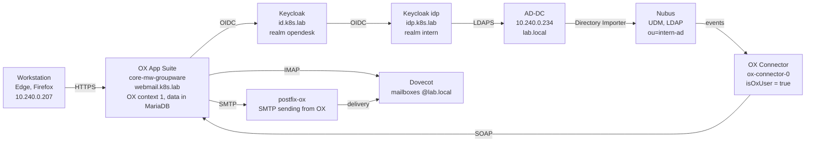

# 05 – OX App Suite (Groupware) in openDesk

> Part 5 of the build series. Previous: [04 – Active Directory and SSO](04-active-directory-sso.md) · Next: [06 – Adding a worker node](06-add-worker-node.md)

OX App Suite has been active since 14.10.2026: all 500 AD users have email under `@lab.local`, plus calendar and address book on `webmail.k8s.lab`, logged in via "Login with AD account".

| Field | Value |
|---|---|
| Scope | Enable OX App Suite (groupware) in openDesk |
| Prerequisite | [01](01-proxmox-cloud-init-template.md) – [03](03-opendesk-deployment.md): template, cluster, openDesk v1.17.2; [04](04-active-directory-sso.md): AD integration with Directory Importer and Keycloak idp.k8s.lab |
| Date | 14.10.2026, 08:00 – 10:40 CEST (assessment on 13.10.2026) |
| openDesk version | v1.17.2 (namespace `opendesk`, environment `dev`) |
| Network | SDN VNet vl5000 · 10.240.0.0/24 · MTU 1450 |
| Status | Enabled and accepted – mail, calendar invitation and address book work between two AD accounts |

> **Important:** This document contains no passwords. Never copy output that contains passwords or tokens into a chat, a ticket or a log.

## 0. Overview

### 0.1 Goal

This document is both a record of the work done on 14.10.2026 and a guide for a rebuild. It follows the structure of [04](04-active-directory-sso.md):

- **Part A** (sections 1 – 3): pre-check, permissions, backup – no changes.
- **Part B** (sections 4 – 5): change the configuration, review the diff, roll out.
- **Part C** (sections 6 – 10): functional check, two follow-up fixes, browser acceptance, final backup.
- **Sections 11 – 14:** data, errors, normal behavior, operations and checklist.

### 0.2 Architecture

OX uses the AD login from [04](04-active-directory-sso.md) and the mail infrastructure from [03](03-opendesk-deployment.md).



All paths except login and import stay inside the cluster. The browser reaches webmail.k8s.lab via the HAProxy Ingress 10.240.0.190.

**Login flow:** the user opens the Email tile in the portal. webmail.k8s.lab redirects to the openDesk Keycloak (id.k8s.lab) for login. With "Login with AD account", idp.k8s.lab checks the login name and password via LDAPS against AD-DC (as in [04](04-active-directory-sso.md)).

**Mail flow:** the OX middleware reads mailboxes from Dovecot and sends via postfix-ox. Mail between two openDesk users stays inside the cluster. The OX database lives in MariaDB.

**Provisioning:** the Directory Importer creates AD users in Nubus. The OX Connector receives every change through Nubus provisioning and creates users with `isOxUser = true` in OX context 1.

### 0.3 Roles of the machines

| Machine | IP | Role in this part |
|---|---|---|
| kubespray (VM 104) | 10.240.0.200 | All commands as user k8s |
| master (VM 201) | 10.240.0.21 | etcd backups via SSH |
| node1 – node5 (VM 202 – 206) | 10.240.0.22 – .26 | OX pods, Dovecot, Postfix, MariaDB |
| Windows workstation | 10.240.0.207 | Browser acceptance (Edge and Firefox) |
| AD-DC (VM 114) | 10.240.0.234 | Unchanged: DNS, LDAPS for the login |
| FS (VM 115) | 10.240.0.223 | Unchanged; must be reachable in case Nextcloud restarts |

### 0.4 Names

| Purpose | Value |
|---|---|
| openDesk mail domain | `lab.local` (`global.mailDomain`) |
| Web UI | https://webmail.k8s.lab |
| CalDAV / CardDAV | https://dav.k8s.lab |
| Groupware permission | UDM attribute `isOxUser = true`, plus `oxContext 1` and `oxAccess opendesk_standard` |
| Groupware group | `managed-by-attribute-Groupware` (`cn=managed-by-attribute-Groupware,cn=groups,dc=swp-ldap,dc=internal`), 500 members |
| OX context | 1 |
| Test accounts | alexander.braun (Edge), alexander.lorenz (Firefox); other test accounts from [04](04-active-directory-sso.md), section 21.5 |
| Helper pod | `udmcli` in the namespace `directory-importer` (section 2.1) |

### 0.5 Software versions

| Component (release) | Chart / version |
|---|---|
| openDesk | v1.17.2 |
| OX App Suite (open-xchange) | appsuite-public-sector 2.31.56 – new |
| OX Connector (ox-connector) | ox-connector 0.36.4 – new |
| OX bootstrap (opendesk-open-xchange-bootstrap) | 4.2.0 – new |
| Dovecot (dovecot) | 3.7.1 – since part 3, reconfigured |
| Postfix (postfix, postfix-ox) | postfix 6.1.1 – since part 3, reconfigured |
| Nubus (ums) | nubus 1.21.0 |
| Nextcloud management (opendesk-nextcloud-management) | 4.10.2 |
| Keycloak bootstrap (opendesk-keycloak-bootstrap) | 2.9.0 |

### 0.6 What changed compared to parts 3 and 4

| Topic | Before | Now |
|---|---|---|
| `apps.oxAppSuite.enabled` | false | true |
| `global.mailDomain` | Not set, so `k8s.lab` | `lab.local` |
| Helm releases in the namespace `opendesk` | 23 | 26 |
| Ingress hosts | 7 | 9 (+ webmail.k8s.lab, dav.k8s.lab) |
| Portal tiles | Files, Office | Additionally Email, Calendar, Contacts, Tasks |
| [04](04-active-directory-sso.md), 24.5 "clarify the mail domain lab.local" | Open | Done |

### 0.7 Conventions

- The conventions from [04](04-active-directory-sso.md), section 0.7, apply.
- All commands run on the kubespray VM. From Z01, log in with `ssh 10.240.0.200` **without** a user name (error F1). Check the prompt: `(kubespray-venv) k8s@kubespray:~$`.
- Queries to Nubus go through the helper pod `udmcli` (section 2.1). It holds the Nubus password only as an environment variable.
- Linux times are UTC (07:30 UTC = 09:30 CEST).

### 0.8 Steps

| Section | Topic | Run on |
|---|---|---|
| 1 – 3 | Part A: pre-check, permissions, backup | kubespray (k8s) |
| 4 – 5 | Part B: configuration, diff, rollout | kubespray (k8s), tmux |
| 6 – 8 | Part C: functional check, files_external, groupware group | kubespray (k8s) |
| 9 | Acceptance in the browser | Windows workstation |
| 10 | Final backup, resources | kubespray (k8s) |
| 11 – 14 | Data, errors, normal behavior, operations | – |

---

# Part A – Preparation

Part A checks the starting state and backs it up. Nothing is changed.

## 1. Pre-check

The starting state on 13 and 14.10.2026 was completely fine: resources, disk space and the mail infrastructure from part 3 are enough for OX.

**Run on:** kubespray VM as k8s

### 1.1 Resources and existing mail infrastructure

```bash
cd ~/kubespray
kubectl top nodes
kubectl describe nodes | grep -E '^Name:|^  (cpu|memory) +[0-9]'
ansible -i inventory/mycluster/inventory.ini kube_node -m shell -a "df -h /var/lib | tail -1" -o
kubectl -n opendesk get pods | grep -iE 'dovecot|postfix|clamav|mariadb'
yq '.global, .apps' ~/opendesk/helmfile/environments/dev/values.yaml.gotmpl
```

The scheduler decides based on the **requests** (first column in `describe`), not on the usage from `kubectl top`.

### 1.2 Repository, pods, importer

```bash
cd ~/opendesk
git describe --tags
git -C ~/opendesk diff --stat
kubectl -n opendesk get pods | grep -vE 'Running|Completed'
kubectl -n directory-importer logs deployment/directory-importer --since=10m | grep -E "ERROR|Sleeping" | tail -3
```

### 1.3 nls_utf8 and SMB mounts

A full rollout can restart Nextcloud. Without `nls_utf8` or without a reachable FS, Nextcloud then does not start ([04](04-active-directory-sso.md), F7).

```bash
cd ~/kubespray && ansible -i inventory/mycluster/inventory.ini all -m shell -a "uname -r; lsmod | grep -c '^nls_utf8'" -o
NCPOD=$(kubectl -n opendesk get pod -l app.kubernetes.io/name=aio --field-selector=status.phase=Running -o jsonpath='{.items[0].metadata.name}')
for p in fs-allgemein fs-austausch fs-abteilungen/Vertrieb fs-projekte/CRM; do
  kubectl -n opendesk exec $NCPOD -- sh -c "touch /mnt/$p/.t && rm /mnt/$p/.t && echo $p OK"
done
```

### 1.4 Result

| Check | Result |
|---|---|
| CPU usage (13.10.) | 5 – 8 % per node |
| RAM usage (13.10.) | 2077 – 3635 MiB per node (13 – 24 %) |
| Requests on the workers (13.10.) | CPU 21 – 33 %, node2 83 %; memory 15 – 35 % |
| Disk space on the workers | 16 – 21 % used, 92 – 97 GB free |
| Mail infrastructure | dovecot, postfix, postfix-ox, mariadb, clamav-simple running since part 3 |
| values.yaml.gotmpl | domain `k8s.lab`, no `mailDomain`, `oxAppSuite` false |
| git describe | v1.17.2 |
| git diff --stat | 1 file changed, 24 insertions(+), 2 deletions(-) – Nextcloud patch from [04](04-active-directory-sso.md) |
| Pods outside Running/Completed | None |
| Directory Importer | "Sleeping 300 seconds", no ERROR |
| nls_utf8 | Loaded on all 6 nodes, kernel 6.8.0-146-generic |
| SMB mounts in the Nextcloud pod | 4 × OK |

## 2. Groupware permission and email addresses

All 500 imported users already had `isOxUser = true` and an `@lab.local` address before the activation. The group `managed-by-attribute-Groupware` did not exist before the rollout.

The openDesk permission "Groupware" **is** the UDM attribute `isOxUser`. There is no attribute `opendeskGroupwareEnabled`; files, on the other hand, are controlled by `opendeskFileshareEnabled`.

**Run on:** kubespray VM as k8s, one session (the variable `B` is reused)

### 2.1 Helper pod udmcli

The pod holds the Nubus password only as an environment variable and ends itself after 10 minutes. It is used in sections 2, 6 and 8.

```bash
UDM_PW=$(kubectl -n opendesk get secret ums-nubus-credentials -o jsonpath='{.data.administrator_password}' | base64 -d)
kubectl -n directory-importer run udmcli --image=curlimages/curl:8.10.1 --restart=Never --command --env="PW=$UDM_PW" -- sleep 600
unset UDM_PW
kubectl -n directory-importer wait --for=condition=Ready pod/udmcli --timeout=60s
B=http://ums-udm-rest-api.opendesk.svc.cluster.local:9979/univention/udm
```

Remove it after every use:

```bash
kubectl -n directory-importer delete pod udmcli
```

> **Note:** If the Nubus administrator password has been changed ([04](04-active-directory-sso.md), 24.3), every query returns 401. In that case, use the new password in the first command.

### 2.2 Groups managed-by-attribute-* with member count

```bash
kubectl -n directory-importer exec udmcli -- sh -c \
  "curl -sS -u \"Administrator:\$PW\" -H 'Accept: application/json' '$B/groups/group/?filter=cn%3Dmanaged-by-Attribute-*&properties=name&properties=users'" \
  | jq -r '._embedded["udm:object"][] | "\(.properties.name)\t\(.properties.users|length)"' | sort
```

### 2.3 openDesk and OX attributes of a test account

```bash
kubectl -n directory-importer exec udmcli -- sh -c \
  "curl -sS -u \"Administrator:\$PW\" -H 'Accept: application/json' '$B/users/user/?filter=uid%3Dalexander.braun&properties=*'" \
  | jq '._embedded["udm:object"][0].properties | with_entries(select(.key|test("opendesk|^ox|isox|mailPrimary|mailHome";"i")))'
```

### 2.4 Count all imported users

```bash
kubectl -n directory-importer exec udmcli -- sh -c \
  "curl -sS -u \"Administrator:\$PW\" -H 'Accept: application/json' '$B/users/user/?position=ou%3Dintern-ad%2Cdc%3Dswp-ldap%2Cdc%3Dinternal&properties=username&properties=isOxUser&properties=mailPrimaryAddress'" \
  | jq -r '._embedded["udm:object"] | "Users: \(length)   isOxUser=true: \([.[]|select(.properties.isOxUser==true)]|length)   Mail @lab.local: \([.[]|select(.properties.mailPrimaryAddress|tostring|endswith("@lab.local"))]|length)"'
kubectl -n directory-importer delete pod udmcli
```

### 2.5 Result

| Check | Result on 14.10.2026 |
|---|---|
| Groups managed-by-attribute-* | Fileshare 500, FileshareAdmin 0; Groupware not present |
| alexander.braun, OX | isOxUser true, oxContext 1, oxAccess opendesk_standard |
| alexander.braun, mail | mailPrimaryAddress alexander.braun@lab.local, mailHomeServer empty |
| alexander.braun, openDesk | opendeskFileshareEnabled true; project, knowledge, chat, video and notes permissions false |
| All imported users | Users 500, isOxUser=true 500, mail @lab.local 500 |

**Consequence for section 4:** the openDesk mail domain must be `lab.local`.

## 3. Backups before the change

Before the change, the release state, the configuration and etcd were backed up (snapshot `vor-ox`, 92 MB). A VM backup was not needed because AD-DC and FS stay unchanged.

**Run on:** kubespray VM as k8s – etcd lines one by one, without line breaks

### 3.1 Record the release state

```bash
helm -n opendesk list -a -o json | jq -r '.[] | "\(.name)\t\(.revision)\t\(.chart)\t\(.status)"' | sort > ~/helm-releases-vor-ox.txt
wc -l ~/helm-releases-vor-ox.txt
```

### 3.2 Back up the configuration

The file contains the client secret from [04](04-active-directory-sso.md), hence `chmod 600`.

```bash
cp ~/opendesk/helmfile/environments/dev/values.yaml.gotmpl ~/values-dev.yaml.gotmpl.vor-ox
chmod 600 ~/values-dev.yaml.gotmpl.vor-ox
ls -l ~/values-dev.yaml.gotmpl.vor-ox
```

### 3.3 etcd snapshot

```bash
ssh k8s@10.240.0.21 "sudo etcdctl --endpoints=https://10.240.0.21:2379 --cacert=/etc/ssl/etcd/ssl/ca.pem --cert=/etc/ssl/etcd/ssl/admin-master.pem --key=/etc/ssl/etcd/ssl/admin-master-key.pem snapshot save /var/backups/etcd/vor-ox.db"
ssh k8s@10.240.0.21 "sudo etcdutl --write-out=table snapshot status /var/backups/etcd/vor-ox.db"
ssh k8s@10.240.0.21 "sudo cat /var/backups/etcd/vor-ox.db" > ~/backups/etcd/vor-ox-$(date +%F-%H%M).db
chmod 600 ~/backups/etcd/*.db
ls -lh ~/backups/etcd/
```

### 3.4 Result

| Check | Result on 14.10.2026 |
|---|---|
| Releases in the namespace `opendesk` | 23 |
| `~/values-dev.yaml.gotmpl.vor-ox` | 1898 bytes, `-rw-------` |
| etcd vor-ox | HASH b67862b0, REVISION 2 556 948, 1 813 keys, 92 MB, etcd 3.6.0 |
| Copy on kubespray | `~/backups/etcd/vor-ox-2026-10-14-0657.db` (89M) |

This snapshot replaces the open item "etcd backup nach-ad-anbindung" from [04](04-active-directory-sso.md), because nothing had changed since then.

> **Note:** The etcd database has grown from 44 MB to 92 MB since 08.10.2026 (section 13). This does not matter for the snapshot.

---

# Part B – Activation

Part B changes two values in the openDesk configuration and rolls them out.

## 4. Change the configuration and review the differences

Two values are enough: `global.mailDomain: lab.local` and `apps.oxAppSuite.enabled: true`. Before the rollout, the diff showed that the Nextcloud pod would not restart and that only one one-time job would be removed.

**Run on:** kubespray VM as k8s, directory `~/opendesk`

### 4.1 Decision on the mail domain

openDesk knows one mail domain. Without a value, it is the same as the domain `k8s.lab`.

| Option | Consequence | Decision |
|---|---|---|
| `global.mailDomain: lab.local` | Matches the 500 AD addresses and the email-based account link of "Login with AD account" ([04](04-active-directory-sso.md), 0.2); the mail domain `lab.local` exists in Nubus since part 4 | **Chosen** |
| Switch the addresses to `@k8s.lab` | The Nubus address would differ from the AD address; the SSO link via email address would break | Rejected |

### 4.2 Set two values

```bash
cd ~/opendesk
V=helmfile/environments/dev/values.yaml.gotmpl
yq -i '.global.mailDomain = "lab.local" | .apps.oxAppSuite.enabled = true' "$V"
yq '.global, .apps.oxAppSuite' "$V"
diff ~/values-dev.yaml.gotmpl.vor-ox "$V" | grep -vi secret
```

✔ **Expected and achieved:** `mailDomain: lab.local`, `enabled: true`; the diff shows exactly one new line and one changed line (false → true). `grep -vi secret` prevents the client secret from appearing on screen.

### 4.3 helmfile diff

Run `tmux new -s opendesk` on its own, then inside tmux:

```bash
cd ~/opendesk
export MASTER_PASSWORD="$(cat ~/opendesk-master-password.txt)"
echo "${#MASTER_PASSWORD}"             # 44
helmfile -e dev diff -n opendesk --suppress-secrets --context 2 > ~/opendesk-diff-ox.log 2>&1
echo "Exit code: $?"                   # 0
```

The first run downloads the OX charts and shows nothing for minutes ([03](03-opendesk-deployment.md), F5). Do not cancel.

### 4.4 Evaluation

```bash
grep -E 'has (changed|been added|been removed):' ~/opendesk-diff-ox.log | grep -E 'Deployment|StatefulSet|DaemonSet|Job' | sort
echo "Removed objects: $(grep -c 'has been removed:' ~/opendesk-diff-ox.log)"
tail -n 5 ~/opendesk-diff-ox.log
```

Only share this summary, not the whole log.

| Area | Objects according to the diff | Assessment |
|---|---|---|
| OX App Suite | 12 deployments `open-xchange-*`: core-mw-groupware, core-ui, core-ui-middleware, core-ui-middleware-updater, core-documentconverter, core-imageconverter, core-guidedtours, core-user-guide, gotenberg, guard-ui, nextcloud-integration-ui, public-sector-ui | New |
| OX Connector, bootstrap | StatefulSet ox-connector, job opendesk-open-xchange-bootstrap-c39ee253a5 | New |
| Mail | Deployments dovecot, postfix, postfix-ox | Changed (new mail domain); short restart, no mails existed yet |
| Nubus | Deployment ums-keycloak-extensions-handler, job ums-provisioning-register-consumers-1 | Changed; the OX Connector is registered as a provisioning consumer |
| Portal | Deployment opendesk-static-files | Changed (new tiles) |
| Keycloak bootstrap | Job opendesk-keycloak-bootstrap-bootstrap-2 removed, -1 new | The only removed object; one-time job, no data |
| Nextcloud | Only job opendesk-nextcloud-management-1 | The pod opendesk-nextcloud-aio does not restart; but the job switches off files_external (F3, section 7) |

## 5. Rollout

The rollout took about 25 minutes and ended around 07:36 UTC. All releases are deployed, all OX pods are running, and there are two new hosts: webmail.k8s.lab and dav.k8s.lab.

**Run on:** kubespray VM as k8s, in the tmux session `opendesk`

```bash
cd ~/opendesk
export MASTER_PASSWORD="$(cat ~/opendesk-master-password.txt)"
echo "${#MASTER_PASSWORD}"             # 44
helmfile -e dev apply -n opendesk --suppress-diff 2>&1 | tee ~/opendesk-apply-ox.log
```

Watch in a second SSH session (from Z01: `ssh 10.240.0.200`):

```bash
watch -n 10 'kubectl -n opendesk get pods | grep -vE "Running|Completed"'
```

During the run, pods in `Init`, `Error` or `CrashLoopBackOff` are normal: OX waits for the database, LDAP and Keycloak ([03](03-opendesk-deployment.md), section 17). Do not cancel.

> **Important:** Always use the same `MASTER_PASSWORD` and always `-n opendesk` ([03](03-opendesk-deployment.md), section 18.4).

### 5.1 Checks after the end

```bash
tail -n 15 ~/opendesk-apply-ox.log
helm -n opendesk list -a | grep -v deployed
kubectl -n opendesk get pods | grep -vE 'Running|Completed'
kubectl -n opendesk get pods | grep -E 'open-xchange|ox-connector|dovecot|postfix'
kubectl -n opendesk get ingress -o jsonpath='{range .items[*]}{.spec.rules[*].host}{"\n"}{end}' | sort -u
```

### 5.2 Result

| Check | Result on 14.10.2026 |
|---|---|
| Last release | opendesk-migrations-post, revision 2, 07:30:26 UTC, duration 6 min 5 s |
| `helm list -a` | Only the header line, all releases deployed |
| Pods outside Running/Completed | None |
| OX App Suite | 12 pods `open-xchange-*` Running, core-mw-groupware for 16 minutes |
| OX Connector | ox-connector-0 Running, 2 restarts at start (section 13) |
| Mail | dovecot, postfix, postfix-ox Running with the new configuration |
| Ingress hosts | dav, files, ics, id, k8s.lab, objectstorage, office, portal, webmail |

The line "Updated Releases" at the end of the log only names one release. helmfile prints the summary per stage; the log only contains the last stage.

---

# Part C – Verification and follow-up fixes

Part C checks the result, fixes two side effects of the rollout and accepts OX in the browser.

## 6. Functional check on the command line

Certificate, reachability, OX Connector and SSO were fine. Two items needed follow-up work: the groupware group was empty (section 8) and files_external had been switched off (section 7).

**Run on:** kubespray VM as k8s

### 6.1 Certificate and reachability

```bash
kubectl -n opendesk get certificate
kubectl -n opendesk get secret opendesk-certificates-tls -o jsonpath='{.data.tls\.crt}' | base64 -d | openssl x509 -noout -ext subjectAltName
for h in webmail dav portal files; do echo -n "$h.k8s.lab: "; curl -s -o /dev/null -w "%{http_code}\n" --cacert ~/opendesk-ca.crt https://$h.k8s.lab; done
```

### 6.2 OX Connector

```bash
kubectl -n opendesk logs ox-connector-0 --previous --tail=5 2>&1 | cut -c1-160
echo "Error lines: $(kubectl -n opendesk logs ox-connector-0 --since=30m | grep -ciE 'error|traceback')"
kubectl -n opendesk logs ox-connector-0 --tail=15 | cut -c1-160
```

### 6.3 Groupware group

Start the helper pod from section 2.1, run the query from section 2.2 and remove the pod again.

### 6.4 "Login with AD account" after the new bootstrap run

The Keycloak bootstrap ran again during the rollout. The block from [04](04-active-directory-sso.md), section 19.3, shows whether the identity provider still exists.

```bash
KCADMIN=$(kubectl -n opendesk get secret opendesk-keycloak-bootstrap-admin-creds -o jsonpath='{.data.admin\.yaml}' | base64 -d | grep -i password | awk '{print $2}')
kubectl -n opendesk run kcapi --image=curlimages/curl:8.10.1 --restart=Never --command --env="PW=$KCADMIN" -- \
  sh -c 'TOKEN=$(curl -s -d "client_id=admin-cli" -d "username=kcadmin" -d "password=$PW" -d "grant_type=password" http://ums-keycloak.opendesk.svc.cluster.local:8080/realms/master/protocol/openid-connect/token | sed -n "s/.*\"access_token\":\"\([^\"]*\)\".*/\1/p"); curl -s -H "Authorization: Bearer $TOKEN" http://ums-keycloak.opendesk.svc.cluster.local:8080/admin/realms/opendesk/identity-provider/instances'
unset KCADMIN
kubectl -n opendesk wait --for=jsonpath='{.status.phase}'=Succeeded pod/kcapi --timeout=60s
kubectl -n opendesk logs kcapi | jq -r '.[] | [.alias, .displayName, .enabled] | @tsv'
kubectl -n opendesk delete pod kcapi
```

### 6.5 Nextcloud after the management job ran again

```bash
NCPOD=$(kubectl -n opendesk get pod -l app.kubernetes.io/name=aio --field-selector=status.phase=Running -o jsonpath='{.items[0].metadata.name}')
kubectl -n opendesk exec $NCPOD -- php /var/www/html/occ app:list --output=json | jq -r '.enabled.files_external // "files_external NOT active"'
~/nc-mounts.sh ~/nc-mounts.csv > /tmp/nc-check.txt 2>&1
echo "SKIP: $(grep -c '^SKIP' /tmp/nc-check.txt)"
grep -v '^SKIP' /tmp/nc-check.txt
```

### 6.6 Result

| Check | Result on 14.10.2026 | Assessment |
|---|---|---|
| Certificates | opendesk-certificates, opendesk-certificates-ca READY True | OK |
| SAN of opendesk-certificates-tls | k8s.lab, office, ics, id, files, portal, webmail, dav, objectstorage, objectstorage-ui, static | OK; same openDesk CA, nothing to do on the workstation |
| HTTP codes | webmail 302, dav 401, portal 301, files 302 | OK |
| OX Connector, previous run | Aborted with "Schema "PRIMARYDB_7" … is locked or is now being updated" | Normal on the first start (section 13) |
| OX Connector, current | 0 error lines, messages up to no. 550 acknowledged | OK |
| managed-by-attribute-Groupware | Present, 0 members | F2, section 8 |
| Identity provider | sso-federation-idp-internIdP, "Anmeldung mit AD-Konto", true | OK |
| files_external | NOT active; nc-mounts.sh shows 27 × PLAN and "There are no commands defined in the "files_external" namespace" | F3, section 7 |

## 7. Enable files_external again

After `occ app:enable files_external`, all 27 mounts were back immediately, with all their options. They are stored in the Nextcloud database and are not lost when the app is switched off.

**Cause:** the job `opendesk-nextcloud-management` runs on every rollout and switches off all apps that are not on its list. Between 07:30 UTC and the repair, users could not see their FS folders.

**Run on:** kubespray VM as k8s

### 7.1 Enable the app and check the mounts

```bash
NCPOD=$(kubectl -n opendesk get pod -l app.kubernetes.io/name=aio --field-selector=status.phase=Running -o jsonpath='{.items[0].metadata.name}')
OCC="kubectl -n opendesk exec $NCPOD -- php /var/www/html/occ"
$OCC app:enable files_external
echo "Mounts: $($OCC files_external:list --output=json | jq length)"
for id in 13 14 15 16 17 18 19 25; do echo -n "$id readonly="; $OCC files_external:option $id readonly; done
~/nc-mounts.sh ~/nc-mounts.csv > /tmp/nc-check.txt 2>&1
echo "SKIP: $(grep -c '^SKIP' /tmp/nc-check.txt)"
grep -v '^SKIP' /tmp/nc-check.txt
```

The dry run of `nc-mounts.sh` changes nothing; running it several times is harmless.

| Check | Result on 14.10.2026 |
|---|---|
| `app:enable files_external` | 1.24.1 enabled |
| Mounts | 27 |
| readonly of IDs 13 – 19 (GL) and 25 (Quellcode-Lesen) | 8 × true |
| nc-mounts.sh dry run | SKIP: 27; no mount without assignment |

### 7.2 Root cause in the repository

```bash
cd ~/opendesk
grep -rn -i -B3 -A3 'files_external' helmfile/apps/nextcloud/ | cut -c1-180
awk 'NR>=55 && NR<=90 {printf "%3d: %s\n", NR, $0}' helmfile/apps/nextcloud/values-nextcloud-management.yaml.gotmpl
grep -rn 'files_external' ~/.cache/helmfile 2>/dev/null | cut -c1-200 | head -20
```

**Finding:** `files_external` appears neither in `helmfile/apps/nextcloud/` nor in the chart cache. The block `feature.apps` in `values-nextcloud-management.yaml.gotmpl` (lines 59 – 76) only knows contacts, cryptpad, filesZip, groupfolders, integrationOpenproject, notifyPush, sharereview and spreed. So the app is switched off inside the image of the management job, and this cannot be changed through the values.

> **Important:** After every `helmfile apply` that touches Nextcloud, run section 7.1. The job only runs during a rollout, not regularly. [04](04-active-directory-sso.md), section 24.4, already planned this check.

## 8. Set the groupware group for all 500 users

The group `managed-by-attribute-Groupware` now has 500 members. Without membership, the portal shows no OX tiles and Keycloak does not allow the OX login.

**Why the group was empty:** it was only created during the rollout. Nubus only recalculates the managed-by groups when a user object changes, and the 500 users had not been changed since. The test in 8.1 confirmed this on one account. Afterwards, the member list was set directly once: exactly the users Nubus would calculate itself (`isOxUser = true`).

**Run on:** kubespray VM as k8s, one session; start the helper pod from section 2.1 first

### 8.1 Test on alexander.braun

The unused OX extra field `oxUserfield01` is set briefly and cleared again.

```bash
UDN="uid%3Dalexander.braun%2Cou%3Dintern-ad%2Cdc%3Dswp-ldap%2Cdc%3Dinternal"
gw() { kubectl -n directory-importer exec udmcli -- sh -c "curl -sS -u \"Administrator:\$PW\" -H 'Accept: application/json' '$B/groups/group/?filter=cn%3Dmanaged-by-attribute-Groupware&properties=users'" | jq -r '._embedded["udm:object"][0].properties.users | "Members: \(length)   braun: \(map(select(test("alexander.braun")))|length)"'; }
gw
kubectl -n directory-importer exec udmcli -- sh -c \
  "curl -sS -o /dev/null -w 'PATCH set: %{http_code}\n' -u \"Administrator:\$PW\" -H 'Accept: application/json' -H 'Content-Type: application/json' -X PATCH -d '{\"properties\":{\"oxUserfield01\":\"gw-test\"}}' $B/users/user/$UDN"
sleep 5
gw
kubectl -n directory-importer exec udmcli -- sh -c \
  "curl -sS -o /dev/null -w 'PATCH reset: %{http_code}\n' -u \"Administrator:\$PW\" -H 'Accept: application/json' -H 'Content-Type: application/json' -X PATCH -d '{\"properties\":{\"oxUserfield01\":null}}' $B/users/user/$UDN"
sleep 5
gw
```

Result: `Members: 0   braun: 0` → `PATCH set 204` → `Members: 1   braun: 1` → `PATCH reset 204` → braun stays a member.

> **Important:** A PATCH on `users` replaces the entire member list. So always send the complete list of all users with `isOxUser = true`.

### 8.2 Set the member list for everyone

```bash
GDN="cn%3Dmanaged-by-attribute-Groupware%2Ccn%3Dgroups%2Cdc%3Dswp-ldap%2Cdc%3Dinternal"
kubectl -n directory-importer exec udmcli -- sh -c \
  "curl -sS -u \"Administrator:\$PW\" -H 'Accept: application/json' '$B/users/user/?position=ou%3Dintern-ad%2Cdc%3Dswp-ldap%2Cdc%3Dinternal&properties=isOxUser'" \
  | jq -c '{properties:{users:[._embedded["udm:object"][] | select(.properties.isOxUser==true) | .dn]}}' > /tmp/gw-users.json
echo "DNs in the list: $(jq '.properties.users | length' /tmp/gw-users.json)"
jq -r '.properties.users[0]' /tmp/gw-users.json
kubectl -n directory-importer exec -i udmcli -- sh -c \
  "curl -sS -w '\nPATCH group: %{http_code}\n' -u \"Administrator:\$PW\" -H 'Accept: application/json' -H 'Content-Type: application/json' -X PATCH --data @- $B/groups/group/$GDN | tail -c 600" < /tmp/gw-users.json
gw
rm -f /tmp/gw-users.json
kubectl -n directory-importer delete pod udmcli
```

| Check | Result on 14.10.2026 |
|---|---|
| DNs in the list | 500, first entry `uid=alexander.lorenz,ou=intern-ad,dc=swp-ldap,dc=internal` |
| PATCH group | 204 |
| Check | Members: 500, braun: 1 |

### 8.3 Users in OX

After registering as a provisioning consumer, the OX Connector created the existing users itself. The remaining logs contain 328 distinct users; the log of the first container was lost during the restarts. All of the roughly 550 provisioning messages were acknowledged without errors, and the acceptance in section 9 worked with two logged-in accounts; the address book also showed andrea.krause and andrea.krause1.

```bash
for f in "" "--previous"; do kubectl -n opendesk logs ox-connector-0 -c main $f 2>/dev/null; done \
  | grep '\[users.create_user' | grep -oE "uid=[^,']+" | sort -u | wc -l
```

## 9. Acceptance in the browser

All seven tests on 14.10.2026 passed: login with AD account, mail in both directions, calendar invitation with acceptance, address book and unchanged FS mounts.

### 9.1 Check beforehand

**Run on:** kubespray VM as k8s

```bash
NCPOD=$(kubectl -n opendesk get pod -l app.kubernetes.io/name=aio --field-selector=status.phase=Running -o jsonpath='{.items[0].metadata.name}')
kubectl -n opendesk exec $NCPOD -- php /var/www/html/occ app:list --output=json | jq -r '.enabled.files_external // "NOT active"'
```

✔ **Expected:** `1.24.1`

### 9.2 Tests

**Run on:** Windows workstation (10.240.0.207)

> **Important:** For two accounts logged in at the same time, use two different browsers, e.g. Edge InPrivate and Firefox Private. All InPrivate windows of one browser share one session. Close all private windows first, so that no old session without the groupware permission is left over.

Login for each account: `https://portal.k8s.lab` → Log in → "Anmeldung mit AD-Konto" (Login with AD account) → login name + test password ([04](04-active-directory-sso.md), 19.1).

| # | Account | Test | Expected | Result |
|---|---|---|---|---|
| 1 | alexander.braun (Edge) | Look at the portal | Tiles Email, Calendar, Contacts, Tasks; Files still there | Passed |
| 2 | alexander.braun | Open the Email tile | webmail.k8s.lab without a second login; sender alexander.braun@lab.local | Passed |
| 3 | alexander.braun | Mail to alexander.lorenz@lab.local, subject "OX-Test 1" | Sent without an error message | Passed |
| 4 | alexander.lorenz (Firefox) | Open Email, reply | "OX-Test 1" in the inbox; the reply arrives at braun | Passed |
| 5 | alexander.braun | Appointment tomorrow 10:00, participant lorenz | Invitation at lorenz; after "Accept", braun sees the acceptance | Passed |
| 6 | alexander.braun | Address book, search "krause" | andrea.krause and andrea.krause1 as two entries | Passed |
| 7 | alexander.braun | Files → External storage | Exactly 3 mounts: Allgemein, Austausch, Produktion | Passed |

### 9.3 If mail is not delivered

**Run on:** kubespray VM as k8s

```bash
kubectl -n opendesk logs deploy/postfix-ox --since=15m | grep -E 'status=|reject' | cut -c1-200 | tail -5
kubectl -n opendesk logs deploy/dovecot --since=15m | grep -iE 'saved mail|error' | cut -c1-200 | tail -5
```

Not needed on 14.10.2026, because all tests passed.

## 10. Final backup and resources

After the acceptance, etcd (snapshot `nach-ox`) and the configuration were backed up. Together, OX needs about 3.7 GiB more RAM on the workers; the CPU load stayed almost the same.

**Run on:** kubespray VM as k8s – etcd lines one by one, without line breaks

### 10.1 etcd snapshot after the activation

```bash
ssh k8s@10.240.0.21 "sudo etcdctl --endpoints=https://10.240.0.21:2379 --cacert=/etc/ssl/etcd/ssl/ca.pem --cert=/etc/ssl/etcd/ssl/admin-master.pem --key=/etc/ssl/etcd/ssl/admin-master-key.pem snapshot save /var/backups/etcd/nach-ox.db"
ssh k8s@10.240.0.21 "sudo etcdutl --write-out=table snapshot status /var/backups/etcd/nach-ox.db"
ssh k8s@10.240.0.21 "sudo cat /var/backups/etcd/nach-ox.db" > ~/backups/etcd/nach-ox-$(date +%F-%H%M).db
chmod 600 ~/backups/etcd/*.db
ls -lh ~/backups/etcd/
```

| Check | Result on 14.10.2026 |
|---|---|
| etcd nach-ox | HASH 15d370f5, REVISION 2 587 800, 2 045 keys, 92 MB, etcd 3.6.0 |
| Copy on kubespray | `~/backups/etcd/nach-ox-2026-10-14-0837.db` (89M) |

### 10.2 Configuration and release state

```bash
cp ~/opendesk/helmfile/environments/dev/values.yaml.gotmpl ~/values-dev.yaml.gotmpl.nach-ox
chmod 600 ~/values-dev.yaml.gotmpl.nach-ox
helm -n opendesk list -a -o json | jq -r '.[] | "\(.name)\t\(.revision)\t\(.chart)\t\(.status)"' | sort > ~/helm-releases-nach-ox.txt
echo "Releases before/after: $(wc -l < ~/helm-releases-vor-ox.txt) / $(wc -l < ~/helm-releases-nach-ox.txt)"
diff ~/helm-releases-vor-ox.txt ~/helm-releases-nach-ox.txt | grep '^>' | cut -f1,3
git -C ~/opendesk status --short
```

| Check | Result on 14.10.2026 |
|---|---|
| Releases before / after | 23 / 26 |
| New releases | open-xchange, ox-connector, opendesk-open-xchange-bootstrap |
| Updated releases | dovecot, postfix, postfix-ox, ums, opendesk-certificates, opendesk-keycloak-bootstrap, opendesk-migrations-pre, opendesk-migrations-post, opendesk-nextcloud-management, opendesk-static-files, seaweedfs |
| `git status --short` | Only `M helmfile/apps/nextcloud/values-nextcloud.yaml.gotmpl` (patch from [04](04-active-directory-sso.md)) |

### 10.3 Resources before and after

```bash
kubectl top nodes
kubectl describe nodes | grep -E '^Name:|^  (cpu|memory) +[0-9]'
```

| Node | RAM usage 13.10. | RAM usage 14.10. | CPU requests 14.10. | Memory requests 14.10. | Memory limits 14.10. |
|---|---|---|---|---|---|
| master | 2561 MiB | 2666 MiB | 11 % | 1 % | 14 % |
| node1 | 3124 MiB | 5144 MiB | 52 % | 33 % | 150 % |
| node2 | 2077 MiB | 2237 MiB | 80 % | 35 % | 92 % |
| node3 | 3635 MiB | 4189 MiB | 28 % | 22 % | 91 % |
| node4 | 3094 MiB | 3463 MiB | 37 % | 26 % | 71 % |
| node5 | 3226 MiB | 3914 MiB | 38 % | 27 % | 81 % |

Sum over the workers: 15 156 MiB → 18 947 MiB (+3 791 MiB). CPU usage afterwards 5 – 9 % per node. Memory limits above 100 % are overcommit: limits are upper bounds and are not reserved (section 13, open item in 14.4).

## 11. Access and data

This part did not create any new passwords. openDesk derives the internal OX passwords from the master password; the access data of all other systems is described in [04](04-active-directory-sso.md), section 21.1.

### 11.1 Access

| System | Address | Login |
|---|---|---|
| Webmail, calendar, contacts | https://webmail.k8s.lab (or portal → Email tile) | Login with AD account |
| CalDAV / CardDAV | https://dav.k8s.lab | AD account; not tested with clients |
| Test accounts | alexander.braun, alexander.lorenz and others | Shared test password from [04](04-active-directory-sso.md), 19.1 |
| Internal OX accounts | Secrets in the namespace `opendesk` | Derived from `MASTER_PASSWORD`; not in this document |

### 11.2 Addresses in the cluster

| Service | Address | Note |
|---|---|---|
| Webmail, DAV | 10.240.0.190 (HAProxy Ingress) | Via the wildcard `*.k8s.lab` on AD-DC |
| OX database | Host `mariadb` in the namespace `opendesk` | Schema PRIMARYDB_7 according to the connector log |
| Nubus UDM REST API | `http://ums-udm-rest-api.opendesk.svc.cluster.local:9979/univention/udm/` | Cluster-internal only |
| Mail domain | lab.local | Mailboxes of the 500 AD users |

### 11.3 Backups and certificates

| Object | Value |
|---|---|
| etcd vor-ox | HASH b67862b0, REVISION 2 556 948, 1 813 keys, 92 MB |
| etcd nach-ox | HASH 15d370f5, REVISION 2 587 800, 2 045 keys, 92 MB |
| Certificate opendesk-certificates | Reissued with SAN webmail.k8s.lab and dav.k8s.lab; issuer unchanged: openDesk CA (SHA1 72:B4:21:CC:BE:06:7C:69:A4:D7:AB:A7:FD:43:BE:A7:BB:1E:93:E0, valid until 06.01.2027) |

### 11.4 Kubernetes and Nubus objects

| Location | Object | Purpose |
|---|---|---|
| opendesk | Release `open-xchange` (12 deployments `open-xchange-*`) | OX App Suite |
| opendesk | Release `ox-connector` (StatefulSet `ox-connector`) | Provisioning Nubus → OX |
| opendesk | Release `opendesk-open-xchange-bootstrap` | Initial OX setup |
| opendesk | Ingress hosts webmail.k8s.lab, dav.k8s.lab | Web UI, CalDAV/CardDAV |
| Nubus | Group `managed-by-attribute-Groupware`, 500 members | Portal tiles and Keycloak permission for OX |

### 11.5 Important files

| File | Machine | Content |
|---|---|---|
| `~/opendesk/helmfile/environments/dev/values.yaml.gotmpl` | kubespray | Now with `mailDomain lab.local` and `oxAppSuite true`; contains the client secret |
| `~/values-dev.yaml.gotmpl.vor-ox`, `~/values-dev.yaml.gotmpl.nach-ox` | kubespray (chmod 600) | Configuration before and after this part |
| `~/helm-releases-vor-ox.txt`, `~/helm-releases-nach-ox.txt` | kubespray | Release state before and after this part |
| `~/opendesk-diff-ox.log` | kubespray | helmfile diff (secrets suppressed) |
| `~/opendesk-apply-ox.log` | kubespray | Rollout log |
| `~/backups/etcd/vor-ox-2026-10-14-0657.db`, `~/backups/etcd/nach-ox-2026-10-14-0837.db` | kubespray (chmod 600) | etcd before and after this part |
| `/var/backups/etcd/vor-ox.db`, `/var/backups/etcd/nach-ox.db` | master | Originals of the snapshots |

## 12. Troubleshooting

Five errors occurred on 13 and 14.10.2026; F2 and F3 affect every future rollout and are included as mandatory checks in section 14.1.

| # | Problem / message | Cause | Solution |
|---|---|---|---|
| F1 | Z01: `cd ~/kubespray` → "No such file or directory"; `ssh support@10.240.0.21` → "Permission denied (publickey)" | Commands run on Z01 instead of the kubespray VM; the user `support` does not exist on the nodes; a user given on the command line overrides `User k8s` from `~/.ssh/config` | From Z01 use `ssh 10.240.0.200` without a user name; check the prompt `(kubespray-venv) k8s@kubespray` |
| F2 | managed-by-attribute-Groupware: 0 members, before and after the rollout | The group is only created with OX; Nubus only adds members when a user object changes | Mechanism checked on one account, group set once to all 500 users with `isOxUser = true` (section 8) |
| F3 | After the rollout "files_external NOT active"; nc-mounts.sh shows PLAN instead of SKIP and "There are no commands defined in the "files_external" namespace" | The job opendesk-nextcloud-management ran during the rollout and switches off apps outside its list | `occ app:enable files_external`; mounts and options are kept (section 7); repeat after every rollout |
| F4 | Expected values in the guide did not match: "about 60 releases", host "mail.k8s.lab" | 60 is the number of all possible releases; the OX host is called webmail | Corrected in this document: 23 and 26 releases, webmail.k8s.lab |
| F5 | Logout: idp.k8s.lab shows "We are sorry… Invalid redirect uri" | The client `opendesk` in the realm `intern` had no "Valid post logout redirect URIs"; part 4 (19.4) only set the redirect URI for the login. The openDesk session ended, the session on idp.k8s.lab stayed open | Post-logout URI `https://id.k8s.lab/realms/opendesk/broker/sso-federation-idp-internIdP/endpoint/logout_response` set via the admin REST API, PUT 204 (section 12.2) |

### 12.1 Typical errors and checks

| Symptom | Check / solution |
|---|---|
| No Email or Calendar tiles after login | Old session without group claim: close all private windows and log in again; check the membership with section 2.2 |
| Tiles missing for a new AD user | Check `isOxUser` of the user (section 2.3); check membership in managed-by-attribute-Groupware; if needed, change the user once (section 8.1) |
| Webmail reports a login error or an unknown account | User not in OX: search `kubectl -n opendesk logs ox-connector-0 -c main` for `uid=<name>` |
| ox-connector in CrashLoopBackOff | `kubectl -n opendesk logs ox-connector-0 --previous`; "Schema … is locked" is only normal on the first start; if it persists, check mariadb |
| Mail does not arrive | Logs of postfix-ox and dovecot (section 9.3) |
| FS folders missing after a rollout | F3, section 7.1 |
| Nubus queries return 401 | Nubus administrator password changed: start the helper pod with the new password (section 2.1) |
| PATCH on a group returns 422 | Read the error message in the response body (`tail -c 600` in section 8.2) |

### 12.2 Fixing the logout (F5)

**Run on:** kubespray VM as k8s. The admin token is valid for 60 seconds; run the block quickly.

```bash
kubectl -n idp logs keycloak-keycloakx-0 --since=30m | grep -i 'LOGOUT_ERROR' | tail -2 | grep -oE 'redirect_uri="?[^", ]+' | sort -u
KCPW=$(cat ~/keycloak-admin-password.txt)
TOKEN=$(curl -s --cacert ~/opendesk-ca.crt -d client_id=admin-cli -d username=admin --data-urlencode "password=$KCPW" -d grant_type=password https://idp.k8s.lab/auth/realms/master/protocol/openid-connect/token | jq -r .access_token)
unset KCPW
B=https://idp.k8s.lab/auth/admin/realms/intern/clients
CID=$(curl -s --cacert ~/opendesk-ca.crt -H "Authorization: Bearer $TOKEN" "$B?clientId=opendesk" | jq -r '.[0].id')
curl -s --cacert ~/opendesk-ca.crt -H "Authorization: Bearer $TOKEN" "$B/$CID" \
  | jq '.attributes["post.logout.redirect.uris"]="https://id.k8s.lab/realms/opendesk/broker/sso-federation-idp-internIdP/endpoint/logout_response"' > /tmp/client.json
curl -s --cacert ~/opendesk-ca.crt -o /dev/null -w "PUT: %{http_code}\n" -X PUT \
  -H "Authorization: Bearer $TOKEN" -H "Content-Type: application/json" --data @/tmp/client.json "$B/$CID"
rm -f /tmp/client.json
curl -s --cacert ~/opendesk-ca.crt -H "Authorization: Bearer $TOKEN" "$B?clientId=opendesk" | jq -c '.[] | {clientId, redirectUris, postLogout: .attributes["post.logout.redirect.uris"]}'
unset TOKEN
```

Result on 14.10.2026: the Keycloak log showed `redirect_uri=…/endpoint/logout_response`, and `postLogout` was `null` before. After `PUT 204`, logout ends without an error, and the next "Login with AD account" asks for the password again. `/tmp/client.json` contains the client secret and is deleted immediately.

## 13. Not an error – normal behavior

These messages and states looked like errors on 14.10.2026, but are normal.

| Message / state | Explanation |
|---|---|
| ox-connector-0 with 2 restarts; log "Schema "PRIMARYDB_7" from database 5 on host "mariadb" is locked or is now being updated" | The OX database was still being set up on the first start; the connector started too early and then ran stably |
| WARNING "cn=managed-by-attribute-Fileshare,… is no OX group. Skipping..." | OX only creates groups that are enabled for groupware |
| "Object('users/user', 'uid=administrator,…') does not exist. Doing nothing.." | Administrator is not an OX user |
| "Non OX object created, only update non-ox-object DB" | The connector remembers objects without an OX relation but creates nothing in OX |
| diff: job opendesk-keycloak-bootstrap-bootstrap-2 "has been removed" | A one-time bootstrap job is replaced by a new one; the old one deletes itself after success anyway |
| "Skipping refresh for chart … (shared cache, another process may be using it …)" | Notice from the helmfile cache |
| "Updated Releases" only names opendesk-migrations-post | helmfile prints the summary per stage; the log only contains the last one |
| dav.k8s.lab → HTTP 401 | Login required, the service answers |
| webmail.k8s.lab → HTTP 302 | Redirect to the login |
| managed-by-attribute-Groupware changed directly although Nubus "manages" it | Nubus overwrites the list on the next user change with the same result, because it follows from `isOxUser` |
| PATCH returns 204 without a body | Success with the UDM REST API |
| 328 distinct users in the create_user lines instead of 500 | The log of the first container was lost during the restarts; acceptance and address book confirm the creation |
| CPU limits of several 1000 %, memory limits on node1 150 % | Limits are upper bounds, not reservations; the scheduler works with the requests (overcommit, open item 14.4) |
| etcd database 92 MB instead of 44 MB on 08.10. (REVISION 233 980 → 2 556 948) | Many status changes in the cluster since part 4; space is only freed after a defragmentation; the etcd default limit is 2 GB |
| 89M in `ls`, 92 MB in `etcdutl` | MiB versus MB |
| "Defaulted container "main" out of: main, wait-for-provisioning-api (init), migrate-database (init)" | The pod has two init containers; the log comes from main |
| etcd command pasted twice, only one file | The second call overwrites the same file |

### 13.1 When changes become visible

**Folders Abteilungen and Projekte:** Nextcloud creates these folders in the root of every user as normal personal folders; they only contain the mounts. A file saved directly there lives in the personal area and is invisible to colleagues (14.10.2026: Test.ods in Projekte). Only the folders with the external storage icon are shared, e.g. Abteilungen/IT; Quellcode-Lesen is read-only.

| Change | Visible after | Reason |
|---|---|---|
| New account in AD (under OU=Benutzer, enabled, with first and last name) | At most 5 minutes in Nubus and OX; "Login with AD account" immediately | Importer every 300 s; OX Connector within seconds; idp.k8s.lab asks AD directly at login |
| Group membership changed in AD | Up to about 15 minutes in Nextcloud | Importer up to 5 minutes; Nextcloud caches LDAP groups for about 10 minutes |
| File created via Nextcloud | Immediately after reloading the folder view | All members see the same mount |
| File created directly on FS | When the folder is opened in Nextcloud | `filesystem_check_changes = 1` ([04](04-active-directory-sso.md), section 15) |

The AD account must not have "User must change password at next logon" set, otherwise the login fails with `data 773` ([04](04-active-directory-sso.md)).

## 14. Operations, dates and open items

After every rollout, two checks are mandatory: files_external and the groupware group. This part adds no new dates; the dates from [04](04-active-directory-sso.md), section 24.1, apply.

### 14.1 Mandatory after every helmfile apply

**Run on:** kubespray VM as k8s

```bash
NCPOD=$(kubectl -n opendesk get pod -l app.kubernetes.io/name=aio --field-selector=status.phase=Running -o jsonpath='{.items[0].metadata.name}')
OCC="kubectl -n opendesk exec $NCPOD -- php /var/www/html/occ"
$OCC app:enable files_external
~/nc-mounts.sh ~/nc-mounts.csv          # dry run: only SKIP, no mount without assignment
```

Then check the member count of managed-by-attribute-Groupware (sections 2.1 and 2.2). It must match the number of users with `isOxUser = true`.

### 14.2 Regular checks

```bash
kubectl -n opendesk get pods | grep -E 'open-xchange|ox-connector|dovecot|postfix' | grep -v Running
echo "Error lines ox-connector (24 h): $(kubectl -n opendesk logs ox-connector-0 -c main --since=24h | grep -ciE 'error|traceback')"
for h in webmail dav; do echo -n "$h.k8s.lab: "; curl -s -o /dev/null -w "%{http_code}\n" --cacert ~/opendesk-ca.crt https://$h.k8s.lab; done
```

✔ **Expected:** no line from the first command, 0 error lines, webmail 302 and dav 401.

### 14.3 Dates

| Date | Event | Action |
|---|---|---|
| Approx. 29.10.2026 | idp-tls is renewed | Automatic ([04](04-active-directory-sso.md), 24.1) |
| Before 06.01.2027 | The openDesk CA is renewed | Renew the copy in `idp`, distribute the new CA to the workstations ([04](04-active-directory-sso.md), 24.1); the certificate for webmail and dav follows automatically |

### 14.4 What is still missing for production

- **Mail is internal only:** no public MX, no smarthost, no DKIM, no spam filter. Mail to addresses outside openDesk has not been tested.
- **Mail clients:** IMAP and SMTP for Thunderbird and other clients are not set up and not tested; the same applies to CalDAV/CardDAV.
- **Backup:** mailboxes and the OX database live in Longhorn volumes without a backup target. etcd does not contain any mails.
- **Deletion in AD:** a user who disappears from AD is deleted in Nubus after 7 days ([04](04-active-directory-sso.md), section 7). The OX Connector then also removes the OX account – and the mailbox is gone.
- **Overcommit:** memory limits on node1 at 150 %, on node2 and node3 above 90 %.
- **etcd:** database at 92 MB; plan a defragmentation.
- **files_external:** switched off on every rollout; a permanent solution is still open.
- **Upgrade:** plan openDesk 1.18 separately, not together with other changes.
- **Part 4:** the open items from [04](04-active-directory-sso.md), section 24.3, remain (Nubus administrator password, permanent Keycloak admin, resetting the test accounts).

### 14.5 Final checklist

- [x] Pre-check: repository, pods, importer, `nls_utf8`, SMB mounts, resources
- [x] Groupware attributes: 500 × `isOxUser`, 500 × `@lab.local`
- [x] Backup: release state, values, etcd vor-ox
- [x] mailDomain `lab.local` and oxAppSuite enabled, diff reviewed
- [x] Rollout: all releases deployed, OX pods Running
- [x] Certificate with webmail.k8s.lab and dav.k8s.lab
- [x] "Login with AD account" still active
- [x] files_external active again, 27 mounts with options
- [x] managed-by-attribute-Groupware with 500 members
- [x] Browser acceptance: 7 of 7 tests passed
- [x] etcd nach-ox, configuration and release state backed up
- [x] Logout fixed: post-logout URI in the client `opendesk` (F5)
- [x] New AD account automatically taken over into Nubus and OX
- [x] File in Abteilungen/IT visible for two IT users
- [ ] Check mail and calendar with the other test accounts
- [ ] Delete test mails, test appointment and test files
- [ ] [04](04-active-directory-sso.md), 19.2: add "Valid post logout redirect URIs" to the client table
- [ ] [04](04-active-directory-sso.md), 24.5: mark the item "mail domain lab.local" as done
- [ ] [04](04-active-directory-sso.md), 24.4: add the mandatory check from section 14.1
- [ ] Copy the etcd backups vor-ox and nach-ox to FS
- [ ] Clarify a permanent solution for files_external
- [ ] Decide whether the mounts move to the top level (`/IT` instead of `/Abteilungen/IT`)

---

Previous: [04 – Active Directory and SSO](04-active-directory-sso.md) · Next: [06 – Adding a worker node](06-add-worker-node.md)
