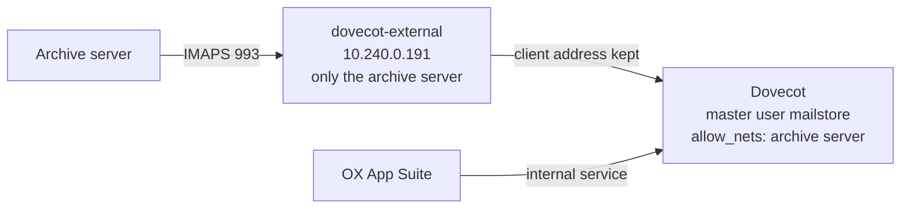

# 20 – IMAP Access for a Mail Archive (Dovecot Master User)

> Part 20 of the series. Previous: [19 – Upgrading openDesk to 1.20](19-opendesk-upgrade-1-20.md) · Back to the [overview](../README.md)

**Summary:** In the second installation of this setup, a mail archive server (MailStore Server) has to read every mailbox in openDesk, and once export old archives into the mailboxes. Users from AD have no password in openDesk – they log in through Keycloak – so the archive cannot log in as the users. It needs a Dovecot **master user**: one account that may open every mailbox. The Dovecot chart of openDesk has no option for extra configuration, so the master user rides on a values file for the release `dovecot`. IMAPS is published on a second MetalLB address and only accepted from the archive server, both in Dovecot and in front of it. Set up on openDesk v1.20.2 on 18.11.2026.

| Field | Value |
|---|---|
| Version | openDesk v1.20.2, chart `dovecot` 4.7.0, Dovecot 2.3.21 (community image) |
| Changed | Release `dovecot`: values file, new Service `dovecot-external`; one DNS record |
| Downtime | About one minute of mail while the Dovecot pod restarts |
| Lab values | Second MetalLB address `10.240.0.191`, name `imap.k8s.lab`; `<archive IP>` = address of the archive server |

## 1. How it works



- **Login.** The archive logs in as `<mail address>*mailstore` with the master password, or with SASL PLAIN and the mail address as authorization identity (the "master password" profiles of archive products). `*` is the `auth_master_user_separator` that openDesk already sets. Dovecot checks the master password, then looks the target user up in the LDAP userdb like for any delivery, so the mailbox is the normal one of that user.
- **Rights.** With a master login, Dovecot checks the ACLs as the master user by default, and the master user owns no mailbox. `plugin { acl_user = %u }` makes the checks run as the mailbox owner. For normal logins nothing changes, `%u` is the user anyway.
- **Only from the archive server.** `allow_nets` on the master passdb rejects the master password from any other address. Dovecot must see the real client address for this: the Service uses `externalTrafficPolicy: Local`. With the default `Cluster`, the client address is replaced by a node address and `allow_nets` would never match.

## 2. Why not something simpler

| Option | Why not |
|---|---|
| Log in as the users | AD users have no password in openDesk. The password grant of Dovecot (`04-oauth2-plain`) only works for local Keycloak accounts |
| The chart's migration master password (`dovecot.migration`) | Built for migrations: the same password works for every user, without a separate master name and without an address limit. Archive products with a master password profile log in with an authorization identity, which Dovecot only accepts through a passdb with `master = yes` – so every mailbox would need its own line in a CSV file |
| Patch the chart or add a post-renderer | Has to be applied again after every openDesk update, like the Nextcloud patch ([04](04-active-directory-sso.md)) |

The chart renders all files in `configs/` into `/etc/dovecot`, and `dovecot.conf` has no `!include`. One value, however, is written into `dovecot.conf` unquoted: `login_trusted_networks={{ .Values.dovecot.loginTrustedNetworks }}`. A multi-line value therefore adds lines to the configuration. This is a workaround, not an interface – check it after every openDesk update (section 6).

## 3. Master password and values file

**Run on:** kubespray VM as k8s

The password is random and only stored on the kubespray VM; the values file holds a salted hash (`{SSHA512}`). The init container of the chart only replaces its own `${DC_…}` variables (`envsubst` with a fixed list), so the hash reaches Dovecot unchanged.

```bash
umask 077; mkdir -p ~/secrets
PWF=~/secrets/dovecot-mailstore-master.txt
[ -s "$PWF" ] || openssl rand -base64 48 | tr -dc 'A-Za-z0-9' | cut -c1-32 > "$PWF"
HASH=$(python3 -c 'import hashlib,base64,os,sys; pw=open(sys.argv[1]).read().strip().encode(); s=os.urandom(16); print("{SSHA512}"+base64.b64encode(hashlib.sha512(pw+s).digest()+s).decode())' "$PWF")
```

The first line of `loginTrustedNetworks` must stay openDesk's own value (`cluster.networking.cidr`, joined with spaces). Read it from the running configuration:

```bash
kubectl -n opendesk get cm dovecot -o jsonpath='{.data.dovecot\.conf}' | grep '^login_trusted_networks'
# login_trusted_networks=10.0.0.0/8 fc00::/7
```

`~/opendesk-custom/dovecot-mailstore.yaml` (chmod 600, never in the repository):

```yaml
dovecot:
  loginTrustedNetworks: |-
    10.0.0.0/8 fc00::/7

    # --- archive master user (custom) ---
    passdb {
      driver = static
      master = yes
      username_filter = mailstore
      args = password=<HASH> allow_nets=<archive IP>/32
    }
    # master logins get the rights of the mailbox owner, not of the master user
    plugin {
      acl_user = %u
    }
    # --- end archive master user ---
service:
  external:
    # keeps the client address visible to Dovecot, needed for allow_nets
    externalTrafficPolicy: "Local"
```

Write it with a here-document (`cat > … <<EOF`) so that `${HASH}` is filled in, then `unset HASH`.

## 4. Publish IMAPS and roll out

openDesk publishes IMAPS with three values; `exposeImaps` has no other effect:

```bash
source ~/k8s-opendesk-homelab/automation/lab.env
V="$OPENDESK_DIR/helmfile/environments/$OPENDESK_ENV/values.yaml.gotmpl"
cp -p "$V" "$V.bak-$(date +%Y%m%d-%H%M)"
yq -i '
  .functional.groupware.externalClients.exposeImaps = true |
  .service.type.dovecot = "LoadBalancer" |
  .service.loadBalancerIP.dovecot = "10.240.0.191" |
  .customization.release.dovecot = ["/home/k8s/opendesk-custom/dovecot-mailstore.yaml"]
' "$V"
```

Render first and look at the two places that matter (the render holds secrets – delete it):

```bash
R=$(mktemp)
( cd "$OPENDESK_DIR" && MASTER_PASSWORD="$(cat "$MASTER_PASSWORD_FILE")" helmfile -e "$OPENDESK_ENV" -n "$OPENDESK_NAMESPACE" -l name=dovecot template ) > "$R"
yq 'select(.kind=="ConfigMap" and .metadata.name=="dovecot") | .data["dovecot.conf"]' "$R" | grep -A14 '^login_trusted_networks' | sed 's/password={SSHA512}[^ ]*/password=***/'
yq 'select(.kind=="Service" and .metadata.name=="dovecot-external") | .spec' "$R"
rm -f "$R"
```

✔ **Expected:** the passdb block right after `login_trusted_networks`, and a Service of type `LoadBalancer` with `10.240.0.191`, port 993 → 30993 and `externalTrafficPolicy: Local`. Then roll out only Dovecot:

```bash
cd "$OPENDESK_DIR"
MASTER_PASSWORD="$(cat "$MASTER_PASSWORD_FILE")" helmfile -e "$OPENDESK_ENV" -n "$OPENDESK_NAMESPACE" -l name=dovecot apply
kubectl -n opendesk rollout status deploy/dovecot --timeout=5m
kubectl -n opendesk get svc dovecot-external -o wide
```

### 4.1 Limit the Service to the archive server

The chart has no `loadBalancerSourceRanges`, and Kubernetes also opens a node port for the Service on every node, which would bypass such a limit. Both are patched on the Service:

```bash
kubectl -n opendesk patch svc dovecot-external --type json -p '[
  {"op":"add","path":"/spec/loadBalancerSourceRanges","value":["<archive IP>/32"]},
  {"op":"add","path":"/spec/allocateLoadBalancerNodePorts","value":false},
  {"op":"remove","path":"/spec/ports/0/nodePort"}]'
```

Helm keeps fields that are not in its manifests, so a later rollout of `dovecot` should leave them alone – check it anyway (section 6). OX is not affected: it reaches Dovecot through the internal Service.

### 4.2 DNS

One A record `imap.k8s.lab` → `10.240.0.191` on the DNS server of the AD. A wildcard `*.k8s.lab` → `10.240.0.190` ([03](03-opendesk-deployment.md)) does not get in the way: a record for the exact name wins over the wildcard. The wildcard certificate already covers the name.

## 5. Tests

**Inside Dovecot.** `doveadm auth test` takes the client address as `rip`, so the address limit can be tested without the archive server. Only the last line may succeed:

```bash
PWF=~/secrets/dovecot-mailstore-master.txt
read -r -p "Test mail address: " T
t() { kubectl -n opendesk exec deploy/dovecot -c dovecot -- doveadm auth test -x service=imap -x rip="$1" "$2" "$3" 2>&1 | grep -o -E "auth (succeeded|failed)" | head -1; }
echo "other address: $(t 10.240.0.200 "$T*mailstore" "$(cat "$PWF")")"    # failed
echo "wrong password: $(t <archive IP> "$T*mailstore" wrong-password)"       # failed
echo "other name:     $(t <archive IP> "$T*other" "$(cat "$PWF")")"         # failed
echo "archive:        $(t <archive IP> "$T*mailstore" "$(cat "$PWF")")"     # succeeded
```

The password is a command line argument here for a moment; run the tests on the kubespray VM only.

**Over the network**, from the kubespray VM before section 4.1: TLS must work and the master login must be refused, because the kubespray VM is not the archive server. The log of Dovecot must show the real address of the kubespray VM (`rip=10.240.0.200`), not a node or pod address – proof that `externalTrafficPolicy: Local` works:

```bash
kubectl -n opendesk get secret opendesk-certificates-ca-tls -o jsonpath='{.data.ca\.crt}' | base64 -d > /tmp/ca.crt
(sleep 2; printf 'a1 LOGOUT\r\n'; sleep 1) | timeout 10 openssl s_client -connect 10.240.0.191:993 -servername imap.k8s.lab -verify_hostname imap.k8s.lab -CAfile /tmp/ca.crt 2>&1 | grep -E '^\* OK|Verify return code'
curl -sS --cacert /tmp/ca.crt --resolve imap.k8s.lab:993:10.240.0.191 \
  --netrc-file <(printf 'machine imap.k8s.lab login %s password %s\n' "$T*mailstore" "$(cat "$PWF")") imaps://imap.k8s.lab/
kubectl -n opendesk logs deploy/dovecot -c dovecot --since=3m | grep -o -E 'rip=[0-9a-f.:]+' | sort | uniq -c
rm -f /tmp/ca.crt; unset T
```

✔ **Expected:** `* OK … Dovecot ready.`, `Verify return code: 0 (ok)`, `curl: (67) Login denied`, and a line `rip=10.240.0.200`. Other addresses in the log are normal: the node of the Dovecot pod (liveness probes, `no auth attempts`) and the browser addresses of OX users, which OX passes on to Dovecot. After section 4.1, `timeout 8 openssl s_client -connect 10.240.0.191:993 </dev/null` must time out (exit 124) from the kubespray VM.

In the second installation all tests passed; normal logins through OX kept working.

## 6. After every openDesk update

```bash
kubectl -n opendesk get cm dovecot -o jsonpath='{.data.dovecot\.conf}' | grep -c 'archive master user'   # 2 (start and end line)
kubectl -n opendesk get svc dovecot-external -o jsonpath='{.spec.loadBalancerSourceRanges} {.spec.externalTrafficPolicy} {.spec.ports[0].nodePort}{"\n"}'
```

✔ **Expected:** `2`, then `["<archive IP>/32"] Local` without a node port. If the passdb block is missing, the chart has changed how it writes `login_trusted_networks`: the archive cannot log in, everything else keeps working. If the Service lost its patch, run section 4.1 again.

## 7. Security notes

- **The master user can read and write every mailbox.** The password belongs only into the archive server; it is handed over in person, not by mail or chat.
- **Three limits:** the password, `allow_nets` in Dovecot, and `loadBalancerSourceRanges` in front of it.
- **Trusted networks.** `login_trusted_networks` covers the cluster networks: a client from there may pass a different client address to Dovecot (OX does that for its users). A pod inside the cluster could therefore claim the archive's address – it would still need the master password.
- **No extra config hook upstream.** An option for extra Dovecot configuration in the chart would make the workaround of section 2 unnecessary.

## 8. Takeaways

- **Read the chart before you build a workaround.** The chart already had the external Service, a fixed address and `externalTrafficPolicy`; only the master passdb was missing.
- **An address limit needs the real address.** Without `externalTrafficPolicy: Local`, Dovecot would have seen a node address, and `allow_nets` could not have worked.
- **Test the refusals, not only the success.** Three of the four login tests had to fail.
